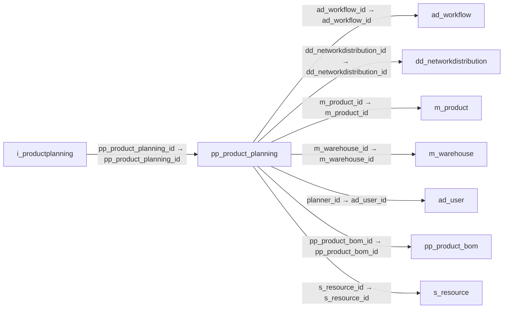

# pp_product_planning — 제품 생산·조달 계획

[전체 일람](../TABLE_INDEX.md) · [분류 일람](README.md) · [AI 사용 안내](../README.md) · [외래키 읽는 법](../RELATIONSHIPS.md)

## 기본 정보

| 항목 | 내용 |
|---|---|
| 물리명 | `adempiere.pp_product_planning` |
| 한국어 논리명(문서용 해석) | 제품 생산·조달 계획 |
| 원본 논리명 | Product Planning |
| 원본 사전 ID | 53020 |
| 분류 | `pp` — 제조·생산 계획·제품 구성 |
| 전체 테넌트 행 수 | 219 |
| 물리 열 수 | 34 |
| 나가는 FK / 들어오는 FK | 7 / 1 |
| 구조·행 수 확인 시점 | 2026-11-03T23:29:01+09:00 |

## 의미와 쓰임

제품에 적용하는 생산 및 조달 계획 정보를 정의한다.

- 설명 근거: 원본 애플리케이션 사전 명칭·설명을 한국어로 해석.
- 한국어 이름과 개요는 문서용 해석입니다. 공식 한국어 번역으로 간주하지 않습니다.
- 원본 설명: Product Planning
- 원본 도움말: —
- PostgreSQL 테이블 주석: —

## 키와 열

### 기본키·고유 제약조건

| 종류 | 제약조건 | 열(순서 유지) |
|---|---|---|
| PRIMARY KEY | `pp_product_planning_key` | `pp_product_planning_id` |
| UNIQUE | `pp_product_planning_uu_idx` | `pp_product_planning_uu` |

### 열 목록

원본 논리명·설명은 `AD_Column`에서 가져왔습니다. 기본값은 실제 PostgreSQL 메타데이터이며, 비어 있는 항목은 `—`로 표시합니다.

| 순서 | 물리명 | 원본 논리명 | PostgreSQL 타입 | NULL | PK | 기본값 | 설명 |
|---:|---|---|---|---|---|---|---|
| 1 | `ad_client_id` | Tenant | numeric(10,0) | 불가 | — | — | Tenant for this installation. |
| 2 | `ad_org_id` | Organization | numeric(10,0) | 불가 | — | (0)::numeric | Organizational entity within tenant |
| 3 | `ad_workflow_id` | Workflow | numeric(10,0) | 허용 | — | — | Workflow or combination of tasks |
| 4 | `created` | Created | timestamp without time zone | 불가 | — | statement_timestamp() | Date this record was created |
| 5 | `createdby` | Created By | numeric(10,0) | 불가 | — | — | User who created this records |
| 6 | `deliverytime_promised` | Promised Delivery Time | numeric | 허용 | — | — | Promised days between order and delivery |
| 7 | `isactive` | Active | character(1) | 불가 | — | — | The record is active in the system |
| 8 | `iscreateplan` | Create Plan | character(1) | 불가 | — | 'Y'::bpchar | Indicates whether planned orders will be generated by MRP |
| 9 | `isissue` | — | character(1) | 불가 | — | 'Y'::bpchar | — |
| 10 | `ismps` | Is MPS | character(1) | 허용 | — | — | — |
| 11 | `isphantom` | Phantom | character(1) | 불가 | — | — | Phantom Component |
| 12 | `isrequiredmrp` | Required Calculate MRP | character(1) | 불가 | — | — | — |
| 13 | `m_product_id` | Product | numeric(10,0) | 불가 | — | — | Product, Service, Item |
| 14 | `m_warehouse_id` | Warehouse | numeric(10,0) | 허용 | — | — | Storage Warehouse and Service Point |
| 15 | `order_max` | Maximum Order Qty | numeric | 허용 | — | — | Maximum order quantity in UOM |
| 16 | `order_min` | Minimum Order Qty | numeric | 허용 | — | — | Minimum order quantity in UOM |
| 17 | `order_pack` | Order Pack Qty | numeric | 허용 | — | — | Package order size in UOM (e.g. order set of 5 units) |
| 18 | `order_period` | Order Period | numeric | 허용 | — | — | — |
| 19 | `order_policy` | Order Policy | character varying(3) | 허용 | — | — | — |
| 20 | `order_qty` | Order Qty | numeric | 허용 | — | — | — |
| 21 | `pp_product_bom_id` | BOM &amp; Formula | numeric(10,0) | 허용 | — | — | BOM &amp; Formula |
| 22 | `pp_product_planning_id` | Product Planning | numeric(10,0) | 불가 | 예 | — | — |
| 23 | `planner_id` | Planner | numeric(10,0) | 허용 | — | — | — |
| 24 | `s_resource_id` | Resource | numeric(10,0) | 허용 | — | — | Resource |
| 25 | `timefence` | Time Fence | numeric | 허용 | — | — | — |
| 26 | `transferttime` | Transfer Time | numeric | 허용 | — | — | — |
| 27 | `updated` | Updated | timestamp without time zone | 불가 | — | statement_timestamp() | Date this record was updated |
| 28 | `updatedby` | Updated By | numeric(10,0) | 불가 | — | — | User who updated this records |
| 29 | `workingtime` | Working Time | numeric | 허용 | — | — | Workflow Simulation Execution Time |
| 30 | `yield` | Yield % | numeric(10,0) | 허용 | — | (100)::numeric | The Yield is the percentage of a lot that is expected to be of acceptable wuality may fall below 100 percent |
| 31 | `dd_networkdistribution_id` | Network Distribution | numeric(10,0) | 허용 | — | — | — |
| 32 | `safetystock` | Safety Stock Qty | numeric | 허용 | — | — | Safety stock is a term used to describe a level of stock that is maintained below the cycle stock to buffer against stock-outs |
| 33 | `isrequireddrp` | Required Calculate DRP | character(1) | 불가 | — | 'N'::bpchar | — |
| 34 | `pp_product_planning_uu` | PP_Product_Planning_UU | uuid | 허용 | — | — | — |

## 외래키 흐름

화살표는 **FK를 가진 자식 → 참조되는 부모**입니다. 업무 처리의 시간 순서나 무조건적인 1:N 관계를 뜻하지 않습니다.

주변 관계 8개 중 8개를 그림으로 표시합니다. **전체 관계는 아래 두 표에 모두 포함**합니다.

### 이 테이블이 참조하는 부모 — 나가는 FK

| 제약조건 | 참조하는 쪽(자식) | 자식 열 | 참조받는 쪽(부모) | 부모 열 | 삭제 / 갱신 | 검증 / 지연 가능 |
|---|---|---|---|---|---|---|
| `adworkflow_ppproductplanning` <!-- FK_OUT: adempiere.pp_product_planning.adworkflow_ppproductplanning --> | [`pp_product_planning`](pp_product_planning.md) | `ad_workflow_id` | [`ad_workflow`](../ad/ad_workflow.md) | `ad_workflow_id` | NO ACTION / NO ACTION | 완료 / 가능 (초기 지연) |
| `ddnetworkdistribution_ppproduc` <!-- FK_OUT: adempiere.pp_product_planning.ddnetworkdistribution_ppproduc --> | [`pp_product_planning`](pp_product_planning.md) | `dd_networkdistribution_id` | [`dd_networkdistribution`](../dd/dd_networkdistribution.md) | `dd_networkdistribution_id` | NO ACTION / NO ACTION | 완료 / 가능 (초기 지연) |
| `mproduct_ppproductplanning` <!-- FK_OUT: adempiere.pp_product_planning.mproduct_ppproductplanning --> | [`pp_product_planning`](pp_product_planning.md) | `m_product_id` | [`m_product`](../m/m_product.md) | `m_product_id` | NO ACTION / NO ACTION | 완료 / 가능 (초기 지연) |
| `mwarehouse_ppproductplanning` <!-- FK_OUT: adempiere.pp_product_planning.mwarehouse_ppproductplanning --> | [`pp_product_planning`](pp_product_planning.md) | `m_warehouse_id` | [`m_warehouse`](../m/m_warehouse.md) | `m_warehouse_id` | NO ACTION / NO ACTION | 완료 / 가능 (초기 지연) |
| `planner_ppproductplanning` <!-- FK_OUT: adempiere.pp_product_planning.planner_ppproductplanning --> | [`pp_product_planning`](pp_product_planning.md) | `planner_id` | [`ad_user`](../ad/ad_user.md) | `ad_user_id` | NO ACTION / NO ACTION | 완료 / 가능 (초기 지연) |
| `ppproductbom_ppproductplanning` <!-- FK_OUT: adempiere.pp_product_planning.ppproductbom_ppproductplanning --> | [`pp_product_planning`](pp_product_planning.md) | `pp_product_bom_id` | [`pp_product_bom`](pp_product_bom.md) | `pp_product_bom_id` | NO ACTION / NO ACTION | 완료 / 가능 (초기 지연) |
| `sresource_ppproductplanning` <!-- FK_OUT: adempiere.pp_product_planning.sresource_ppproductplanning --> | [`pp_product_planning`](pp_product_planning.md) | `s_resource_id` | [`s_resource`](../s/s_resource.md) | `s_resource_id` | NO ACTION / NO ACTION | 완료 / 가능 (초기 지연) |

### 이 테이블을 참조하는 자식 — 들어오는 FK

| 제약조건 | 참조하는 쪽(자식) | 자식 열 | 참조받는 쪽(부모) | 부모 열 | 삭제 / 갱신 | 검증 / 지연 가능 |
|---|---|---|---|---|---|---|
| `ppproductplanning_iproductplan` <!-- FK_IN: adempiere.i_productplanning.ppproductplanning_iproductplan --> | [`i_productplanning`](../i/i_productplanning.md) | `pp_product_planning_id` | [`pp_product_planning`](pp_product_planning.md) | `pp_product_planning_id` | NO ACTION / NO ACTION | 완료 / 가능 (초기 지연) |

## 조회 시 주의

- FK 표의 자식 열과 부모 열을 같은 순서로 대응시킵니다. 복합 FK는 모든 열의 동등 조건을 `AND`로 연결합니다.
- 테이블 이름이나 `_id` 열 이름만으로 물리 FK가 있다고 가정하지 않습니다. FK 미선언은 업무 관계가 없다는 뜻도 아닙니다.
- 자식이 여러 행인 테이블과 조인하면 부모의 금액·건수가 중복될 수 있습니다. 집계 단위를 먼저 정합니다.
- `ad_client_id`가 있습니다. 업무 분석에서는 대상 테넌트를 명시합니다. GardenWorld는 `11`, 시스템 공통 설정은 `0`일 수 있으므로 일괄 필터 적용 전에 테이블 역할을 확인합니다.
- 행 수는 위 확인 시점의 전체 테넌트 값입니다. 최신 업무 실적이나 현재 실행 결과로 재사용하지 않습니다.
