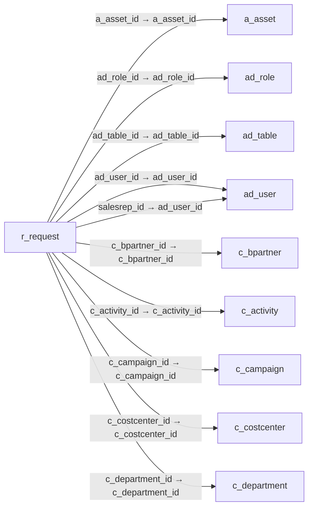

# r_request — 고객·잠재고객 요청

[전체 일람](../TABLE_INDEX.md) · [분류 일람](README.md) · [AI 사용 안내](../README.md) · [외래키 읽는 법](../RELATIONSHIPS.md)

## 기본 정보

| 항목 | 내용 |
|---|---|
| 물리명 | `adempiere.r_request` |
| 한국어 논리명(문서용 해석) | 고객·잠재고객 요청 |
| 원본 논리명 | Request |
| 원본 사전 ID | 417 |
| 분류 | `r` — 요청·지원·상태 관리 |
| 전체 테넌트 행 수 | 1 |
| 물리 열 수 | 68 |
| 나가는 FK / 들어오는 FK | 29 / 6 |
| 구조·행 수 확인 시점 | 2026-11-03T23:29:01+09:00 |

## 의미와 쓰임

거래처 또는 잠재고객이 제기한 요청을 관리하는 기본 테이블이다.

- 설명 근거: 원본 애플리케이션 사전 명칭·설명을 한국어로 해석.
- 한국어 이름과 개요는 문서용 해석입니다. 공식 한국어 번역으로 간주하지 않습니다.
- 원본 설명: Request from a Business Partner or Prospect
- 원본 도움말: —
- PostgreSQL 테이블 주석: —

## 키와 열

### 기본키·고유 제약조건

| 종류 | 제약조건 | 열(순서 유지) |
|---|---|---|
| PRIMARY KEY | `r_request_pkey` | `r_request_id` |
| UNIQUE | `r_request_uu_idx` | `r_request_uu` |

### 열 목록

원본 논리명·설명은 `AD_Column`에서 가져왔습니다. 기본값은 실제 PostgreSQL 메타데이터이며, 비어 있는 항목은 `—`로 표시합니다.

| 순서 | 물리명 | 원본 논리명 | PostgreSQL 타입 | NULL | PK | 기본값 | 설명 |
|---:|---|---|---|---|---|---|---|
| 1 | `r_request_id` | Request | numeric(10,0) | 불가 | 예 | — | Request from a Business Partner or Prospect |
| 2 | `ad_client_id` | Tenant | numeric(10,0) | 불가 | — | — | Tenant for this installation. |
| 3 | `ad_org_id` | Organization | numeric(10,0) | 불가 | — | — | Organizational entity within tenant |
| 4 | `isactive` | Active | character(1) | 불가 | — | 'Y'::bpchar | The record is active in the system |
| 5 | `created` | Created | timestamp without time zone | 불가 | — | now() | Date this record was created |
| 6 | `createdby` | Created By | numeric(10,0) | 불가 | — | — | User who created this records |
| 7 | `updated` | Updated | timestamp without time zone | 불가 | — | now() | Date this record was updated |
| 8 | `updatedby` | Updated By | numeric(10,0) | 불가 | — | — | User who updated this records |
| 9 | `documentno` | Document No | character varying(30) | 불가 | — | — | Document sequence number of the document |
| 10 | `r_requesttype_id` | Request Type | numeric(10,0) | 불가 | — | — | Type of request (e.g. Inquiry, Complaint, ..) |
| 11 | `r_group_id` | Group | numeric(10,0) | 허용 | — | — | Request Group |
| 12 | `r_category_id` | Category | numeric(10,0) | 허용 | — | — | Request Category |
| 13 | `r_status_id` | Status | numeric(10,0) | 허용 | — | — | Request Status |
| 14 | `r_resolution_id` | Resolution | numeric(10,0) | 허용 | — | — | Request Resolution |
| 15 | `r_requestrelated_id` | Related Request | numeric(10,0) | 허용 | — | — | Related Request (Master Issue, ..) |
| 16 | `priority` | Priority | character(1) | 불가 | — | — | Indicates if this request is of a high, medium or low priority. |
| 17 | `priorityuser` | User Importance | character(1) | 허용 | — | — | Priority of the issue for the User |
| 18 | `duetype` | Due type | character(1) | 불가 | — | — | Status of the next action for this Request |
| 19 | `summary` | Summary | character varying(2000) | 불가 | — | — | Textual summary of this request |
| 20 | `confidentialtype` | Confidentiality | character(1) | 불가 | — | 'C'::bpchar | Type of Confidentiality |
| 21 | `isescalated` | Escalated | character(1) | 불가 | — | 'N'::bpchar | This request has been escalated |
| 22 | `isselfservice` | Self-Service | character(1) | 불가 | — | 'N'::bpchar | This is a Self-Service entry or this entry can be changed via Self-Service |
| 23 | `salesrep_id` | Sales Representative | numeric(10,0) | 불가 | — | — | Sales Representative or Company Agent |
| 24 | `ad_role_id` | Role | numeric(10,0) | 허용 | — | — | Responsibility Role |
| 25 | `datelastaction` | Date Last Action | timestamp without time zone | 허용 | — | — | Date this request was last acted on |
| 26 | `datelastalert` | Last Alert | timestamp without time zone | 허용 | — | — | Date when last alert were sent |
| 27 | `lastresult` | Last Result | character varying(2000) | 허용 | — | — | Result of last contact |
| 28 | `processed` | Processed | character(1) | 불가 | — | 'N'::bpchar | The document has been processed |
| 29 | `isinvoiced` | Invoiced | character(1) | 불가 | — | 'N'::bpchar | Is this invoiced? |
| 30 | `c_bpartner_id` | Business Partner | numeric(10,0) | 허용 | — | — | Identifies a Business Partner |
| 31 | `ad_user_id` | User/Contact | numeric(10,0) | 허용 | — | — | User within the system - Internal or Business Partner Contact |
| 32 | `c_campaign_id` | Campaign | numeric(10,0) | 허용 | — | — | Marketing Campaign |
| 33 | `c_order_id` | Order | numeric(10,0) | 허용 | — | — | Order |
| 34 | `c_invoice_id` | Invoice | numeric(10,0) | 허용 | — | — | Invoice Identifier |
| 35 | `c_payment_id` | Payment | numeric(10,0) | 허용 | — | — | Payment identifier |
| 36 | `m_product_id` | Product | numeric(10,0) | 허용 | — | — | Product, Service, Item |
| 37 | `c_project_id` | Project | numeric(10,0) | 허용 | — | — | Financial Project |
| 38 | `a_asset_id` | Asset | numeric(10,0) | 허용 | — | — | Asset used internally or by customers |
| 39 | `m_inout_id` | Shipment/Receipt | numeric(10,0) | 허용 | — | — | Material Shipment Document |
| 40 | `m_rma_id` | RMA | numeric(10,0) | 허용 | — | — | Return Material Authorization |
| 41 | `ad_table_id` | Table | numeric(10,0) | 허용 | — | — | Database Table information |
| 42 | `record_id` | Record ID | numeric(10,0) | 허용 | — | — | Direct internal record ID |
| 43 | `requestamt` | Request Amount | numeric | 불가 | — | 0 | Amount associated with this request |
| 44 | `r_mailtext_id` | Mail Template | numeric(10,0) | 허용 | — | — | Text templates for mailings |
| 45 | `result` | Result | character varying(2000) | 허용 | — | — | Result of the action taken |
| 46 | `confidentialtypeentry` | Entry Confidentiality | character(1) | 불가 | — | — | Confidentiality of the individual entry |
| 47 | `r_standardresponse_id` | Standard Response | numeric(10,0) | 허용 | — | — | Request Standard Response  |
| 48 | `nextaction` | Next action | character(1) | 허용 | — | — | Next Action to be taken |
| 49 | `datenextaction` | Date Next Action | timestamp without time zone | 허용 | — | — | Date that this request should be acted on |
| 50 | `starttime` | Start Time | timestamp without time zone | 허용 | — | — | Time started |
| 51 | `endtime` | End Time | timestamp without time zone | 허용 | — | — | End of the time span |
| 52 | `qtyspent` | Quantity Used | numeric | 허용 | — | 0 | Quantity used for this event |
| 53 | `qtyinvoiced` | Quantity Invoiced | numeric | 허용 | — | 0 | Invoiced Quantity |
| 54 | `m_productspent_id` | Product Used | numeric(10,0) | 허용 | — | — | Product/Resource/Service used in Request |
| 55 | `c_activity_id` | Activity | numeric(10,0) | 허용 | — | — | Business Activity |
| 56 | `startdate` | Start Date | timestamp without time zone | 허용 | — | — | First effective day (inclusive) |
| 57 | `closedate` | Close Date | timestamp without time zone | 허용 | — | — | Close Date |
| 58 | `c_invoicerequest_id` | Request Invoice | numeric(10,0) | 허용 | — | — | The generated invoice for this request |
| 59 | `m_changerequest_id` | Change Request | numeric(10,0) | 허용 | — | — | BOM (Engineering) Change Request |
| 60 | `taskstatus` | Task Status | character(1) | 허용 | — | — | Status of the Task |
| 61 | `qtyplan` | Quantity Plan | numeric | 허용 | — | — | Planned Quantity |
| 62 | `datecompleteplan` | Complete Plan | timestamp without time zone | 허용 | — | — | Planned Completion Date |
| 63 | `datestartplan` | Start Plan | timestamp without time zone | 허용 | — | — | Planned Start Date |
| 64 | `m_fixchangenotice_id` | Fixed in | numeric(10,0) | 허용 | — | — | Fixed in Change Notice |
| 65 | `r_request_uu` | R_Request_UU | uuid | 허용 | — | — | — |
| 66 | `record_uu` | Record UUID | uuid | 허용 | — | — | — |
| 67 | `c_costcenter_id` | Cost Center | numeric(10,0) | 허용 | — | NULL::numeric | — |
| 68 | `c_department_id` | Department | numeric(10,0) | 허용 | — | NULL::numeric | — |

## 외래키 흐름

화살표는 **FK를 가진 자식 → 참조되는 부모**입니다. 업무 처리의 시간 순서나 무조건적인 1:N 관계를 뜻하지 않습니다.

주변 관계 34개 중 10개를 그림으로 표시합니다. **전체 관계는 아래 두 표에 모두 포함**합니다.

### 이 테이블이 참조하는 부모 — 나가는 FK

| 제약조건 | 참조하는 쪽(자식) | 자식 열 | 참조받는 쪽(부모) | 부모 열 | 삭제 / 갱신 | 검증 / 지연 가능 |
|---|---|---|---|---|---|---|
| `aasset_rrequest` <!-- FK_OUT: adempiere.r_request.aasset_rrequest --> | [`r_request`](r_request.md) | `a_asset_id` | [`a_asset`](../a/a_asset.md) | `a_asset_id` | NO ACTION / NO ACTION | 완료 / 가능 (초기 지연) |
| `adrole_rrequest` <!-- FK_OUT: adempiere.r_request.adrole_rrequest --> | [`r_request`](r_request.md) | `ad_role_id` | [`ad_role`](../ad/ad_role.md) | `ad_role_id` | NO ACTION / NO ACTION | 완료 / 가능 (초기 지연) |
| `adtable_rrequest` <!-- FK_OUT: adempiere.r_request.adtable_rrequest --> | [`r_request`](r_request.md) | `ad_table_id` | [`ad_table`](../ad/ad_table.md) | `ad_table_id` | NO ACTION / NO ACTION | 완료 / 가능 (초기 지연) |
| `aduser_rrequest` <!-- FK_OUT: adempiere.r_request.aduser_rrequest --> | [`r_request`](r_request.md) | `ad_user_id` | [`ad_user`](../ad/ad_user.md) | `ad_user_id` | NO ACTION / NO ACTION | 완료 / 가능 (초기 지연) |
| `adusersr_rrequest` <!-- FK_OUT: adempiere.r_request.adusersr_rrequest --> | [`r_request`](r_request.md) | `salesrep_id` | [`ad_user`](../ad/ad_user.md) | `ad_user_id` | NO ACTION / NO ACTION | 완료 / 가능 (초기 지연) |
| `c_bpartner_rrequest` <!-- FK_OUT: adempiere.r_request.c_bpartner_rrequest --> | [`r_request`](r_request.md) | `c_bpartner_id` | [`c_bpartner`](../c/c_bpartner.md) | `c_bpartner_id` | NO ACTION / NO ACTION | 완료 / 가능 (초기 지연) |
| `cactivity_rrequest` <!-- FK_OUT: adempiere.r_request.cactivity_rrequest --> | [`r_request`](r_request.md) | `c_activity_id` | [`c_activity`](../c/c_activity.md) | `c_activity_id` | NO ACTION / NO ACTION | 완료 / 가능 (초기 지연) |
| `ccampaign_rrequest` <!-- FK_OUT: adempiere.r_request.ccampaign_rrequest --> | [`r_request`](r_request.md) | `c_campaign_id` | [`c_campaign`](../c/c_campaign.md) | `c_campaign_id` | NO ACTION / NO ACTION | 완료 / 가능 (초기 지연) |
| `ccostcenter_rrequest` <!-- FK_OUT: adempiere.r_request.ccostcenter_rrequest --> | [`r_request`](r_request.md) | `c_costcenter_id` | [`c_costcenter`](../c/c_costcenter.md) | `c_costcenter_id` | NO ACTION / NO ACTION | 완료 / 가능 (초기 지연) |
| `cdepartment_rrequest` <!-- FK_OUT: adempiere.r_request.cdepartment_rrequest --> | [`r_request`](r_request.md) | `c_department_id` | [`c_department`](../c/c_department.md) | `c_department_id` | NO ACTION / NO ACTION | 완료 / 가능 (초기 지연) |
| `cinvoicerequest_rrequest` <!-- FK_OUT: adempiere.r_request.cinvoicerequest_rrequest --> | [`r_request`](r_request.md) | `c_invoicerequest_id` | [`c_invoice`](../c/c_invoice.md) | `c_invoice_id` | NO ACTION / NO ACTION | 완료 / 가능 (초기 지연) |
| `corder_rrequest` <!-- FK_OUT: adempiere.r_request.corder_rrequest --> | [`r_request`](r_request.md) | `c_order_id` | [`c_order`](../c/c_order.md) | `c_order_id` | NO ACTION / NO ACTION | 완료 / 가능 (초기 지연) |
| `cpayment_rrequest` <!-- FK_OUT: adempiere.r_request.cpayment_rrequest --> | [`r_request`](r_request.md) | `c_payment_id` | [`c_payment`](../c/c_payment.md) | `c_payment_id` | NO ACTION / NO ACTION | 완료 / 가능 (초기 지연) |
| `cproject_rrequest` <!-- FK_OUT: adempiere.r_request.cproject_rrequest --> | [`r_request`](r_request.md) | `c_project_id` | [`c_project`](../c/c_project.md) | `c_project_id` | NO ACTION / NO ACTION | 완료 / 가능 (초기 지연) |
| `mchangerequest_rrequest` <!-- FK_OUT: adempiere.r_request.mchangerequest_rrequest --> | [`r_request`](r_request.md) | `m_changerequest_id` | [`m_changerequest`](../m/m_changerequest.md) | `m_changerequest_id` | NO ACTION / NO ACTION | 완료 / 가능 (초기 지연) |
| `mfixchangenotice_rrequest` <!-- FK_OUT: adempiere.r_request.mfixchangenotice_rrequest --> | [`r_request`](r_request.md) | `m_fixchangenotice_id` | [`m_changenotice`](../m/m_changenotice.md) | `m_changenotice_id` | NO ACTION / NO ACTION | 완료 / 가능 (초기 지연) |
| `minout_rrequest` <!-- FK_OUT: adempiere.r_request.minout_rrequest --> | [`r_request`](r_request.md) | `m_inout_id` | [`m_inout`](../m/m_inout.md) | `m_inout_id` | NO ACTION / NO ACTION | 완료 / 가능 (초기 지연) |
| `mproduct_rrequest` <!-- FK_OUT: adempiere.r_request.mproduct_rrequest --> | [`r_request`](r_request.md) | `m_product_id` | [`m_product`](../m/m_product.md) | `m_product_id` | NO ACTION / NO ACTION | 완료 / 가능 (초기 지연) |
| `mproductspent_rrequest` <!-- FK_OUT: adempiere.r_request.mproductspent_rrequest --> | [`r_request`](r_request.md) | `m_productspent_id` | [`m_product`](../m/m_product.md) | `m_product_id` | NO ACTION / NO ACTION | 완료 / 가능 (초기 지연) |
| `mrma_rrequest` <!-- FK_OUT: adempiere.r_request.mrma_rrequest --> | [`r_request`](r_request.md) | `m_rma_id` | [`m_rma`](../m/m_rma.md) | `m_rma_id` | NO ACTION / NO ACTION | 완료 / 가능 (초기 지연) |
| `rcategory_rrequest` <!-- FK_OUT: adempiere.r_request.rcategory_rrequest --> | [`r_request`](r_request.md) | `r_category_id` | [`r_category`](r_category.md) | `r_category_id` | NO ACTION / NO ACTION | 완료 / 가능 (초기 지연) |
| `rgroup_rrequest` <!-- FK_OUT: adempiere.r_request.rgroup_rrequest --> | [`r_request`](r_request.md) | `r_group_id` | [`r_group`](r_group.md) | `r_group_id` | NO ACTION / NO ACTION | 완료 / 가능 (초기 지연) |
| `rinvoice_rrequest` <!-- FK_OUT: adempiere.r_request.rinvoice_rrequest --> | [`r_request`](r_request.md) | `c_invoice_id` | [`c_invoice`](../c/c_invoice.md) | `c_invoice_id` | NO ACTION / NO ACTION | 완료 / 가능 (초기 지연) |
| `rmailtext_rrequest` <!-- FK_OUT: adempiere.r_request.rmailtext_rrequest --> | [`r_request`](r_request.md) | `r_mailtext_id` | [`r_mailtext`](r_mailtext.md) | `r_mailtext_id` | NO ACTION / NO ACTION | 완료 / 가능 (초기 지연) |
| `rrequest_related` <!-- FK_OUT: adempiere.r_request.rrequest_related --> | [`r_request`](r_request.md) | `r_requestrelated_id` | [`r_request`](r_request.md) | `r_request_id` | NO ACTION / NO ACTION | 완료 / 가능 (초기 지연) |
| `rrequesttype_rrequest` <!-- FK_OUT: adempiere.r_request.rrequesttype_rrequest --> | [`r_request`](r_request.md) | `r_requesttype_id` | [`r_requesttype`](r_requesttype.md) | `r_requesttype_id` | NO ACTION / NO ACTION | 완료 / 가능 (초기 지연) |
| `rresolution_rrequest` <!-- FK_OUT: adempiere.r_request.rresolution_rrequest --> | [`r_request`](r_request.md) | `r_resolution_id` | [`r_resolution`](r_resolution.md) | `r_resolution_id` | NO ACTION / NO ACTION | 완료 / 가능 (초기 지연) |
| `rstandardresponse_rrequest` <!-- FK_OUT: adempiere.r_request.rstandardresponse_rrequest --> | [`r_request`](r_request.md) | `r_standardresponse_id` | [`r_standardresponse`](r_standardresponse.md) | `r_standardresponse_id` | NO ACTION / NO ACTION | 완료 / 가능 (초기 지연) |
| `rstatus_rrequest` <!-- FK_OUT: adempiere.r_request.rstatus_rrequest --> | [`r_request`](r_request.md) | `r_status_id` | [`r_status`](r_status.md) | `r_status_id` | NO ACTION / NO ACTION | 완료 / 가능 (초기 지연) |

### 이 테이블을 참조하는 자식 — 들어오는 FK

| 제약조건 | 참조하는 쪽(자식) | 자식 열 | 참조받는 쪽(부모) | 부모 열 | 삭제 / 갱신 | 검증 / 지연 가능 |
|---|---|---|---|---|---|---|
| `rrequest_adissue` <!-- FK_IN: adempiere.ad_issue.rrequest_adissue --> | [`ad_issue`](../ad/ad_issue.md) | `r_request_id` | [`r_request`](r_request.md) | `r_request_id` | SET NULL / NO ACTION | 완료 / 가능 (초기 지연) |
| `rrequest_rissueknown` <!-- FK_IN: adempiere.r_issueknown.rrequest_rissueknown --> | [`r_issueknown`](r_issueknown.md) | `r_request_id` | [`r_request`](r_request.md) | `r_request_id` | NO ACTION / NO ACTION | 완료 / 가능 (초기 지연) |
| `rrequest_related` <!-- FK_IN: adempiere.r_request.rrequest_related --> | [`r_request`](r_request.md) | `r_requestrelated_id` | [`r_request`](r_request.md) | `r_request_id` | NO ACTION / NO ACTION | 완료 / 가능 (초기 지연) |
| `rrequest_rrequestaction` <!-- FK_IN: adempiere.r_requestaction.rrequest_rrequestaction --> | [`r_requestaction`](r_requestaction.md) | `r_request_id` | [`r_request`](r_request.md) | `r_request_id` | NO ACTION / NO ACTION | 완료 / 가능 (초기 지연) |
| `rrequest_rrequestupdate` <!-- FK_IN: adempiere.r_requestupdate.rrequest_rrequestupdate --> | [`r_requestupdate`](r_requestupdate.md) | `r_request_id` | [`r_request`](r_request.md) | `r_request_id` | NO ACTION / NO ACTION | 완료 / 가능 (초기 지연) |
| `rrequest_rrupdates` <!-- FK_IN: adempiere.r_requestupdates.rrequest_rrupdates --> | [`r_requestupdates`](r_requestupdates.md) | `r_request_id` | [`r_request`](r_request.md) | `r_request_id` | NO ACTION / NO ACTION | 완료 / 가능 (초기 지연) |

## 조회 시 주의

- FK 표의 자식 열과 부모 열을 같은 순서로 대응시킵니다. 복합 FK는 모든 열의 동등 조건을 `AND`로 연결합니다.
- 테이블 이름이나 `_id` 열 이름만으로 물리 FK가 있다고 가정하지 않습니다. FK 미선언은 업무 관계가 없다는 뜻도 아닙니다.
- 자식이 여러 행인 테이블과 조인하면 부모의 금액·건수가 중복될 수 있습니다. 집계 단위를 먼저 정합니다.
- `ad_client_id`가 있습니다. 업무 분석에서는 대상 테넌트를 명시합니다. GardenWorld는 `11`, 시스템 공통 설정은 `0`일 수 있으므로 일괄 필터 적용 전에 테이블 역할을 확인합니다.
- `record_id`는 가리키는 테이블이 메타데이터에 따라 달라질 수 있습니다. 물리 FK 목록에 없는 대상은 별도 확인합니다.
- 행 수는 위 확인 시점의 전체 테넌트 값입니다. 최신 업무 실적이나 현재 실행 결과로 재사용하지 않습니다.
