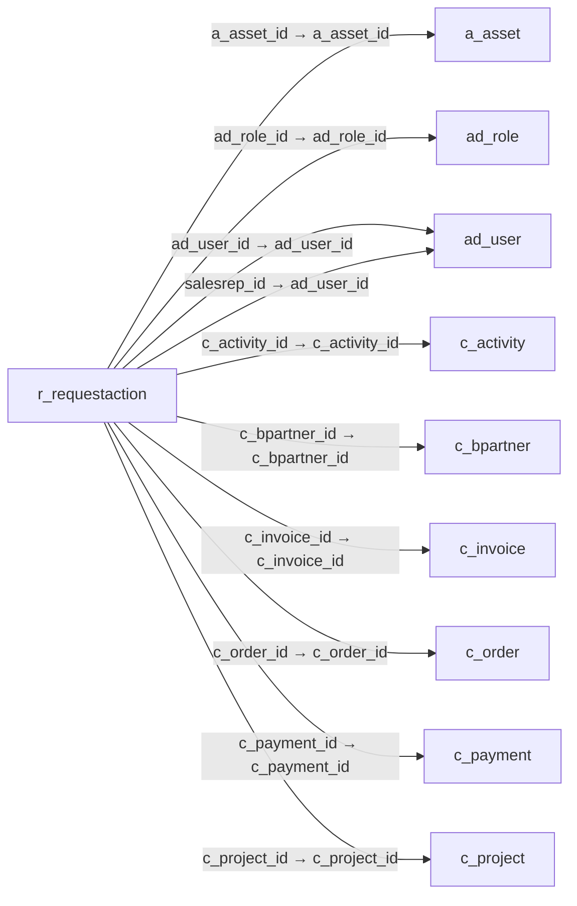

# r_requestaction — 요청 변경 이력

[전체 일람](../TABLE_INDEX.md) · [분류 일람](README.md) · [AI 사용 안내](../README.md) · [외래키 읽는 법](../RELATIONSHIPS.md)

## 기본 정보

| 항목 | 내용 |
|---|---|
| 물리명 | `adempiere.r_requestaction` |
| 한국어 논리명(문서용 해석) | 요청 변경 이력 |
| 원본 논리명 | Request History |
| 원본 사전 ID | 418 |
| 분류 | `r` — 요청·지원·상태 관리 |
| 전체 테넌트 행 수 | 2 |
| 물리 열 수 | 46 |
| 나가는 FK / 들어오는 FK | 20 / 0 |
| 구조·행 수 확인 시점 | 2026-11-03T23:29:01+09:00 |

## 의미와 쓰임

요청의 상태·담당자·분류·우선순위 및 관련 업무 문서 등의 변경 이력을 저장한다.

- 설명 근거: 물리명·열·외래키 구조를 근거로 보수적으로 해석.
- 한국어 이름과 개요는 문서용 해석입니다. 공식 한국어 번역으로 간주하지 않습니다.
- 원본 설명: —
- 원본 도움말: —
- PostgreSQL 테이블 주석: —

## 키와 열

### 기본키·고유 제약조건

| 종류 | 제약조건 | 열(순서 유지) |
|---|---|---|
| PRIMARY KEY | `r_requestaction_pkey` | `r_requestaction_id` |
| UNIQUE | `r_requestaction_uu_idx` | `r_requestaction_uu` |

### 열 목록

원본 논리명·설명은 `AD_Column`에서 가져왔습니다. 기본값은 실제 PostgreSQL 메타데이터이며, 비어 있는 항목은 `—`로 표시합니다.

| 순서 | 물리명 | 원본 논리명 | PostgreSQL 타입 | NULL | PK | 기본값 | 설명 |
|---:|---|---|---|---|---|---|---|
| 1 | `r_requestaction_id` | Request History | numeric(10,0) | 불가 | 예 | — | Request has been changed |
| 2 | `ad_client_id` | Tenant | numeric(10,0) | 불가 | — | — | Tenant for this installation. |
| 3 | `ad_org_id` | Organization | numeric(10,0) | 불가 | — | — | Organizational entity within tenant |
| 4 | `isactive` | Active | character(1) | 불가 | — | 'Y'::bpchar | The record is active in the system |
| 5 | `created` | Created | timestamp without time zone | 불가 | — | now() | Date this record was created |
| 6 | `createdby` | Created By | numeric(10,0) | 불가 | — | — | User who created this records |
| 7 | `updated` | Updated | timestamp without time zone | 불가 | — | now() | Date this record was updated |
| 8 | `updatedby` | Updated By | numeric(10,0) | 불가 | — | — | User who updated this records |
| 9 | `r_request_id` | Request | numeric(10,0) | 불가 | — | — | Request from a Business Partner or Prospect |
| 10 | `r_group_id` | Group | numeric(10,0) | 허용 | — | — | Request Group |
| 11 | `r_category_id` | Category | numeric(10,0) | 허용 | — | — | Request Category |
| 12 | `r_status_id` | Status | numeric(10,0) | 허용 | — | — | Request Status |
| 13 | `r_resolution_id` | Resolution | numeric(10,0) | 허용 | — | — | Request Resolution |
| 14 | `salesrep_id` | Sales Representative | numeric(10,0) | 허용 | — | — | Sales Representative or Company Agent |
| 15 | `ad_role_id` | Role | numeric(10,0) | 허용 | — | — | Responsibility Role |
| 16 | `isescalated` | Escalated | character(1) | 허용 | — | — | This request has been escalated |
| 17 | `isinvoiced` | Invoiced | character(1) | 허용 | — | — | Is this invoiced? |
| 18 | `confidentialtype` | Confidentiality | character(1) | 허용 | — | — | Type of Confidentiality |
| 19 | `isselfservice` | Self-Service | character(1) | 허용 | — | — | This is a Self-Service entry or this entry can be changed via Self-Service |
| 20 | `priority` | Priority | character(1) | 허용 | — | — | Indicates if this request is of a high, medium or low priority. |
| 21 | `priorityuser` | User Importance | character(1) | 허용 | — | — | Priority of the issue for the User |
| 22 | `c_bpartner_id` | Business Partner | numeric(10,0) | 허용 | — | — | Identifies a Business Partner |
| 23 | `ad_user_id` | User/Contact | numeric(10,0) | 허용 | — | — | User within the system - Internal or Business Partner Contact |
| 24 | `c_order_id` | Order | numeric(10,0) | 허용 | — | — | Order |
| 25 | `c_invoice_id` | Invoice | numeric(10,0) | 허용 | — | — | Invoice Identifier |
| 26 | `c_payment_id` | Payment | numeric(10,0) | 허용 | — | — | Payment identifier |
| 27 | `m_product_id` | Product | numeric(10,0) | 허용 | — | — | Product, Service, Item |
| 28 | `c_project_id` | Project | numeric(10,0) | 허용 | — | — | Financial Project |
| 29 | `summary` | Summary | character varying(2000) | 허용 | — | — | Textual summary of this request |
| 30 | `datenextaction` | Date Next Action | timestamp without time zone | 허용 | — | — | Date that this request should be acted on |
| 31 | `c_activity_id` | Activity | numeric(10,0) | 허용 | — | — | Business Activity |
| 32 | `r_requesttype_id` | Request Type | numeric(10,0) | 허용 | — | — | Type of request (e.g. Inquiry, Complaint, ..) |
| 33 | `a_asset_id` | Asset | numeric(10,0) | 허용 | — | — | Asset used internally or by customers |
| 34 | `m_inout_id` | Shipment/Receipt | numeric(10,0) | 허용 | — | — | Material Shipment Document |
| 35 | `m_rma_id` | RMA | numeric(10,0) | 허용 | — | — | Return Material Authorization |
| 36 | `nullcolumns` | Null Columns | character varying(255) | 허용 | — | — | Columns with NULL value |
| 37 | `taskstatus` | Task Status | character(1) | 허용 | — | — | Status of the Task |
| 38 | `datecompleteplan` | Complete Plan | timestamp without time zone | 허용 | — | — | Planned Completion Date |
| 39 | `qtyplan` | Quantity Plan | numeric | 허용 | — | — | Planned Quantity |
| 40 | `qtyspent` | Quantity Used | numeric | 허용 | — | — | Quantity used for this event |
| 41 | `startdate` | Start Date | timestamp without time zone | 허용 | — | — | First effective day (inclusive) |
| 42 | `enddate` | End Date | timestamp without time zone | 허용 | — | — | Last effective date (inclusive) |
| 43 | `datestartplan` | Start Plan | timestamp without time zone | 허용 | — | — | Planned Start Date |
| 44 | `qtyinvoiced` | Quantity Invoiced | numeric | 허용 | — | — | Invoiced Quantity |
| 45 | `m_productspent_id` | Product Used | numeric(10,0) | 허용 | — | — | Product/Resource/Service used in Request |
| 46 | `r_requestaction_uu` | R_RequestAction_UU | uuid | 허용 | — | — | — |

## 외래키 흐름

화살표는 **FK를 가진 자식 → 참조되는 부모**입니다. 업무 처리의 시간 순서나 무조건적인 1:N 관계를 뜻하지 않습니다.

주변 관계 20개 중 10개를 그림으로 표시합니다. **전체 관계는 아래 두 표에 모두 포함**합니다.

### 이 테이블이 참조하는 부모 — 나가는 FK

| 제약조건 | 참조하는 쪽(자식) | 자식 열 | 참조받는 쪽(부모) | 부모 열 | 삭제 / 갱신 | 검증 / 지연 가능 |
|---|---|---|---|---|---|---|
| `aasset_rrequestaction` <!-- FK_OUT: adempiere.r_requestaction.aasset_rrequestaction --> | [`r_requestaction`](r_requestaction.md) | `a_asset_id` | [`a_asset`](../a/a_asset.md) | `a_asset_id` | NO ACTION / NO ACTION | 완료 / 가능 (초기 지연) |
| `adrole_rrequestaction` <!-- FK_OUT: adempiere.r_requestaction.adrole_rrequestaction --> | [`r_requestaction`](r_requestaction.md) | `ad_role_id` | [`ad_role`](../ad/ad_role.md) | `ad_role_id` | NO ACTION / NO ACTION | 완료 / 가능 (초기 지연) |
| `aduser_rrequestaction` <!-- FK_OUT: adempiere.r_requestaction.aduser_rrequestaction --> | [`r_requestaction`](r_requestaction.md) | `ad_user_id` | [`ad_user`](../ad/ad_user.md) | `ad_user_id` | NO ACTION / NO ACTION | 완료 / 가능 (초기 지연) |
| `adusersr_rrequestaction` <!-- FK_OUT: adempiere.r_requestaction.adusersr_rrequestaction --> | [`r_requestaction`](r_requestaction.md) | `salesrep_id` | [`ad_user`](../ad/ad_user.md) | `ad_user_id` | NO ACTION / NO ACTION | 완료 / 가능 (초기 지연) |
| `cactivity_rrequestaction` <!-- FK_OUT: adempiere.r_requestaction.cactivity_rrequestaction --> | [`r_requestaction`](r_requestaction.md) | `c_activity_id` | [`c_activity`](../c/c_activity.md) | `c_activity_id` | NO ACTION / NO ACTION | 완료 / 가능 (초기 지연) |
| `cbpartner_rrequestaction` <!-- FK_OUT: adempiere.r_requestaction.cbpartner_rrequestaction --> | [`r_requestaction`](r_requestaction.md) | `c_bpartner_id` | [`c_bpartner`](../c/c_bpartner.md) | `c_bpartner_id` | NO ACTION / NO ACTION | 완료 / 가능 (초기 지연) |
| `cinvoice_rrequestaction` <!-- FK_OUT: adempiere.r_requestaction.cinvoice_rrequestaction --> | [`r_requestaction`](r_requestaction.md) | `c_invoice_id` | [`c_invoice`](../c/c_invoice.md) | `c_invoice_id` | NO ACTION / NO ACTION | 완료 / 가능 (초기 지연) |
| `corder_rrequestaction` <!-- FK_OUT: adempiere.r_requestaction.corder_rrequestaction --> | [`r_requestaction`](r_requestaction.md) | `c_order_id` | [`c_order`](../c/c_order.md) | `c_order_id` | NO ACTION / NO ACTION | 완료 / 가능 (초기 지연) |
| `cpayment_rrequestaction` <!-- FK_OUT: adempiere.r_requestaction.cpayment_rrequestaction --> | [`r_requestaction`](r_requestaction.md) | `c_payment_id` | [`c_payment`](../c/c_payment.md) | `c_payment_id` | NO ACTION / NO ACTION | 완료 / 가능 (초기 지연) |
| `cproject_rrequestaction` <!-- FK_OUT: adempiere.r_requestaction.cproject_rrequestaction --> | [`r_requestaction`](r_requestaction.md) | `c_project_id` | [`c_project`](../c/c_project.md) | `c_project_id` | NO ACTION / NO ACTION | 완료 / 가능 (초기 지연) |
| `minout_mrequestaction` <!-- FK_OUT: adempiere.r_requestaction.minout_mrequestaction --> | [`r_requestaction`](r_requestaction.md) | `m_inout_id` | [`m_inout`](../m/m_inout.md) | `m_inout_id` | NO ACTION / NO ACTION | 완료 / 가능 (초기 지연) |
| `mproduct_rrequestaction` <!-- FK_OUT: adempiere.r_requestaction.mproduct_rrequestaction --> | [`r_requestaction`](r_requestaction.md) | `m_product_id` | [`m_product`](../m/m_product.md) | `m_product_id` | NO ACTION / NO ACTION | 완료 / 가능 (초기 지연) |
| `mproductspent_rrequestaction` <!-- FK_OUT: adempiere.r_requestaction.mproductspent_rrequestaction --> | [`r_requestaction`](r_requestaction.md) | `m_productspent_id` | [`m_product`](../m/m_product.md) | `m_product_id` | NO ACTION / NO ACTION | 완료 / 가능 (초기 지연) |
| `mrma_rrequestaction` <!-- FK_OUT: adempiere.r_requestaction.mrma_rrequestaction --> | [`r_requestaction`](r_requestaction.md) | `m_rma_id` | [`m_rma`](../m/m_rma.md) | `m_rma_id` | NO ACTION / NO ACTION | 완료 / 가능 (초기 지연) |
| `rcategory_rrequestaction` <!-- FK_OUT: adempiere.r_requestaction.rcategory_rrequestaction --> | [`r_requestaction`](r_requestaction.md) | `r_category_id` | [`r_category`](r_category.md) | `r_category_id` | NO ACTION / NO ACTION | 완료 / 가능 (초기 지연) |
| `rgroup_rrequestaction` <!-- FK_OUT: adempiere.r_requestaction.rgroup_rrequestaction --> | [`r_requestaction`](r_requestaction.md) | `r_group_id` | [`r_group`](r_group.md) | `r_group_id` | NO ACTION / NO ACTION | 완료 / 가능 (초기 지연) |
| `rrequest_rrequestaction` <!-- FK_OUT: adempiere.r_requestaction.rrequest_rrequestaction --> | [`r_requestaction`](r_requestaction.md) | `r_request_id` | [`r_request`](r_request.md) | `r_request_id` | NO ACTION / NO ACTION | 완료 / 가능 (초기 지연) |
| `rrequesttype_rrequestaction` <!-- FK_OUT: adempiere.r_requestaction.rrequesttype_rrequestaction --> | [`r_requestaction`](r_requestaction.md) | `r_requesttype_id` | [`r_requesttype`](r_requesttype.md) | `r_requesttype_id` | NO ACTION / NO ACTION | 완료 / 가능 (초기 지연) |
| `rresolution_rrequestaction` <!-- FK_OUT: adempiere.r_requestaction.rresolution_rrequestaction --> | [`r_requestaction`](r_requestaction.md) | `r_resolution_id` | [`r_resolution`](r_resolution.md) | `r_resolution_id` | NO ACTION / NO ACTION | 완료 / 가능 (초기 지연) |
| `rstatus_rrequestaction` <!-- FK_OUT: adempiere.r_requestaction.rstatus_rrequestaction --> | [`r_requestaction`](r_requestaction.md) | `r_status_id` | [`r_status`](r_status.md) | `r_status_id` | NO ACTION / NO ACTION | 완료 / 가능 (초기 지연) |

### 이 테이블을 참조하는 자식 — 들어오는 FK

해당 방향의 물리 FK 제약조건은 없습니다. 이름이 비슷한 열만으로 관계를 추가하지 않습니다.

## 조회 시 주의

- FK 표의 자식 열과 부모 열을 같은 순서로 대응시킵니다. 복합 FK는 모든 열의 동등 조건을 `AND`로 연결합니다.
- 테이블 이름이나 `_id` 열 이름만으로 물리 FK가 있다고 가정하지 않습니다. FK 미선언은 업무 관계가 없다는 뜻도 아닙니다.
- 자식이 여러 행인 테이블과 조인하면 부모의 금액·건수가 중복될 수 있습니다. 집계 단위를 먼저 정합니다.
- `ad_client_id`가 있습니다. 업무 분석에서는 대상 테넌트를 명시합니다. GardenWorld는 `11`, 시스템 공통 설정은 `0`일 수 있으므로 일괄 필터 적용 전에 테이블 역할을 확인합니다.
- 행 수는 위 확인 시점의 전체 테넌트 값입니다. 최신 업무 실적이나 현재 실행 결과로 재사용하지 않습니다.
