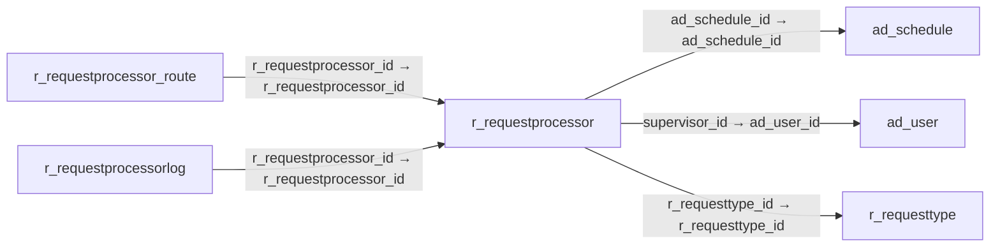

# r_requestprocessor — 요청 자동 처리기

[전체 일람](../TABLE_INDEX.md) · [분류 일람](README.md) · [AI 사용 안내](../README.md) · [외래키 읽는 법](../RELATIONSHIPS.md)

## 기본 정보

| 항목 | 내용 |
|---|---|
| 물리명 | `adempiere.r_requestprocessor` |
| 한국어 논리명(문서용 해석) | 요청 자동 처리기 |
| 원본 논리명 | Request Processor |
| 원본 사전 ID | 420 |
| 분류 | `r` — 요청·지원·상태 관리 |
| 전체 테넌트 행 수 | 1 |
| 물리 열 수 | 24 |
| 나가는 FK / 들어오는 FK | 3 / 2 |
| 구조·행 수 확인 시점 | 2026-11-03T23:29:01+09:00 |

## 의미와 쓰임

요청 처리의 실행 주기와 기한 초과·미활동 알림 및 담당 재배정 기준을 정의한다.

- 설명 근거: 물리명·열·외래키 구조를 근거로 보수적으로 해석.
- 한국어 이름과 개요는 문서용 해석입니다. 공식 한국어 번역으로 간주하지 않습니다.
- 원본 설명: —
- 원본 도움말: —
- PostgreSQL 테이블 주석: —

## 키와 열

### 기본키·고유 제약조건

| 종류 | 제약조건 | 열(순서 유지) |
|---|---|---|
| PRIMARY KEY | `r_requestprocessor_pkey` | `r_requestprocessor_id` |
| UNIQUE | `r_requestprocessor_uu_idx` | `r_requestprocessor_uu` |

### 열 목록

원본 논리명·설명은 `AD_Column`에서 가져왔습니다. 기본값은 실제 PostgreSQL 메타데이터이며, 비어 있는 항목은 `—`로 표시합니다.

| 순서 | 물리명 | 원본 논리명 | PostgreSQL 타입 | NULL | PK | 기본값 | 설명 |
|---:|---|---|---|---|---|---|---|
| 1 | `r_requestprocessor_id` | Request Processor | numeric(10,0) | 불가 | 예 | — | Processor for Requests |
| 2 | `ad_client_id` | Tenant | numeric(10,0) | 불가 | — | — | Tenant for this installation. |
| 3 | `ad_org_id` | Organization | numeric(10,0) | 불가 | — | — | Organizational entity within tenant |
| 4 | `isactive` | Active | character(1) | 불가 | — | 'Y'::bpchar | The record is active in the system |
| 5 | `created` | Created | timestamp without time zone | 불가 | — | now() | Date this record was created |
| 6 | `createdby` | Created By | numeric(10,0) | 불가 | — | — | User who created this records |
| 7 | `updated` | Updated | timestamp without time zone | 불가 | — | now() | Date this record was updated |
| 8 | `updatedby` | Updated By | numeric(10,0) | 불가 | — | — | User who updated this records |
| 9 | `name` | Name | character varying(60) | 불가 | — | — | Alphanumeric identifier of the entity |
| 10 | `description` | Description | character varying(255) | 허용 | — | — | Optional short description of the record |
| 11 | `frequency` | Frequency | numeric(10,0) | 허용 | — | (1)::numeric | Frequency of events |
| 12 | `frequencytype` | Frequency Type | character(1) | 허용 | — | — | Frequency of event |
| 13 | `datelastrun` | Date Last Run | timestamp without time zone | 허용 | — | — | Date the process was last run. |
| 14 | `datenextrun` | Date Next Run | timestamp without time zone | 허용 | — | — | Date the process will run next |
| 15 | `processing` | Process Now | character(1) | 허용 | — | — | — |
| 16 | `overduealertdays` | Alert after Days Due | numeric(10,0) | 불가 | — | — | Send email alert after number of days due (0=no alerts) |
| 17 | `overdueassigndays` | Escalate after Days Due | numeric(10,0) | 불가 | — | — | Escalation to superior after number of due days (0 = no) |
| 18 | `supervisor_id` | Supervisor | numeric(10,0) | 불가 | — | — | Supervisor for this user/organization - used for escalation and approval |
| 19 | `keeplogdays` | Days to keep Log | numeric(10,0) | 불가 | — | — | Number of days to keep the log entries |
| 20 | `reminddays` | Reminder Days | numeric(10,0) | 불가 | — | 7 | Days between sending Reminder Emails for a due or inactive Document |
| 21 | `inactivityalertdays` | Inactivity Alert Days | numeric(10,0) | 불가 | — | 0 | Send Alert when there is no activity after days (0= no alert) |
| 22 | `r_requesttype_id` | Request Type | numeric(10,0) | 허용 | — | — | Type of request (e.g. Inquiry, Complaint, ..) |
| 23 | `r_requestprocessor_uu` | R_RequestProcessor_UU | uuid | 허용 | — | — | — |
| 24 | `ad_schedule_id` | Schedule | numeric(10,0) | 불가 | — | NULL::numeric | — |

## 외래키 흐름

화살표는 **FK를 가진 자식 → 참조되는 부모**입니다. 업무 처리의 시간 순서나 무조건적인 1:N 관계를 뜻하지 않습니다.

주변 관계 5개 중 5개를 그림으로 표시합니다. **전체 관계는 아래 두 표에 모두 포함**합니다.

### 이 테이블이 참조하는 부모 — 나가는 FK

| 제약조건 | 참조하는 쪽(자식) | 자식 열 | 참조받는 쪽(부모) | 부모 열 | 삭제 / 갱신 | 검증 / 지연 가능 |
|---|---|---|---|---|---|---|
| `adschedule_rrequestprocessor` <!-- FK_OUT: adempiere.r_requestprocessor.adschedule_rrequestprocessor --> | [`r_requestprocessor`](r_requestprocessor.md) | `ad_schedule_id` | [`ad_schedule`](../ad/ad_schedule.md) | `ad_schedule_id` | NO ACTION / NO ACTION | 완료 / 가능 (초기 지연) |
| `aduser_rrequestprocessor` <!-- FK_OUT: adempiere.r_requestprocessor.aduser_rrequestprocessor --> | [`r_requestprocessor`](r_requestprocessor.md) | `supervisor_id` | [`ad_user`](../ad/ad_user.md) | `ad_user_id` | NO ACTION / NO ACTION | 완료 / 가능 (초기 지연) |
| `rrequesttype_rrequestprocessor` <!-- FK_OUT: adempiere.r_requestprocessor.rrequesttype_rrequestprocessor --> | [`r_requestprocessor`](r_requestprocessor.md) | `r_requesttype_id` | [`r_requesttype`](r_requesttype.md) | `r_requesttype_id` | NO ACTION / NO ACTION | 완료 / 가능 (초기 지연) |

### 이 테이블을 참조하는 자식 — 들어오는 FK

| 제약조건 | 참조하는 쪽(자식) | 자식 열 | 참조받는 쪽(부모) | 부모 열 | 삭제 / 갱신 | 검증 / 지연 가능 |
|---|---|---|---|---|---|---|
| `rrequestprocessor_route` <!-- FK_IN: adempiere.r_requestprocessor_route.rrequestprocessor_route --> | [`r_requestprocessor_route`](r_requestprocessor_route.md) | `r_requestprocessor_id` | [`r_requestprocessor`](r_requestprocessor.md) | `r_requestprocessor_id` | NO ACTION / NO ACTION | 완료 / 가능 (초기 지연) |
| `rrequestprocessor_log` <!-- FK_IN: adempiere.r_requestprocessorlog.rrequestprocessor_log --> | [`r_requestprocessorlog`](r_requestprocessorlog.md) | `r_requestprocessor_id` | [`r_requestprocessor`](r_requestprocessor.md) | `r_requestprocessor_id` | CASCADE / NO ACTION | 완료 / 가능 (초기 지연) |

## 조회 시 주의

- FK 표의 자식 열과 부모 열을 같은 순서로 대응시킵니다. 복합 FK는 모든 열의 동등 조건을 `AND`로 연결합니다.
- 테이블 이름이나 `_id` 열 이름만으로 물리 FK가 있다고 가정하지 않습니다. FK 미선언은 업무 관계가 없다는 뜻도 아닙니다.
- 자식이 여러 행인 테이블과 조인하면 부모의 금액·건수가 중복될 수 있습니다. 집계 단위를 먼저 정합니다.
- `ad_client_id`가 있습니다. 업무 분석에서는 대상 테넌트를 명시합니다. GardenWorld는 `11`, 시스템 공통 설정은 `0`일 수 있으므로 일괄 필터 적용 전에 테이블 역할을 확인합니다.
- 행 수는 위 확인 시점의 전체 테넌트 값입니다. 최신 업무 실적이나 현재 실행 결과로 재사용하지 않습니다.
