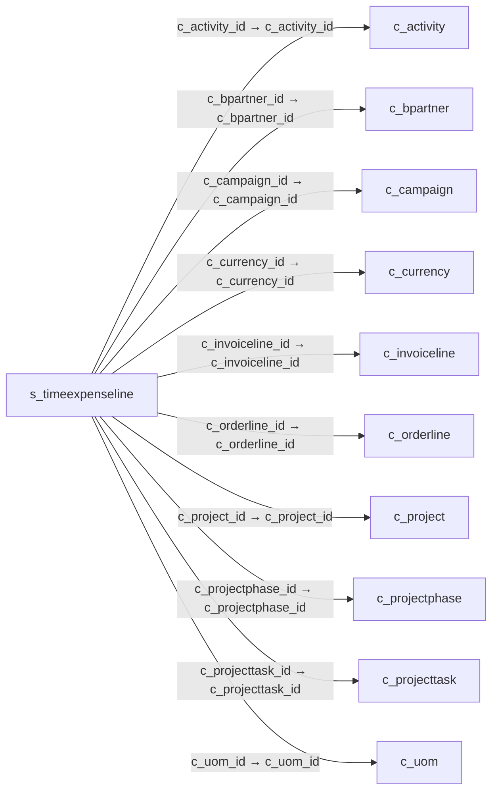

# s_timeexpenseline — 작업 시간·경비 보고행

[전체 일람](../TABLE_INDEX.md) · [분류 일람](README.md) · [AI 사용 안내](../README.md) · [외래키 읽는 법](../RELATIONSHIPS.md)

## 기본 정보

| 항목 | 내용 |
|---|---|
| 물리명 | `adempiere.s_timeexpenseline` |
| 한국어 논리명(문서용 해석) | 작업 시간·경비 보고행 |
| 원본 논리명 | Expense Line |
| 원본 사전 ID | 488 |
| 분류 | `s` — 자원·시간·비용·교육 |
| 전체 테넌트 행 수 | 4 |
| 물리 열 수 | 39 |
| 나가는 FK / 들어오는 FK | 14 / 1 |
| 구조·행 수 확인 시점 | 2026-11-03T23:29:01+09:00 |

## 의미와 쓰임

시간·경비 보고서의 개별 내역을 저장한다.

- 설명 근거: 원본 애플리케이션 사전 명칭·설명을 한국어로 해석.
- 한국어 이름과 개요는 문서용 해석입니다. 공식 한국어 번역으로 간주하지 않습니다.
- 원본 설명: Time and Expense Report Line
- 원본 도움말: —
- PostgreSQL 테이블 주석: —

## 키와 열

### 기본키·고유 제약조건

| 종류 | 제약조건 | 열(순서 유지) |
|---|---|---|
| PRIMARY KEY | `s_timeexpenseline_pkey` | `s_timeexpenseline_id` |
| UNIQUE | `s_timeexpenseline_uu_idx` | `s_timeexpenseline_uu` |

### 열 목록

원본 논리명·설명은 `AD_Column`에서 가져왔습니다. 기본값은 실제 PostgreSQL 메타데이터이며, 비어 있는 항목은 `—`로 표시합니다.

| 순서 | 물리명 | 원본 논리명 | PostgreSQL 타입 | NULL | PK | 기본값 | 설명 |
|---:|---|---|---|---|---|---|---|
| 1 | `s_timeexpenseline_id` | Expense Line | numeric(10,0) | 불가 | 예 | — | Time and Expense Report Line |
| 2 | `ad_client_id` | Tenant | numeric(10,0) | 불가 | — | — | Tenant for this installation. |
| 3 | `ad_org_id` | Organization | numeric(10,0) | 불가 | — | — | Organizational entity within tenant |
| 4 | `isactive` | Active | character(1) | 불가 | — | 'Y'::bpchar | The record is active in the system |
| 5 | `created` | Created | timestamp without time zone | 불가 | — | now() | Date this record was created |
| 6 | `createdby` | Created By | numeric(10,0) | 불가 | — | — | User who created this records |
| 7 | `updated` | Updated | timestamp without time zone | 불가 | — | now() | Date this record was updated |
| 8 | `updatedby` | Updated By | numeric(10,0) | 불가 | — | — | User who updated this records |
| 9 | `s_timeexpense_id` | Expense Report | numeric(10,0) | 불가 | — | — | Time and Expense Report |
| 10 | `line` | Line No | numeric(10,0) | 불가 | — | — | Unique line for this document |
| 11 | `istimereport` | Time Report | character(1) | 불가 | — | 'N'::bpchar | Line is a time report only (no expense) |
| 12 | `dateexpense` | Expense Date | timestamp without time zone | 허용 | — | — | Date of expense |
| 13 | `m_product_id` | Product | numeric(10,0) | 허용 | — | — | Product, Service, Item |
| 14 | `qty` | Quantity | numeric | 허용 | — | 0 | Quantity |
| 15 | `expenseamt` | Expense Amount | numeric | 허용 | — | 0 | Amount for this expense |
| 16 | `c_currency_id` | Currency | numeric(10,0) | 허용 | — | — | The Currency for this record |
| 17 | `convertedamt` | Converted Amount | numeric | 허용 | — | 0 | Converted Amount |
| 18 | `s_resourceassignment_id` | Resource Assignment | numeric(10,0) | 허용 | — | — | Resource Assignment |
| 19 | `description` | Description | character varying(255) | 허용 | — | — | Optional short description of the record |
| 20 | `note` | Note | character varying(255) | 허용 | — | — | Optional additional user defined information |
| 21 | `isinvoiced` | Invoiced | character(1) | 불가 | — | 'N'::bpchar | Is this invoiced? |
| 22 | `c_bpartner_id` | Business Partner | numeric(10,0) | 허용 | — | — | Identifies a Business Partner |
| 23 | `c_project_id` | Project | numeric(10,0) | 허용 | — | — | Financial Project |
| 24 | `c_activity_id` | Activity | numeric(10,0) | 허용 | — | — | Business Activity |
| 25 | `c_campaign_id` | Campaign | numeric(10,0) | 허용 | — | — | Marketing Campaign |
| 26 | `c_invoiceline_id` | Invoice Line | numeric(10,0) | 허용 | — | — | Invoice Detail Line |
| 27 | `invoiceprice` | Invoice Price | numeric | 허용 | — | 0 | Unit price to be invoiced or 0 for default price |
| 28 | `c_uom_id` | UOM | numeric(10,0) | 허용 | — | — | Unit of Measure |
| 29 | `c_orderline_id` | Sales Order Line | numeric(10,0) | 허용 | — | — | Sales Order Line |
| 30 | `c_projectphase_id` | Project Phase | numeric(10,0) | 허용 | — | — | Phase of a Project |
| 31 | `c_projecttask_id` | Project Task | numeric(10,0) | 허용 | — | — | Actual Project Task in a Phase |
| 32 | `s_timetype_id` | Time Type | numeric(10,0) | 허용 | — | — | Type of time recorded |
| 33 | `processed` | Processed | character(1) | 불가 | — | 'N'::bpchar | The document has been processed |
| 34 | `qtyinvoiced` | Quantity Invoiced | numeric | 허용 | — | — | Invoiced Quantity |
| 35 | `qtyreimbursed` | Quantity Reimbursed | numeric | 허용 | — | — | The reimbursed quantity |
| 36 | `priceinvoiced` | Price Invoiced | numeric | 허용 | — | — | The priced invoiced to the customer (in the currency of the customer's AR price list) - 0 for default price |
| 37 | `pricereimbursed` | Price Reimbursed | numeric | 허용 | — | — | The reimbursed price (in currency of the employee's AP price list) |
| 38 | `s_timeexpenseline_uu` | S_TimeExpenseLine_UU | uuid | 허용 | — | — | — |
| 39 | `linenetamt` | Line Amount | numeric | 허용 | — | — | Line Extended Amount (Quantity * Actual Price) without Freight and Charges |

## 외래키 흐름

화살표는 **FK를 가진 자식 → 참조되는 부모**입니다. 업무 처리의 시간 순서나 무조건적인 1:N 관계를 뜻하지 않습니다.

주변 관계 15개 중 10개를 그림으로 표시합니다. **전체 관계는 아래 두 표에 모두 포함**합니다.

### 이 테이블이 참조하는 부모 — 나가는 FK

| 제약조건 | 참조하는 쪽(자식) | 자식 열 | 참조받는 쪽(부모) | 부모 열 | 삭제 / 갱신 | 검증 / 지연 가능 |
|---|---|---|---|---|---|---|
| `cactivity_stimeexpenseline` <!-- FK_OUT: adempiere.s_timeexpenseline.cactivity_stimeexpenseline --> | [`s_timeexpenseline`](s_timeexpenseline.md) | `c_activity_id` | [`c_activity`](../c/c_activity.md) | `c_activity_id` | NO ACTION / NO ACTION | 완료 / 가능 (초기 지연) |
| `cbpartner_stimeexpenseline` <!-- FK_OUT: adempiere.s_timeexpenseline.cbpartner_stimeexpenseline --> | [`s_timeexpenseline`](s_timeexpenseline.md) | `c_bpartner_id` | [`c_bpartner`](../c/c_bpartner.md) | `c_bpartner_id` | NO ACTION / NO ACTION | 완료 / 가능 (초기 지연) |
| `ccampaign_stimeexpenseline` <!-- FK_OUT: adempiere.s_timeexpenseline.ccampaign_stimeexpenseline --> | [`s_timeexpenseline`](s_timeexpenseline.md) | `c_campaign_id` | [`c_campaign`](../c/c_campaign.md) | `c_campaign_id` | NO ACTION / NO ACTION | 완료 / 가능 (초기 지연) |
| `ccurrency_stimeexpenseline` <!-- FK_OUT: adempiere.s_timeexpenseline.ccurrency_stimeexpenseline --> | [`s_timeexpenseline`](s_timeexpenseline.md) | `c_currency_id` | [`c_currency`](../c/c_currency.md) | `c_currency_id` | NO ACTION / NO ACTION | 완료 / 가능 (초기 지연) |
| `cinvoiceline_stimeexpenseline` <!-- FK_OUT: adempiere.s_timeexpenseline.cinvoiceline_stimeexpenseline --> | [`s_timeexpenseline`](s_timeexpenseline.md) | `c_invoiceline_id` | [`c_invoiceline`](../c/c_invoiceline.md) | `c_invoiceline_id` | NO ACTION / NO ACTION | 완료 / 가능 (초기 지연) |
| `corderline_stimeexpenseline` <!-- FK_OUT: adempiere.s_timeexpenseline.corderline_stimeexpenseline --> | [`s_timeexpenseline`](s_timeexpenseline.md) | `c_orderline_id` | [`c_orderline`](../c/c_orderline.md) | `c_orderline_id` | NO ACTION / NO ACTION | 완료 / 가능 (초기 지연) |
| `cproject_stimeexpenseline` <!-- FK_OUT: adempiere.s_timeexpenseline.cproject_stimeexpenseline --> | [`s_timeexpenseline`](s_timeexpenseline.md) | `c_project_id` | [`c_project`](../c/c_project.md) | `c_project_id` | NO ACTION / NO ACTION | 완료 / 가능 (초기 지연) |
| `cprojectphase_stimeexpenseline` <!-- FK_OUT: adempiere.s_timeexpenseline.cprojectphase_stimeexpenseline --> | [`s_timeexpenseline`](s_timeexpenseline.md) | `c_projectphase_id` | [`c_projectphase`](../c/c_projectphase.md) | `c_projectphase_id` | NO ACTION / NO ACTION | 완료 / 가능 (초기 지연) |
| `cprojecttask_stimeexpenseline` <!-- FK_OUT: adempiere.s_timeexpenseline.cprojecttask_stimeexpenseline --> | [`s_timeexpenseline`](s_timeexpenseline.md) | `c_projecttask_id` | [`c_projecttask`](../c/c_projecttask.md) | `c_projecttask_id` | NO ACTION / NO ACTION | 완료 / 가능 (초기 지연) |
| `cuom_stimeexpenseline` <!-- FK_OUT: adempiere.s_timeexpenseline.cuom_stimeexpenseline --> | [`s_timeexpenseline`](s_timeexpenseline.md) | `c_uom_id` | [`c_uom`](../c/c_uom.md) | `c_uom_id` | NO ACTION / NO ACTION | 완료 / 가능 (초기 지연) |
| `mproduct_stimeexpenseline` <!-- FK_OUT: adempiere.s_timeexpenseline.mproduct_stimeexpenseline --> | [`s_timeexpenseline`](s_timeexpenseline.md) | `m_product_id` | [`m_product`](../m/m_product.md) | `m_product_id` | NO ACTION / NO ACTION | 완료 / 가능 (초기 지연) |
| `sresourceassign_steline` <!-- FK_OUT: adempiere.s_timeexpenseline.sresourceassign_steline --> | [`s_timeexpenseline`](s_timeexpenseline.md) | `s_resourceassignment_id` | [`s_resourceassignment`](s_resourceassignment.md) | `s_resourceassignment_id` | NO ACTION / NO ACTION | 완료 / 가능 (초기 지연) |
| `stimeexpense_line` <!-- FK_OUT: adempiere.s_timeexpenseline.stimeexpense_line --> | [`s_timeexpenseline`](s_timeexpenseline.md) | `s_timeexpense_id` | [`s_timeexpense`](s_timeexpense.md) | `s_timeexpense_id` | CASCADE / NO ACTION | 완료 / 가능 (초기 지연) |
| `stimetype_stimeexpenseline` <!-- FK_OUT: adempiere.s_timeexpenseline.stimetype_stimeexpenseline --> | [`s_timeexpenseline`](s_timeexpenseline.md) | `s_timetype_id` | [`s_timetype`](s_timetype.md) | `s_timetype_id` | NO ACTION / NO ACTION | 완료 / 가능 (초기 지연) |

### 이 테이블을 참조하는 자식 — 들어오는 FK

| 제약조건 | 참조하는 쪽(자식) | 자식 열 | 참조받는 쪽(부모) | 부모 열 | 삭제 / 갱신 | 검증 / 지연 가능 |
|---|---|---|---|---|---|---|
| `stimeexpline_cprojectissue` <!-- FK_IN: adempiere.c_projectissue.stimeexpline_cprojectissue --> | [`c_projectissue`](../c/c_projectissue.md) | `s_timeexpenseline_id` | [`s_timeexpenseline`](s_timeexpenseline.md) | `s_timeexpenseline_id` | NO ACTION / NO ACTION | 완료 / 가능 (초기 지연) |

## 조회 시 주의

- FK 표의 자식 열과 부모 열을 같은 순서로 대응시킵니다. 복합 FK는 모든 열의 동등 조건을 `AND`로 연결합니다.
- 테이블 이름이나 `_id` 열 이름만으로 물리 FK가 있다고 가정하지 않습니다. FK 미선언은 업무 관계가 없다는 뜻도 아닙니다.
- 자식이 여러 행인 테이블과 조인하면 부모의 금액·건수가 중복될 수 있습니다. 집계 단위를 먼저 정합니다.
- `ad_client_id`가 있습니다. 업무 분석에서는 대상 테넌트를 명시합니다. GardenWorld는 `11`, 시스템 공통 설정은 `0`일 수 있으므로 일괄 필터 적용 전에 테이블 역할을 확인합니다.
- 행 수는 위 확인 시점의 전체 테넌트 값입니다. 최신 업무 실적이나 현재 실행 결과로 재사용하지 않습니다.
