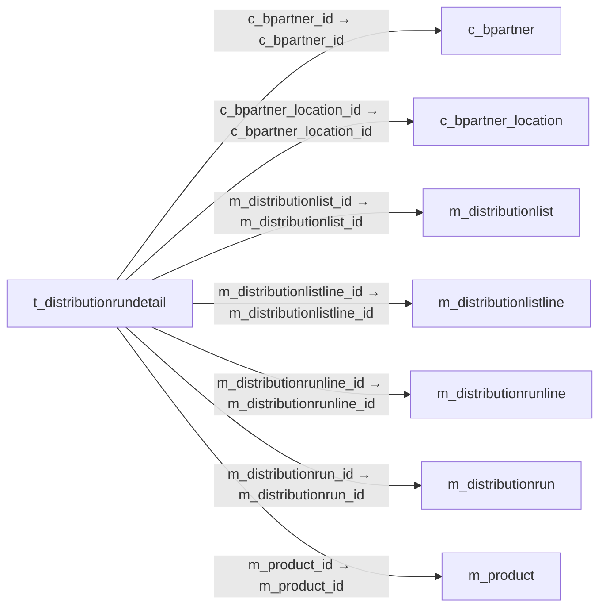

# t_distributionrundetail — 배분 실행 계산 자료

[전체 일람](../TABLE_INDEX.md) · [분류 일람](README.md) · [AI 사용 안내](../README.md) · [외래키 읽는 법](../RELATIONSHIPS.md)

## 기본 정보

| 항목 | 내용 |
|---|---|
| 물리명 | `adempiere.t_distributionrundetail` |
| 한국어 논리명(문서용 해석) | 배분 실행 계산 자료 |
| 원본 논리명 | T_DistributionRunDetail |
| 원본 사전 ID | 714 |
| 분류 | `t` — 작업·보고서용 보조 테이블 |
| 전체 테넌트 행 수 | 0 |
| 물리 열 수 | 18 |
| 나가는 FK / 들어오는 FK | 7 / 0 |
| 구조·행 수 확인 시점 | 2026-11-03T23:29:01+09:00 |

## 의미와 쓰임

배분 실행에서 거래처·제품별 배분 비율과 최소 수량·계산 수량을 저장한다.

- 설명 근거: 물리명·열·외래키 구조를 근거로 보수적으로 해석.
- 한국어 이름과 개요는 문서용 해석입니다. 공식 한국어 번역으로 간주하지 않습니다.
- 원본 설명: —
- 원본 도움말: —
- PostgreSQL 테이블 주석: —

## 키와 열

### 기본키·고유 제약조건

| 종류 | 제약조건 | 열(순서 유지) |
|---|---|---|
| PRIMARY KEY | `t_distributionrundetail_pkey` | `m_distributionrun_id`, `m_distributionrunline_id`, `m_distributionlist_id`, `m_distributionlistline_id` |
| UNIQUE | `t_distributionrundetail_uu_idx` | `t_distributionrundetail_uu` |

### 열 목록

원본 논리명·설명은 `AD_Column`에서 가져왔습니다. 기본값은 실제 PostgreSQL 메타데이터이며, 비어 있는 항목은 `—`로 표시합니다.

| 순서 | 물리명 | 원본 논리명 | PostgreSQL 타입 | NULL | PK | 기본값 | 설명 |
|---:|---|---|---|---|---|---|---|
| 1 | `m_distributionrun_id` | Distribution Run | numeric(10,0) | 불가 | 예 | — | Distribution Run create Orders to distribute products to a selected list of partners |
| 2 | `m_distributionrunline_id` | Distribution Run Line | numeric(10,0) | 불가 | 예 | — | Distribution Run Lines define Distribution List, the Product and Quantities |
| 3 | `m_distributionlist_id` | Distribution List | numeric(10,0) | 불가 | 예 | — | Distribution Lists allow to distribute products to a selected list of partners |
| 4 | `m_distributionlistline_id` | Distribution List Line | numeric(10,0) | 불가 | 예 | — | Distribution List Line with Business Partner and Quantity/Percentage |
| 5 | `ad_client_id` | Tenant | numeric(10,0) | 불가 | — | — | Tenant for this installation. |
| 6 | `ad_org_id` | Organization | numeric(10,0) | 불가 | — | — | Organizational entity within tenant |
| 7 | `isactive` | Active | character(1) | 불가 | — | 'Y'::bpchar | The record is active in the system |
| 8 | `created` | Created | timestamp without time zone | 불가 | — | now() | Date this record was created |
| 9 | `createdby` | Created By | numeric(10,0) | 불가 | — | — | User who created this records |
| 10 | `updated` | Updated | timestamp without time zone | 불가 | — | now() | Date this record was updated |
| 11 | `updatedby` | Updated By | numeric(10,0) | 불가 | — | — | User who updated this records |
| 12 | `ratio` | Ratio | numeric | 불가 | — | — | Relative Ratio for Distributions |
| 13 | `minqty` | Minimum Quantity | numeric | 불가 | — | 0 | Minimum quantity for the business partner |
| 14 | `qty` | Quantity | numeric | 불가 | — | 0 | Quantity |
| 15 | `m_product_id` | Product | numeric(10,0) | 불가 | — | — | Product, Service, Item |
| 16 | `c_bpartner_id` | Business Partner | numeric(10,0) | 불가 | — | — | Identifies a Business Partner |
| 17 | `c_bpartner_location_id` | Partner Location | numeric(10,0) | 불가 | — | — | Identifies the (ship to) address for this Business Partner |
| 18 | `t_distributionrundetail_uu` | T_DistributionRunDetail_UU | uuid | 허용 | — | — | — |

## 외래키 흐름

화살표는 **FK를 가진 자식 → 참조되는 부모**입니다. 업무 처리의 시간 순서나 무조건적인 1:N 관계를 뜻하지 않습니다.

주변 관계 7개 중 7개를 그림으로 표시합니다. **전체 관계는 아래 두 표에 모두 포함**합니다.

### 이 테이블이 참조하는 부모 — 나가는 FK

| 제약조건 | 참조하는 쪽(자식) | 자식 열 | 참조받는 쪽(부모) | 부모 열 | 삭제 / 갱신 | 검증 / 지연 가능 |
|---|---|---|---|---|---|---|
| `cbpartner_tdrdetail` <!-- FK_OUT: adempiere.t_distributionrundetail.cbpartner_tdrdetail --> | [`t_distributionrundetail`](t_distributionrundetail.md) | `c_bpartner_id` | [`c_bpartner`](../c/c_bpartner.md) | `c_bpartner_id` | CASCADE / NO ACTION | 완료 / 가능 (초기 지연) |
| `cbpartnerlocation_tdrdetail` <!-- FK_OUT: adempiere.t_distributionrundetail.cbpartnerlocation_tdrdetail --> | [`t_distributionrundetail`](t_distributionrundetail.md) | `c_bpartner_location_id` | [`c_bpartner_location`](../c/c_bpartner_location.md) | `c_bpartner_location_id` | CASCADE / NO ACTION | 완료 / 가능 (초기 지연) |
| `mdistributionlist_tdrdetail` <!-- FK_OUT: adempiere.t_distributionrundetail.mdistributionlist_tdrdetail --> | [`t_distributionrundetail`](t_distributionrundetail.md) | `m_distributionlist_id` | [`m_distributionlist`](../m/m_distributionlist.md) | `m_distributionlist_id` | CASCADE / NO ACTION | 완료 / 가능 (초기 지연) |
| `mdistributionlline_tdrdetail` <!-- FK_OUT: adempiere.t_distributionrundetail.mdistributionlline_tdrdetail --> | [`t_distributionrundetail`](t_distributionrundetail.md) | `m_distributionlistline_id` | [`m_distributionlistline`](../m/m_distributionlistline.md) | `m_distributionlistline_id` | CASCADE / NO ACTION | 완료 / 가능 (초기 지연) |
| `mdistributionrline_tdrdetail` <!-- FK_OUT: adempiere.t_distributionrundetail.mdistributionrline_tdrdetail --> | [`t_distributionrundetail`](t_distributionrundetail.md) | `m_distributionrunline_id` | [`m_distributionrunline`](../m/m_distributionrunline.md) | `m_distributionrunline_id` | CASCADE / NO ACTION | 완료 / 가능 (초기 지연) |
| `mdistributionrun_tdrdetail` <!-- FK_OUT: adempiere.t_distributionrundetail.mdistributionrun_tdrdetail --> | [`t_distributionrundetail`](t_distributionrundetail.md) | `m_distributionrun_id` | [`m_distributionrun`](../m/m_distributionrun.md) | `m_distributionrun_id` | CASCADE / NO ACTION | 완료 / 가능 (초기 지연) |
| `mproduct_tdrdetail` <!-- FK_OUT: adempiere.t_distributionrundetail.mproduct_tdrdetail --> | [`t_distributionrundetail`](t_distributionrundetail.md) | `m_product_id` | [`m_product`](../m/m_product.md) | `m_product_id` | CASCADE / NO ACTION | 완료 / 가능 (초기 지연) |

### 이 테이블을 참조하는 자식 — 들어오는 FK

해당 방향의 물리 FK 제약조건은 없습니다. 이름이 비슷한 열만으로 관계를 추가하지 않습니다.

## 조회 시 주의

- FK 표의 자식 열과 부모 열을 같은 순서로 대응시킵니다. 복합 FK는 모든 열의 동등 조건을 `AND`로 연결합니다.
- 테이블 이름이나 `_id` 열 이름만으로 물리 FK가 있다고 가정하지 않습니다. FK 미선언은 업무 관계가 없다는 뜻도 아닙니다.
- 자식이 여러 행인 테이블과 조인하면 부모의 금액·건수가 중복될 수 있습니다. 집계 단위를 먼저 정합니다.
- `ad_client_id`가 있습니다. 업무 분석에서는 대상 테넌트를 명시합니다. GardenWorld는 `11`, 시스템 공통 설정은 `0`일 수 있으므로 일괄 필터 적용 전에 테이블 역할을 확인합니다.
- 수집 시점에 0행입니다. 이 표만으로 거래 실적·처리 결과를 계산할 수 없습니다.
- 행 수는 위 확인 시점의 전체 테넌트 값입니다. 최신 업무 실적이나 현재 실행 결과로 재사용하지 않습니다.
