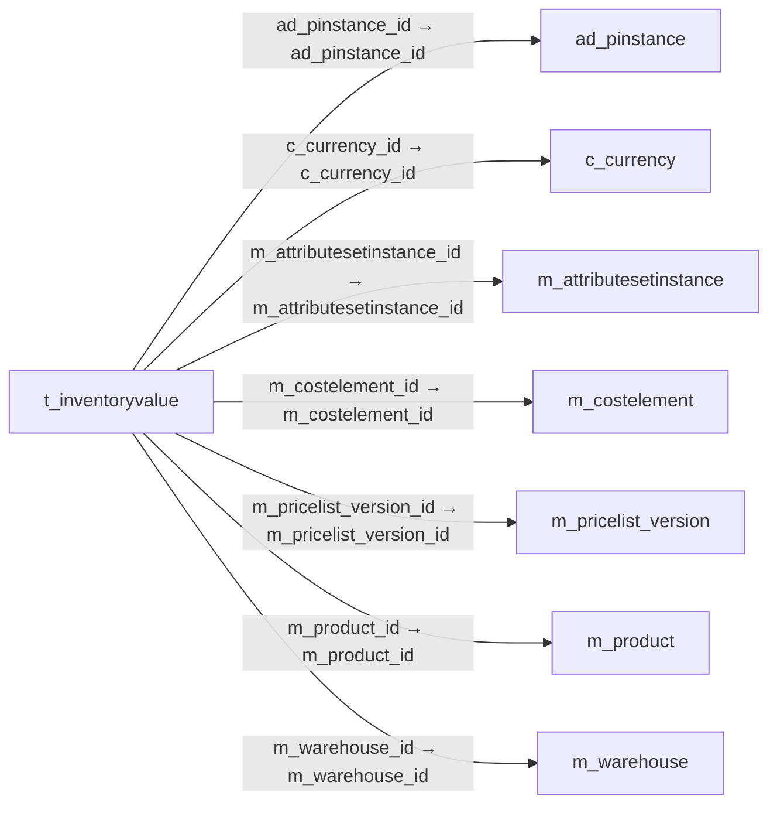

# t_inventoryvalue — 재고 평가 보고 자료

[전체 일람](../TABLE_INDEX.md) · [분류 일람](README.md) · [AI 사용 안내](../README.md) · [외래키 읽는 법](../RELATIONSHIPS.md)

## 기본 정보

| 항목 | 내용 |
|---|---|
| 물리명 | `adempiere.t_inventoryvalue` |
| 한국어 논리명(문서용 해석) | 재고 평가 보고 자료 |
| 원본 논리명 | T_InventoryValue |
| 원본 사전 ID | 478 |
| 분류 | `t` — 작업·보고서용 보조 테이블 |
| 전체 테넌트 행 수 | 0 |
| 물리 열 수 | 24 |
| 나가는 FK / 들어오는 FK | 7 / 0 |
| 구조·행 수 확인 시점 | 2026-11-03T23:29:01+09:00 |

## 의미와 쓰임

실행 건별 제품·창고·속성 인스턴스의 재고 수량과 가격·원가 기준 평가 금액을 저장한다.

- 설명 근거: 물리명·열·외래키 구조를 근거로 보수적으로 해석.
- 한국어 이름과 개요는 문서용 해석입니다. 공식 한국어 번역으로 간주하지 않습니다.
- 원본 설명: —
- 원본 도움말: —
- PostgreSQL 테이블 주석: —

## 키와 열

### 기본키·고유 제약조건

| 종류 | 제약조건 | 열(순서 유지) |
|---|---|---|
| PRIMARY KEY | `t_inventoryvalue_pkey` | `ad_pinstance_id`, `m_warehouse_id`, `m_product_id`, `m_attributesetinstance_id` |
| UNIQUE | `t_inventoryvalue_uu_idx` | `t_inventoryvalue_uu` |

### 열 목록

원본 논리명·설명은 `AD_Column`에서 가져왔습니다. 기본값은 실제 PostgreSQL 메타데이터이며, 비어 있는 항목은 `—`로 표시합니다.

| 순서 | 물리명 | 원본 논리명 | PostgreSQL 타입 | NULL | PK | 기본값 | 설명 |
|---:|---|---|---|---|---|---|---|
| 1 | `ad_pinstance_id` | Process Instance | numeric(10,0) | 불가 | 예 | — | Instance of the process |
| 2 | `m_warehouse_id` | Warehouse | numeric(10,0) | 불가 | 예 | — | Storage Warehouse and Service Point |
| 3 | `m_product_id` | Product | numeric(10,0) | 불가 | 예 | — | Product, Service, Item |
| 4 | `m_attributesetinstance_id` | Attribute Set Instance | numeric(10,0) | 불가 | 예 | — | Product Attribute Set Instance |
| 5 | `ad_client_id` | Tenant | numeric(10,0) | 허용 | — | — | Tenant for this installation. |
| 6 | `ad_org_id` | Organization | numeric(10,0) | 허용 | — | — | Organizational entity within tenant |
| 7 | `m_pricelist_version_id` | Price List Version | numeric(10,0) | 허용 | — | — | Identifies a unique instance of a Price List |
| 8 | `datevalue` | Valuation Date | timestamp without time zone | 허용 | — | — | Date of valuation |
| 9 | `c_currency_id` | Currency | numeric(10,0) | 허용 | — | — | The Currency for this record |
| 10 | `qtyonhand` | On Hand Quantity | numeric | 허용 | — | 0 | On Hand Quantity |
| 11 | `pricepo` | PO Price | numeric | 허용 | — | 0 | Price based on a purchase order |
| 12 | `pricelist` | List Price | numeric | 허용 | — | 0 | List Price |
| 13 | `pricestd` | Standard Price | numeric | 허용 | — | 0 | Standard Price |
| 14 | `pricelimit` | Limit Price | numeric | 허용 | — | 0 | Lowest price for a product |
| 15 | `coststandard` | Standard Cost | numeric | 허용 | — | 0 | Standard Costs |
| 16 | `cost` | Cost | numeric | 허용 | — | 0 | Cost information |
| 17 | `pricepoamt` | PO Price Value | numeric | 허용 | — | 0 | Valuation with PO Price |
| 18 | `pricelistamt` | List price Value | numeric | 허용 | — | 0 | Valuation with List Price |
| 19 | `pricestdamt` | Std Price Value | numeric | 허용 | — | 0 | Valuation with standard price |
| 20 | `pricelimitamt` | Limit price Value | numeric | 허용 | — | 0 | Value with limit price |
| 21 | `coststandardamt` | Standard Cost Value | numeric | 허용 | — | 0 | Value in Standard Costs |
| 22 | `costamt` | Cost Value | numeric | 허용 | — | 0 | Value with Cost |
| 23 | `m_costelement_id` | Cost Element | numeric(10,0) | 허용 | — | — | Product Cost Element |
| 24 | `t_inventoryvalue_uu` | T_InventoryValue_UU | uuid | 허용 | — | — | — |

## 외래키 흐름

화살표는 **FK를 가진 자식 → 참조되는 부모**입니다. 업무 처리의 시간 순서나 무조건적인 1:N 관계를 뜻하지 않습니다.

주변 관계 7개 중 7개를 그림으로 표시합니다. **전체 관계는 아래 두 표에 모두 포함**합니다.

### 이 테이블이 참조하는 부모 — 나가는 FK

| 제약조건 | 참조하는 쪽(자식) | 자식 열 | 참조받는 쪽(부모) | 부모 열 | 삭제 / 갱신 | 검증 / 지연 가능 |
|---|---|---|---|---|---|---|
| `adpinstance_tinventoryvalue` <!-- FK_OUT: adempiere.t_inventoryvalue.adpinstance_tinventoryvalue --> | [`t_inventoryvalue`](t_inventoryvalue.md) | `ad_pinstance_id` | [`ad_pinstance`](../ad/ad_pinstance.md) | `ad_pinstance_id` | CASCADE / NO ACTION | 완료 / 가능 (초기 지연) |
| `ccurrency_tinventoryvalue` <!-- FK_OUT: adempiere.t_inventoryvalue.ccurrency_tinventoryvalue --> | [`t_inventoryvalue`](t_inventoryvalue.md) | `c_currency_id` | [`c_currency`](../c/c_currency.md) | `c_currency_id` | CASCADE / NO ACTION | 완료 / 가능 (초기 지연) |
| `masi_tinventoryvalue` <!-- FK_OUT: adempiere.t_inventoryvalue.masi_tinventoryvalue --> | [`t_inventoryvalue`](t_inventoryvalue.md) | `m_attributesetinstance_id` | [`m_attributesetinstance`](../m/m_attributesetinstance.md) | `m_attributesetinstance_id` | CASCADE / NO ACTION | 완료 / 가능 (초기 지연) |
| `mcostelement_tinventoryvalue` <!-- FK_OUT: adempiere.t_inventoryvalue.mcostelement_tinventoryvalue --> | [`t_inventoryvalue`](t_inventoryvalue.md) | `m_costelement_id` | [`m_costelement`](../m/m_costelement.md) | `m_costelement_id` | CASCADE / NO ACTION | 완료 / 가능 (초기 지연) |
| `mplversion_tinventoryvalue` <!-- FK_OUT: adempiere.t_inventoryvalue.mplversion_tinventoryvalue --> | [`t_inventoryvalue`](t_inventoryvalue.md) | `m_pricelist_version_id` | [`m_pricelist_version`](../m/m_pricelist_version.md) | `m_pricelist_version_id` | CASCADE / NO ACTION | 완료 / 가능 (초기 지연) |
| `mproduct_tinventoryvalue` <!-- FK_OUT: adempiere.t_inventoryvalue.mproduct_tinventoryvalue --> | [`t_inventoryvalue`](t_inventoryvalue.md) | `m_product_id` | [`m_product`](../m/m_product.md) | `m_product_id` | CASCADE / NO ACTION | 완료 / 가능 (초기 지연) |
| `mwarehouse_tinventoryvalue` <!-- FK_OUT: adempiere.t_inventoryvalue.mwarehouse_tinventoryvalue --> | [`t_inventoryvalue`](t_inventoryvalue.md) | `m_warehouse_id` | [`m_warehouse`](../m/m_warehouse.md) | `m_warehouse_id` | CASCADE / NO ACTION | 완료 / 가능 (초기 지연) |

### 이 테이블을 참조하는 자식 — 들어오는 FK

해당 방향의 물리 FK 제약조건은 없습니다. 이름이 비슷한 열만으로 관계를 추가하지 않습니다.

## 조회 시 주의

- FK 표의 자식 열과 부모 열을 같은 순서로 대응시킵니다. 복합 FK는 모든 열의 동등 조건을 `AND`로 연결합니다.
- 테이블 이름이나 `_id` 열 이름만으로 물리 FK가 있다고 가정하지 않습니다. FK 미선언은 업무 관계가 없다는 뜻도 아닙니다.
- 자식이 여러 행인 테이블과 조인하면 부모의 금액·건수가 중복될 수 있습니다. 집계 단위를 먼저 정합니다.
- `ad_client_id`가 있습니다. 업무 분석에서는 대상 테넌트를 명시합니다. GardenWorld는 `11`, 시스템 공통 설정은 `0`일 수 있으므로 일괄 필터 적용 전에 테이블 역할을 확인합니다.
- 수집 시점에 0행입니다. 이 표만으로 거래 실적·처리 결과를 계산할 수 없습니다.
- 행 수는 위 확인 시점의 전체 테넌트 값입니다. 최신 업무 실적이나 현재 실행 결과로 재사용하지 않습니다.
