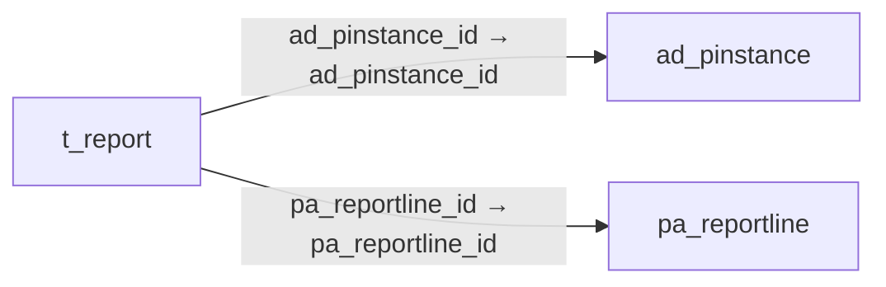

# t_report — 보고서 임시 자료

[전체 일람](../TABLE_INDEX.md) · [분류 일람](README.md) · [AI 사용 안내](../README.md) · [외래키 읽는 법](../RELATIONSHIPS.md)

## 기본 정보

| 항목 | 내용 |
|---|---|
| 물리명 | `adempiere.t_report` |
| 한국어 논리명(문서용 해석) | 보고서 임시 자료 |
| 원본 논리명 | T_Report |
| 원본 사전 ID | 544 |
| 분류 | `t` — 작업·보고서용 보조 테이블 |
| 전체 테넌트 행 수 | 0 |
| 물리 열 수 | 40 |
| 나가는 FK / 들어오는 FK | 2 / 0 |
| 구조·행 수 확인 시점 | 2026-11-03T23:29:01+09:00 |

## 의미와 쓰임

보고서 생성 중 사용하는 행별 임시 결과를 저장한다.

- 설명 근거: 원본 애플리케이션 사전 명칭·설명을 한국어로 해석.
- 한국어 이름과 개요는 문서용 해석입니다. 공식 한국어 번역으로 간주하지 않습니다.
- 원본 설명: Temporary Reporting Table
- 원본 도움말: —
- PostgreSQL 테이블 주석: —

## 키와 열

### 기본키·고유 제약조건

| 종류 | 제약조건 | 열(순서 유지) |
|---|---|---|
| PRIMARY KEY | `t_report_pkey` | `ad_pinstance_id`, `pa_reportline_id`, `record_id`, `fact_acct_id` |
| UNIQUE | `t_report_uu_idx` | `t_report_uu` |

### 열 목록

원본 논리명·설명은 `AD_Column`에서 가져왔습니다. 기본값은 실제 PostgreSQL 메타데이터이며, 비어 있는 항목은 `—`로 표시합니다.

| 순서 | 물리명 | 원본 논리명 | PostgreSQL 타입 | NULL | PK | 기본값 | 설명 |
|---:|---|---|---|---|---|---|---|
| 1 | `ad_pinstance_id` | Process Instance | numeric(10,0) | 불가 | 예 | — | Instance of the process |
| 2 | `pa_reportline_id` | Report Line | numeric(10,0) | 불가 | 예 | — | — |
| 3 | `record_id` | Record ID | numeric(10,0) | 불가 | 예 | — | Direct internal record ID |
| 4 | `fact_acct_id` | Accounting Fact | numeric(10,0) | 불가 | 예 | — | — |
| 5 | `seqno` | Sequence | numeric | 허용 | — | — | Method of ordering records; lowest number comes first |
| 6 | `levelno` | Level no | numeric(10,0) | 허용 | — | 0 | — |
| 7 | `name` | Name | character varying(60) | 허용 | — | — | Alphanumeric identifier of the entity |
| 8 | `description` | Description | character varying(255) | 허용 | — | — | Optional short description of the record |
| 9 | `col_0` | Col_0 | numeric | 허용 | — | — | — |
| 10 | `col_2` | Col_2 | numeric | 허용 | — | — | — |
| 11 | `col_1` | Col_1 | numeric | 허용 | — | — | — |
| 12 | `col_3` | Col_3 | numeric | 허용 | — | — | — |
| 13 | `col_4` | Col_4 | numeric | 허용 | — | — | — |
| 14 | `col_5` | Col_5 | numeric | 허용 | — | — | — |
| 15 | `col_6` | Col_6 | numeric | 허용 | — | — | — |
| 16 | `col_7` | Col_7 | numeric | 허용 | — | — | — |
| 17 | `col_8` | Col_8 | numeric | 허용 | — | — | — |
| 18 | `col_9` | Col_9 | numeric | 허용 | — | — | — |
| 19 | `col_10` | Col_10 | numeric | 허용 | — | — | — |
| 20 | `col_11` | Col_11 | numeric | 허용 | — | — | — |
| 21 | `col_12` | Col_12 | numeric | 허용 | — | — | — |
| 22 | `col_13` | Col_13 | numeric | 허용 | — | — | — |
| 23 | `col_14` | Col_14 | numeric | 허용 | — | — | — |
| 24 | `col_15` | Col_15 | numeric | 허용 | — | — | — |
| 25 | `col_16` | Col_16 | numeric | 허용 | — | — | — |
| 26 | `col_17` | Col_17 | numeric | 허용 | — | — | — |
| 27 | `col_18` | Col_18 | numeric | 허용 | — | — | — |
| 28 | `col_19` | Col_19 | numeric | 허용 | — | — | — |
| 29 | `col_20` | Col_20 | numeric | 허용 | — | — | — |
| 30 | `t_report_uu` | T_Report_UU | uuid | 허용 | — | — | — |
| 31 | `col_21` | Col_21 | numeric | 허용 | — | — | — |
| 32 | `col_22` | Col_22 | numeric | 허용 | — | — | — |
| 33 | `col_23` | Col_23 | numeric | 허용 | — | — | — |
| 34 | `col_24` | Col_24 | numeric | 허용 | — | — | — |
| 35 | `col_25` | Col_25 | numeric | 허용 | — | — | — |
| 36 | `col_26` | Col_26 | numeric | 허용 | — | — | — |
| 37 | `col_27` | Col_27 | numeric | 허용 | — | — | — |
| 38 | `col_28` | Col_28 | numeric | 허용 | — | — | — |
| 39 | `col_29` | Col_29 | numeric | 허용 | — | — | — |
| 40 | `col_30` | Col_30 | numeric | 허용 | — | — | — |

## 외래키 흐름

화살표는 **FK를 가진 자식 → 참조되는 부모**입니다. 업무 처리의 시간 순서나 무조건적인 1:N 관계를 뜻하지 않습니다.

주변 관계 2개 중 2개를 그림으로 표시합니다. **전체 관계는 아래 두 표에 모두 포함**합니다.

### 이 테이블이 참조하는 부모 — 나가는 FK

| 제약조건 | 참조하는 쪽(자식) | 자식 열 | 참조받는 쪽(부모) | 부모 열 | 삭제 / 갱신 | 검증 / 지연 가능 |
|---|---|---|---|---|---|---|
| `adpinstance_treport` <!-- FK_OUT: adempiere.t_report.adpinstance_treport --> | [`t_report`](t_report.md) | `ad_pinstance_id` | [`ad_pinstance`](../ad/ad_pinstance.md) | `ad_pinstance_id` | CASCADE / NO ACTION | 완료 / 가능 (초기 지연) |
| `pareportline_treport` <!-- FK_OUT: adempiere.t_report.pareportline_treport --> | [`t_report`](t_report.md) | `pa_reportline_id` | [`pa_reportline`](../pa/pa_reportline.md) | `pa_reportline_id` | CASCADE / NO ACTION | 완료 / 가능 (초기 지연) |

### 이 테이블을 참조하는 자식 — 들어오는 FK

해당 방향의 물리 FK 제약조건은 없습니다. 이름이 비슷한 열만으로 관계를 추가하지 않습니다.

## 조회 시 주의

- FK 표의 자식 열과 부모 열을 같은 순서로 대응시킵니다. 복합 FK는 모든 열의 동등 조건을 `AND`로 연결합니다.
- 테이블 이름이나 `_id` 열 이름만으로 물리 FK가 있다고 가정하지 않습니다. FK 미선언은 업무 관계가 없다는 뜻도 아닙니다.
- 자식이 여러 행인 테이블과 조인하면 부모의 금액·건수가 중복될 수 있습니다. 집계 단위를 먼저 정합니다.
- `record_id`는 가리키는 테이블이 메타데이터에 따라 달라질 수 있습니다. 물리 FK 목록에 없는 대상은 별도 확인합니다.
- 수집 시점에 0행입니다. 이 표만으로 거래 실적·처리 결과를 계산할 수 없습니다.
- 행 수는 위 확인 시점의 전체 테넌트 값입니다. 최신 업무 실적이나 현재 실행 결과로 재사용하지 않습니다.
