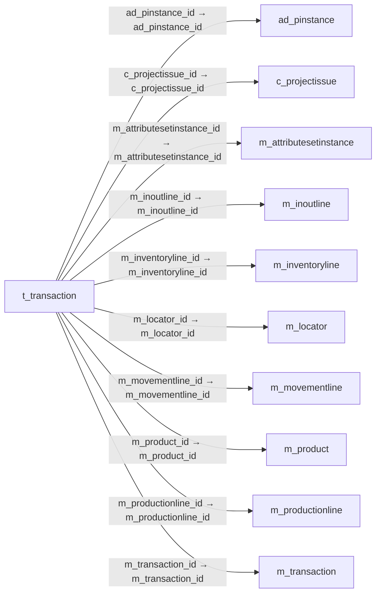

# t_transaction — 재고 수불 보고 자료

[전체 일람](../TABLE_INDEX.md) · [분류 일람](README.md) · [AI 사용 안내](../README.md) · [외래키 읽는 법](../RELATIONSHIPS.md)

## 기본 정보

| 항목 | 내용 |
|---|---|
| 물리명 | `adempiere.t_transaction` |
| 한국어 논리명(문서용 해석) | 재고 수불 보고 자료 |
| 원본 논리명 | T_Transaction |
| 원본 사전 ID | 758 |
| 분류 | `t` — 작업·보고서용 보조 테이블 |
| 전체 테넌트 행 수 | 0 |
| 물리 열 수 | 29 |
| 나가는 FK / 들어오는 FK | 10 / 0 |
| 구조·행 수 확인 시점 | 2026-11-03T23:29:01+09:00 |

## 의미와 쓰임

실행 건별 재고 거래와 관련 입출고·이동·실사·생산 문서의 정보를 보고용으로 저장한다.

- 설명 근거: 물리명·열·외래키 구조를 근거로 보수적으로 해석.
- 한국어 이름과 개요는 문서용 해석입니다. 공식 한국어 번역으로 간주하지 않습니다.
- 원본 설명: —
- 원본 도움말: —
- PostgreSQL 테이블 주석: —

## 키와 열

### 기본키·고유 제약조건

| 종류 | 제약조건 | 열(순서 유지) |
|---|---|---|
| PRIMARY KEY | `t_transaction_pkey` | `ad_pinstance_id`, `m_transaction_id` |
| UNIQUE | `t_transaction_uu_idx` | `t_transaction_uu` |

### 열 목록

원본 논리명·설명은 `AD_Column`에서 가져왔습니다. 기본값은 실제 PostgreSQL 메타데이터이며, 비어 있는 항목은 `—`로 표시합니다.

| 순서 | 물리명 | 원본 논리명 | PostgreSQL 타입 | NULL | PK | 기본값 | 설명 |
|---:|---|---|---|---|---|---|---|
| 1 | `ad_pinstance_id` | Process Instance | numeric(10,0) | 불가 | 예 | — | Instance of the process |
| 2 | `m_transaction_id` | Inventory Transaction | numeric(10,0) | 불가 | 예 | — | — |
| 3 | `ad_client_id` | Tenant | numeric(10,0) | 불가 | — | — | Tenant for this installation. |
| 4 | `ad_org_id` | Organization | numeric(10,0) | 불가 | — | — | Organizational entity within tenant |
| 5 | `isactive` | Active | character(1) | 불가 | — | 'Y'::bpchar | The record is active in the system |
| 6 | `created` | Created | timestamp without time zone | 불가 | — | now() | Date this record was created |
| 7 | `createdby` | Created By | numeric(10,0) | 불가 | — | — | User who created this records |
| 8 | `updated` | Updated | timestamp without time zone | 불가 | — | now() | Date this record was updated |
| 9 | `updatedby` | Updated By | numeric(10,0) | 불가 | — | — | User who updated this records |
| 10 | `movementtype` | Movement Type | character(2) | 불가 | — | — | Method of moving the inventory |
| 11 | `m_locator_id` | Locator | numeric(10,0) | 불가 | — | — | Warehouse Locator |
| 12 | `m_product_id` | Product | numeric(10,0) | 불가 | — | — | Product, Service, Item |
| 13 | `m_attributesetinstance_id` | Attribute Set Instance | numeric(10,0) | 불가 | — | — | Product Attribute Set Instance |
| 14 | `movementdate` | Movement Date | timestamp without time zone | 불가 | — | — | Date a product was moved in or out of inventory |
| 15 | `movementqty` | Movement Quantity | numeric | 불가 | — | 0 | Quantity of a product moved. |
| 16 | `m_inoutline_id` | Shipment/Receipt Line | numeric(10,0) | 허용 | — | — | Line on Shipment or Receipt document |
| 17 | `m_inout_id` | Shipment/Receipt | numeric(10,0) | 허용 | — | — | Material Shipment Document |
| 18 | `m_movementline_id` | Move Line | numeric(10,0) | 허용 | — | — | Inventory Move document Line |
| 19 | `m_movement_id` | Inventory Move | numeric(10,0) | 허용 | — | — | Movement of Inventory |
| 20 | `m_inventoryline_id` | Phys.Inventory Line | numeric(10,0) | 허용 | — | — | Unique line in an Inventory document |
| 21 | `m_inventory_id` | Phys.Inventory | numeric(10,0) | 허용 | — | — | Parameters for a Physical Inventory |
| 22 | `m_productionline_id` | Production Line | numeric(10,0) | 허용 | — | — | Document Line representing a production |
| 23 | `m_production_id` | Production | numeric(10,0) | 허용 | — | — | Plan for producing a product |
| 24 | `c_projectissue_id` | Project Issue | numeric(10,0) | 허용 | — | — | Project Issues (Material, Labor) |
| 25 | `c_project_id` | Project | numeric(10,0) | 허용 | — | — | Financial Project |
| 26 | `search_order_id` | Search Order | numeric(10,0) | 허용 | — | — | Order Identifier |
| 27 | `search_invoice_id` | Search Invoice | numeric(10,0) | 허용 | — | — | Search Invoice Identifier |
| 28 | `search_inout_id` | Search Shipment/Receipt | numeric(10,0) | 허용 | — | — | Material Shipment Document |
| 29 | `t_transaction_uu` | T_Transaction_UU | uuid | 허용 | — | — | — |

## 외래키 흐름

화살표는 **FK를 가진 자식 → 참조되는 부모**입니다. 업무 처리의 시간 순서나 무조건적인 1:N 관계를 뜻하지 않습니다.

주변 관계 10개 중 10개를 그림으로 표시합니다. **전체 관계는 아래 두 표에 모두 포함**합니다.

### 이 테이블이 참조하는 부모 — 나가는 FK

| 제약조건 | 참조하는 쪽(자식) | 자식 열 | 참조받는 쪽(부모) | 부모 열 | 삭제 / 갱신 | 검증 / 지연 가능 |
|---|---|---|---|---|---|---|
| `adpinstance_ttransaction` <!-- FK_OUT: adempiere.t_transaction.adpinstance_ttransaction --> | [`t_transaction`](t_transaction.md) | `ad_pinstance_id` | [`ad_pinstance`](../ad/ad_pinstance.md) | `ad_pinstance_id` | CASCADE / NO ACTION | 완료 / 가능 (초기 지연) |
| `cprojectissue_ttransaction` <!-- FK_OUT: adempiere.t_transaction.cprojectissue_ttransaction --> | [`t_transaction`](t_transaction.md) | `c_projectissue_id` | [`c_projectissue`](../c/c_projectissue.md) | `c_projectissue_id` | CASCADE / NO ACTION | 완료 / 가능 (초기 지연) |
| `masi_ttransaction` <!-- FK_OUT: adempiere.t_transaction.masi_ttransaction --> | [`t_transaction`](t_transaction.md) | `m_attributesetinstance_id` | [`m_attributesetinstance`](../m/m_attributesetinstance.md) | `m_attributesetinstance_id` | CASCADE / NO ACTION | 완료 / 가능 (초기 지연) |
| `minoutline_ttransaction` <!-- FK_OUT: adempiere.t_transaction.minoutline_ttransaction --> | [`t_transaction`](t_transaction.md) | `m_inoutline_id` | [`m_inoutline`](../m/m_inoutline.md) | `m_inoutline_id` | CASCADE / NO ACTION | 완료 / 가능 (초기 지연) |
| `minventoryline_ttransaction` <!-- FK_OUT: adempiere.t_transaction.minventoryline_ttransaction --> | [`t_transaction`](t_transaction.md) | `m_inventoryline_id` | [`m_inventoryline`](../m/m_inventoryline.md) | `m_inventoryline_id` | CASCADE / NO ACTION | 완료 / 가능 (초기 지연) |
| `mlocator_ttransaction` <!-- FK_OUT: adempiere.t_transaction.mlocator_ttransaction --> | [`t_transaction`](t_transaction.md) | `m_locator_id` | [`m_locator`](../m/m_locator.md) | `m_locator_id` | CASCADE / NO ACTION | 완료 / 가능 (초기 지연) |
| `mmovementline_ttransaction` <!-- FK_OUT: adempiere.t_transaction.mmovementline_ttransaction --> | [`t_transaction`](t_transaction.md) | `m_movementline_id` | [`m_movementline`](../m/m_movementline.md) | `m_movementline_id` | CASCADE / NO ACTION | 완료 / 가능 (초기 지연) |
| `mproduct_ttransaction` <!-- FK_OUT: adempiere.t_transaction.mproduct_ttransaction --> | [`t_transaction`](t_transaction.md) | `m_product_id` | [`m_product`](../m/m_product.md) | `m_product_id` | CASCADE / NO ACTION | 완료 / 가능 (초기 지연) |
| `mproductionline_ttransaction` <!-- FK_OUT: adempiere.t_transaction.mproductionline_ttransaction --> | [`t_transaction`](t_transaction.md) | `m_productionline_id` | [`m_productionline`](../m/m_productionline.md) | `m_productionline_id` | CASCADE / NO ACTION | 완료 / 가능 (초기 지연) |
| `mtransaction_ttransaction` <!-- FK_OUT: adempiere.t_transaction.mtransaction_ttransaction --> | [`t_transaction`](t_transaction.md) | `m_transaction_id` | [`m_transaction`](../m/m_transaction.md) | `m_transaction_id` | CASCADE / NO ACTION | 완료 / 가능 (초기 지연) |

### 이 테이블을 참조하는 자식 — 들어오는 FK

해당 방향의 물리 FK 제약조건은 없습니다. 이름이 비슷한 열만으로 관계를 추가하지 않습니다.

## 조회 시 주의

- FK 표의 자식 열과 부모 열을 같은 순서로 대응시킵니다. 복합 FK는 모든 열의 동등 조건을 `AND`로 연결합니다.
- 테이블 이름이나 `_id` 열 이름만으로 물리 FK가 있다고 가정하지 않습니다. FK 미선언은 업무 관계가 없다는 뜻도 아닙니다.
- 자식이 여러 행인 테이블과 조인하면 부모의 금액·건수가 중복될 수 있습니다. 집계 단위를 먼저 정합니다.
- `ad_client_id`가 있습니다. 업무 분석에서는 대상 테넌트를 명시합니다. GardenWorld는 `11`, 시스템 공통 설정은 `0`일 수 있으므로 일괄 필터 적용 전에 테이블 역할을 확인합니다.
- 수집 시점에 0행입니다. 이 표만으로 거래 실적·처리 결과를 계산할 수 없습니다.
- 행 수는 위 확인 시점의 전체 테넌트 값입니다. 최신 업무 실적이나 현재 실행 결과로 재사용하지 않습니다.
