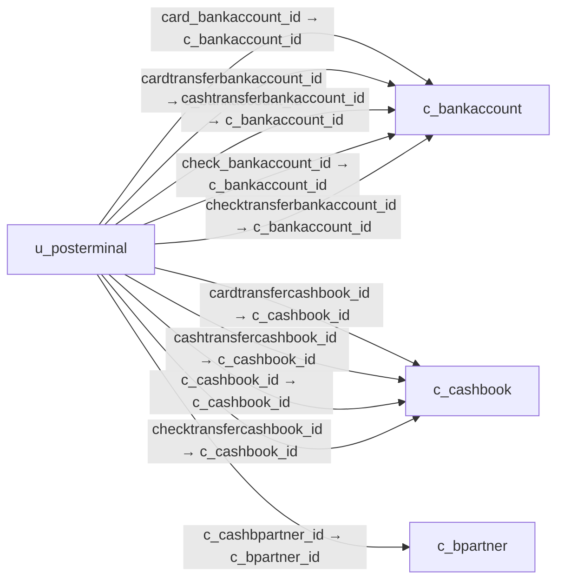

# u_posterminal — 판매시점 단말기

[전체 일람](../TABLE_INDEX.md) · [분류 일람](README.md) · [AI 사용 안내](../README.md) · [외래키 읽는 법](../RELATIONSHIPS.md)

## 기본 정보

| 항목 | 내용 |
|---|---|
| 물리명 | `adempiere.u_posterminal` |
| 한국어 논리명(문서용 해석) | 판매시점 단말기 |
| 원본 논리명 | POS Terminal |
| 원본 사전 ID | 52004 |
| 분류 | `u` — POS·수표 제한·웹 메뉴 설정 |
| 전체 테넌트 행 수 | 1 |
| 물리 열 수 | 37 |
| 나가는 FK / 들어오는 FK | 15 / 0 |
| 구조·행 수 확인 시점 | 2026-11-03T23:29:01+09:00 |

## 의미와 쓰임

POS 단말기의 창고·가격표·담당자·프린터 및 현금·카드·수표 결제 연결 설정을 저장한다.

- 설명 근거: 물리명·열·외래키 구조를 근거로 보수적으로 해석.
- 한국어 이름과 개요는 문서용 해석입니다. 공식 한국어 번역으로 간주하지 않습니다.
- 원본 설명: —
- 원본 도움말: —
- PostgreSQL 테이블 주석: —

## 키와 열

### 기본키·고유 제약조건

| 종류 | 제약조건 | 열(순서 유지) |
|---|---|---|
| PRIMARY KEY | `u_posterminal_key` | `u_posterminal_id` |
| UNIQUE | `u_posterminal_uu_idx` | `u_posterminal_uu` |
| UNIQUE | `u_posterminal_value` | `ad_client_id`, `value` |

### 열 목록

원본 논리명·설명은 `AD_Column`에서 가져왔습니다. 기본값은 실제 PostgreSQL 메타데이터이며, 비어 있는 항목은 `—`로 표시합니다.

| 순서 | 물리명 | 원본 논리명 | PostgreSQL 타입 | NULL | PK | 기본값 | 설명 |
|---:|---|---|---|---|---|---|---|
| 1 | `ad_client_id` | Tenant | numeric(10,0) | 불가 | — | NULL::numeric | Tenant for this installation. |
| 2 | `ad_org_id` | Organization | numeric(10,0) | 불가 | — | NULL::numeric | Organizational entity within tenant |
| 3 | `autolock` | Auto Lock | character(1) | 불가 | — | 'N'::bpchar | Whether to automatically lock the terminal when till is closed |
| 4 | `card_bankaccount_id` | Card Bank Account | numeric(10,0) | 허용 | — | — | Bank Account on which card transactions will be processed |
| 5 | `cardtransferbankaccount_id` | Transfer Card trx to | numeric(10,0) | 허용 | — | — | Bank account on which to transfer Card transactions |
| 6 | `cardtransfercashbook_id` | Transfer Card trx to | numeric(10,0) | 허용 | — | — | Cash Book on which to transfer all Card transactions |
| 7 | `cardtransfertype` | Card Transfer Type | character(1) | 허용 | — | — | — |
| 8 | `cashbooktransfertype` | Cash Book Transfer Type | character(1) | 불가 | — | — | Where the money in the cash book should be transferred to. Either a Bank Account or another Cash Book |
| 9 | `cashtransferbankaccount_id` | Transfer Cash trx to | numeric(10,0) | 허용 | — | — | Bank Account on which to transfer all Cash transactions |
| 10 | `cashtransfercashbook_id` | Transfer Cash trx to | numeric(10,0) | 허용 | — | — | Cash Book on which to transfer all Cash transactions |
| 11 | `c_cashbook_id` | Cash Book | numeric(10,0) | 불가 | — | — | Cash Book for recording petty cash transactions |
| 12 | `c_cashbpartner_id` | Cash BPartner | numeric(10,0) | 불가 | — | — | BPartner to be used for Cash transactions |
| 13 | `check_bankaccount_id` | Check Bank Account | numeric(10,0) | 허용 | — | — | Bank Account to be used for processing Check transactions |
| 14 | `checktransferbankaccount_id` | Transfer Check trx to | numeric(10,0) | 허용 | — | — | Bank account on which to transfer Check transactions |
| 15 | `checktransfercashbook_id` | Transfer Check trx to | numeric(10,0) | 허용 | — | — | Cash Book on which to transfer all Check transactions |
| 16 | `checktransfertype` | Check Transfer Type | character(1) | 허용 | — | — | — |
| 17 | `created` | Created | timestamp without time zone | 불가 | — | statement_timestamp() | Date this record was created |
| 18 | `createdby` | Created By | numeric(10,0) | 불가 | — | — | User who created this records |
| 19 | `c_templatebpartner_id` | Template BPartner | numeric(10,0) | 허용 | — | — | BPartner that is to be used as template when new customers are created |
| 20 | `description` | Description | character varying(255) | 허용 | — | — | Optional short description of the record |
| 21 | `help` | Comment/Help | character varying(2000) | 허용 | — | — | Comment or Hint |
| 22 | `isactive` | Active | character(1) | 허용 | — | 'Y'::bpchar | The record is active in the system |
| 23 | `lastlocktime` | Last Lock Time | timestamp without time zone | 허용 | — | — | Last time at which the terminal was locked |
| 24 | `locked` | Locked | character(1) | 허용 | — | 'N'::bpchar | Whether the terminal is locked |
| 25 | `locktime` | Lock Time | numeric(10,0) | 허용 | — | — | Time in minutes the terminal should be kept in a locked state. |
| 26 | `m_warehouse_id` | Warehouse | numeric(10,0) | 허용 | — | — | Storage Warehouse and Service Point |
| 27 | `name` | Name | character varying(60) | 허용 | — | — | Alphanumeric identifier of the entity |
| 28 | `po_pricelist_id` | Purchase Price List | numeric(10,0) | 허용 | — | — | Price List used by this Business Partner |
| 29 | `printername` | Printer Name | character varying(60) | 허용 | — | — | Name of the Printer |
| 30 | `salesrep_id` | Sales Representative | numeric(10,0) | 허용 | — | — | Sales Representative or Company Agent |
| 31 | `so_pricelist_id` | Sales Price List | numeric(10,0) | 허용 | — | — | — |
| 32 | `unlockingtime` | Unlocking Time | timestamp without time zone | 허용 | — | — | Time at which the terminal should be unlocked |
| 33 | `updated` | Updated | timestamp without time zone | 불가 | — | statement_timestamp() | Date this record was updated |
| 34 | `updatedby` | Updated By | numeric(10,0) | 허용 | — | — | User who updated this records |
| 35 | `u_posterminal_id` | POS Terminal | numeric(10,0) | 불가 | 예 | — | — |
| 36 | `value` | Search Key | character varying(40) | 허용 | — | — | Search key for the record in the format required - must be unique |
| 37 | `u_posterminal_uu` | U_POSTerminal_UU | uuid | 허용 | — | — | — |

## 외래키 흐름

화살표는 **FK를 가진 자식 → 참조되는 부모**입니다. 업무 처리의 시간 순서나 무조건적인 1:N 관계를 뜻하지 않습니다.

주변 관계 15개 중 10개를 그림으로 표시합니다. **전체 관계는 아래 두 표에 모두 포함**합니다.

### 이 테이블이 참조하는 부모 — 나가는 FK

| 제약조건 | 참조하는 쪽(자식) | 자식 열 | 참조받는 쪽(부모) | 부모 열 | 삭제 / 갱신 | 검증 / 지연 가능 |
|---|---|---|---|---|---|---|
| `cardbankaccount_uposterminal` <!-- FK_OUT: adempiere.u_posterminal.cardbankaccount_uposterminal --> | [`u_posterminal`](u_posterminal.md) | `card_bankaccount_id` | [`c_bankaccount`](../c/c_bankaccount.md) | `c_bankaccount_id` | NO ACTION / NO ACTION | 완료 / 가능 (초기 지연) |
| `cardtransferbankaccount_uposte` <!-- FK_OUT: adempiere.u_posterminal.cardtransferbankaccount_uposte --> | [`u_posterminal`](u_posterminal.md) | `cardtransferbankaccount_id` | [`c_bankaccount`](../c/c_bankaccount.md) | `c_bankaccount_id` | NO ACTION / NO ACTION | 완료 / 가능 (초기 지연) |
| `cardtransfercashbook_upostermi` <!-- FK_OUT: adempiere.u_posterminal.cardtransfercashbook_upostermi --> | [`u_posterminal`](u_posterminal.md) | `cardtransfercashbook_id` | [`c_cashbook`](../c/c_cashbook.md) | `c_cashbook_id` | NO ACTION / NO ACTION | 완료 / 가능 (초기 지연) |
| `cashtransferbankaccount_uposte` <!-- FK_OUT: adempiere.u_posterminal.cashtransferbankaccount_uposte --> | [`u_posterminal`](u_posterminal.md) | `cashtransferbankaccount_id` | [`c_bankaccount`](../c/c_bankaccount.md) | `c_bankaccount_id` | NO ACTION / NO ACTION | 완료 / 가능 (초기 지연) |
| `cashtransfercashbook_upostermi` <!-- FK_OUT: adempiere.u_posterminal.cashtransfercashbook_upostermi --> | [`u_posterminal`](u_posterminal.md) | `cashtransfercashbook_id` | [`c_cashbook`](../c/c_cashbook.md) | `c_cashbook_id` | NO ACTION / NO ACTION | 완료 / 가능 (초기 지연) |
| `ccashbook_uposterminal` <!-- FK_OUT: adempiere.u_posterminal.ccashbook_uposterminal --> | [`u_posterminal`](u_posterminal.md) | `c_cashbook_id` | [`c_cashbook`](../c/c_cashbook.md) | `c_cashbook_id` | NO ACTION / NO ACTION | 완료 / 가능 (초기 지연) |
| `ccashbpartner_uposterminal` <!-- FK_OUT: adempiere.u_posterminal.ccashbpartner_uposterminal --> | [`u_posterminal`](u_posterminal.md) | `c_cashbpartner_id` | [`c_bpartner`](../c/c_bpartner.md) | `c_bpartner_id` | NO ACTION / NO ACTION | 완료 / 가능 (초기 지연) |
| `checkbankaccount_uposterminal` <!-- FK_OUT: adempiere.u_posterminal.checkbankaccount_uposterminal --> | [`u_posterminal`](u_posterminal.md) | `check_bankaccount_id` | [`c_bankaccount`](../c/c_bankaccount.md) | `c_bankaccount_id` | NO ACTION / NO ACTION | 완료 / 가능 (초기 지연) |
| `checktransferbankaccount_upost` <!-- FK_OUT: adempiere.u_posterminal.checktransferbankaccount_upost --> | [`u_posterminal`](u_posterminal.md) | `checktransferbankaccount_id` | [`c_bankaccount`](../c/c_bankaccount.md) | `c_bankaccount_id` | NO ACTION / NO ACTION | 완료 / 가능 (초기 지연) |
| `checktransfercashbook_uposterm` <!-- FK_OUT: adempiere.u_posterminal.checktransfercashbook_uposterm --> | [`u_posterminal`](u_posterminal.md) | `checktransfercashbook_id` | [`c_cashbook`](../c/c_cashbook.md) | `c_cashbook_id` | NO ACTION / NO ACTION | 완료 / 가능 (초기 지연) |
| `ctemplatebpartner_uposterminal` <!-- FK_OUT: adempiere.u_posterminal.ctemplatebpartner_uposterminal --> | [`u_posterminal`](u_posterminal.md) | `c_templatebpartner_id` | [`c_bpartner`](../c/c_bpartner.md) | `c_bpartner_id` | NO ACTION / NO ACTION | 완료 / 가능 (초기 지연) |
| `mwarehouse_uposterminal` <!-- FK_OUT: adempiere.u_posterminal.mwarehouse_uposterminal --> | [`u_posterminal`](u_posterminal.md) | `m_warehouse_id` | [`m_warehouse`](../m/m_warehouse.md) | `m_warehouse_id` | NO ACTION / NO ACTION | 완료 / 가능 (초기 지연) |
| `popricelist_uposterminal` <!-- FK_OUT: adempiere.u_posterminal.popricelist_uposterminal --> | [`u_posterminal`](u_posterminal.md) | `po_pricelist_id` | [`m_pricelist`](../m/m_pricelist.md) | `m_pricelist_id` | NO ACTION / NO ACTION | 완료 / 가능 (초기 지연) |
| `salesrep_uposterminal` <!-- FK_OUT: adempiere.u_posterminal.salesrep_uposterminal --> | [`u_posterminal`](u_posterminal.md) | `salesrep_id` | [`ad_user`](../ad/ad_user.md) | `ad_user_id` | NO ACTION / NO ACTION | 완료 / 가능 (초기 지연) |
| `sopricelist_uposterminal` <!-- FK_OUT: adempiere.u_posterminal.sopricelist_uposterminal --> | [`u_posterminal`](u_posterminal.md) | `so_pricelist_id` | [`m_pricelist`](../m/m_pricelist.md) | `m_pricelist_id` | NO ACTION / NO ACTION | 완료 / 가능 (초기 지연) |

### 이 테이블을 참조하는 자식 — 들어오는 FK

해당 방향의 물리 FK 제약조건은 없습니다. 이름이 비슷한 열만으로 관계를 추가하지 않습니다.

## 조회 시 주의

- FK 표의 자식 열과 부모 열을 같은 순서로 대응시킵니다. 복합 FK는 모든 열의 동등 조건을 `AND`로 연결합니다.
- 테이블 이름이나 `_id` 열 이름만으로 물리 FK가 있다고 가정하지 않습니다. FK 미선언은 업무 관계가 없다는 뜻도 아닙니다.
- 자식이 여러 행인 테이블과 조인하면 부모의 금액·건수가 중복될 수 있습니다. 집계 단위를 먼저 정합니다.
- `ad_client_id`가 있습니다. 업무 분석에서는 대상 테넌트를 명시합니다. GardenWorld는 `11`, 시스템 공통 설정은 `0`일 수 있으므로 일괄 필터 적용 전에 테이블 역할을 확인합니다.
- 행 수는 위 확인 시점의 전체 테넌트 값입니다. 최신 업무 실적이나 현재 실행 결과로 재사용하지 않습니다.
