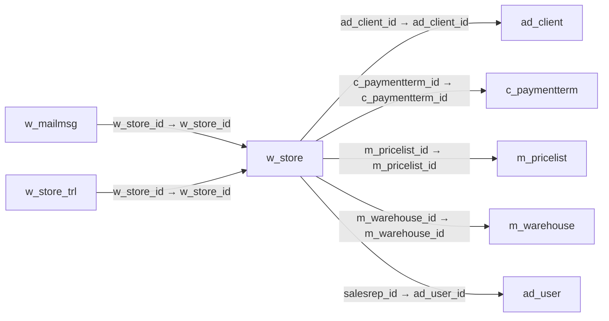

# w_store — 웹 상점

[전체 일람](../TABLE_INDEX.md) · [분류 일람](README.md) · [AI 사용 안내](../README.md) · [외래키 읽는 법](../RELATIONSHIPS.md)

## 기본 정보

| 항목 | 내용 |
|---|---|
| 물리명 | `adempiere.w_store` |
| 한국어 논리명(문서용 해석) | 웹 상점 |
| 원본 논리명 | Web Store |
| 원본 사전 ID | 778 |
| 분류 | `w` — 웹 상점·카운터 |
| 전체 테넌트 행 수 | 1 |
| 물리 열 수 | 43 |
| 나가는 FK / 들어오는 FK | 5 / 2 |
| 구조·행 수 확인 시점 | 2026-11-03T23:29:01+09:00 |

## 의미와 쓰임

테넌트가 운영하는 웹 상점의 기본 정보를 정의한다.

- 설명 근거: 원본 애플리케이션 사전 명칭·설명을 한국어로 해석.
- 한국어 이름과 개요는 문서용 해석입니다. 공식 한국어 번역으로 간주하지 않습니다.
- 원본 설명: A Web Store of the Client
- 원본 도움말: —
- PostgreSQL 테이블 주석: —

## 키와 열

### 기본키·고유 제약조건

| 종류 | 제약조건 | 열(순서 유지) |
|---|---|---|
| PRIMARY KEY | `w_store_pkey` | `w_store_id` |
| UNIQUE | `w_store_uu_idx` | `w_store_uu` |

### 별도 고유 인덱스

PK·UNIQUE 제약조건의 인덱스와 별도로 존재하는 고유 인덱스입니다. 식·조건·열 순서는 원본 정의를 따릅니다.

- `w_store_webcontext`: `CREATE UNIQUE INDEX w_store_webcontext ON adempiere.w_store USING btree (webcontext)`

### 열 목록

원본 논리명·설명은 `AD_Column`에서 가져왔습니다. 기본값은 실제 PostgreSQL 메타데이터이며, 비어 있는 항목은 `—`로 표시합니다.

| 순서 | 물리명 | 원본 논리명 | PostgreSQL 타입 | NULL | PK | 기본값 | 설명 |
|---:|---|---|---|---|---|---|---|
| 1 | `w_store_id` | Web Store | numeric(10,0) | 불가 | 예 | — | A Web Store of the Tenant |
| 2 | `ad_client_id` | Tenant | numeric(10,0) | 불가 | — | — | Tenant for this installation. |
| 3 | `ad_org_id` | Organization | numeric(10,0) | 불가 | — | — | Organizational entity within tenant |
| 4 | `isactive` | Active | character(1) | 불가 | — | 'Y'::bpchar | The record is active in the system |
| 5 | `created` | Created | timestamp without time zone | 불가 | — | now() | Date this record was created |
| 6 | `createdby` | Created By | numeric(10,0) | 불가 | — | — | User who created this records |
| 7 | `updated` | Updated | timestamp without time zone | 불가 | — | now() | Date this record was updated |
| 8 | `updatedby` | Updated By | numeric(10,0) | 불가 | — | — | User who updated this records |
| 9 | `name` | Name | character varying(60) | 불가 | — | — | Alphanumeric identifier of the entity |
| 10 | `description` | Description | character varying(255) | 허용 | — | — | Optional short description of the record |
| 11 | `help` | Comment/Help | character varying(2000) | 허용 | — | — | Comment or Hint |
| 12 | `wstoreemail` | Web Store EMail | character varying(60) | 허용 | — | — | EMail address used as the sender (From) |
| 13 | `wstoreuser` | WebStore User | character varying(60) | 허용 | — | — | User ID of the Web Store EMail address |
| 14 | `wstoreuserpw` | WebStore Password | character varying(20) | 허용 | — | — | Password of the Web Store EMail address |
| 15 | `webinfo` | Web Store Info | character varying(2000) | 허용 | — | — | Web Store Header Information |
| 16 | `webparam1` | Web Parameter 1 | character varying(2000) | 허용 | — | — | Web Site Parameter 1 (default: header image) |
| 17 | `webparam2` | Web Parameter 2 | character varying(2000) | 허용 | — | — | Web Site Parameter 2 (default index page) |
| 18 | `webparam3` | Web Parameter 3 | character varying(2000) | 허용 | — | — | Web Site Parameter 3 (default left - menu) |
| 19 | `webparam4` | Web Parameter 4 | character varying(2000) | 허용 | — | — | Web Site Parameter 4 (default footer left) |
| 20 | `webparam5` | Web Parameter 5 | character varying(2000) | 허용 | — | — | Web Site Parameter 5 (default footer center) |
| 21 | `webparam6` | Web Parameter 6 | character varying(2000) | 허용 | — | — | Web Site Parameter 6 (default footer right) |
| 22 | `ismenuassets` | Menu Assets | character(1) | 불가 | — | 'Y'::bpchar | Show Menu Assets |
| 23 | `ismenuorders` | Menu Orders | character(1) | 불가 | — | 'Y'::bpchar | Show Menu Orders |
| 24 | `ismenuinvoices` | Menu Invoices | character(1) | 불가 | — | 'Y'::bpchar | Show Menu Invoices |
| 25 | `ismenushipments` | Menu Shipments | character(1) | 불가 | — | 'Y'::bpchar | Show Menu Shipments |
| 26 | `ismenupayments` | Menu Payments | character(1) | 불가 | — | 'Y'::bpchar | Show Menu Payments |
| 27 | `ismenurfqs` | Menu RfQs | character(1) | 불가 | — | 'Y'::bpchar | Show Menu RfQs |
| 28 | `ismenurequests` | Menu Requests | character(1) | 불가 | — | 'Y'::bpchar | Show Menu Requests |
| 29 | `ismenuinterests` | Menu Interests | character(1) | 불가 | — | 'Y'::bpchar | Show Menu Interests |
| 30 | `ismenuregistrations` | Menu Registrations | character(1) | 불가 | — | 'Y'::bpchar | Show Menu Registrations |
| 31 | `ismenucontact` | Menu Contact | character(1) | 불가 | — | 'Y'::bpchar | Show Menu Contact |
| 32 | `emailheader` | EMail Header | character varying(2000) | 허용 | — | — | Header added to EMails |
| 33 | `emailfooter` | EMail Footer | character varying(2000) | 허용 | — | — | Footer added to EMails |
| 34 | `salesrep_id` | Sales Representative | numeric(10,0) | 불가 | — | — | Sales Representative or Company Agent |
| 35 | `m_warehouse_id` | Warehouse | numeric(10,0) | 불가 | — | — | Storage Warehouse and Service Point |
| 36 | `m_pricelist_id` | Price List | numeric(10,0) | 불가 | — | — | Unique identifier of a Price List |
| 37 | `webcontext` | Web Context | character varying(20) | 불가 | — | — | Web Server Context - e.g. /wstore |
| 38 | `weborderemail` | Web Order EMail | character varying(60) | 허용 | — | — | EMail address to receive notifications when web orders were processed |
| 39 | `c_paymentterm_id` | Payment Term | numeric(10,0) | 허용 | — | — | The terms of Payment (timing, discount) |
| 40 | `isdefault` | Default | character(1) | 불가 | — | 'N'::bpchar | Default value |
| 41 | `url` | URL | character varying(120) | 불가 | — | 'http://localhost'::character varying | Full URL address - e.g. http://www.idempiere.org |
| 42 | `stylesheet` | Stylesheet | character varying(60) | 허용 | — | — | CSS (Stylesheet) used |
| 43 | `w_store_uu` | W_Store_UU | uuid | 허용 | — | — | — |

## 외래키 흐름

화살표는 **FK를 가진 자식 → 참조되는 부모**입니다. 업무 처리의 시간 순서나 무조건적인 1:N 관계를 뜻하지 않습니다.

주변 관계 7개 중 7개를 그림으로 표시합니다. **전체 관계는 아래 두 표에 모두 포함**합니다.

### 이 테이블이 참조하는 부모 — 나가는 FK

| 제약조건 | 참조하는 쪽(자식) | 자식 열 | 참조받는 쪽(부모) | 부모 열 | 삭제 / 갱신 | 검증 / 지연 가능 |
|---|---|---|---|---|---|---|
| `adclient_wstore` <!-- FK_OUT: adempiere.w_store.adclient_wstore --> | [`w_store`](w_store.md) | `ad_client_id` | [`ad_client`](../ad/ad_client.md) | `ad_client_id` | NO ACTION / NO ACTION | 완료 / 가능 (초기 지연) |
| `cpaymentterm_wstore` <!-- FK_OUT: adempiere.w_store.cpaymentterm_wstore --> | [`w_store`](w_store.md) | `c_paymentterm_id` | [`c_paymentterm`](../c/c_paymentterm.md) | `c_paymentterm_id` | NO ACTION / NO ACTION | 완료 / 가능 (초기 지연) |
| `mpricelist_wstore` <!-- FK_OUT: adempiere.w_store.mpricelist_wstore --> | [`w_store`](w_store.md) | `m_pricelist_id` | [`m_pricelist`](../m/m_pricelist.md) | `m_pricelist_id` | NO ACTION / NO ACTION | 완료 / 가능 (초기 지연) |
| `mwarehouse_wstore` <!-- FK_OUT: adempiere.w_store.mwarehouse_wstore --> | [`w_store`](w_store.md) | `m_warehouse_id` | [`m_warehouse`](../m/m_warehouse.md) | `m_warehouse_id` | NO ACTION / NO ACTION | 완료 / 가능 (초기 지연) |
| `salesrep_wstore` <!-- FK_OUT: adempiere.w_store.salesrep_wstore --> | [`w_store`](w_store.md) | `salesrep_id` | [`ad_user`](../ad/ad_user.md) | `ad_user_id` | NO ACTION / NO ACTION | 완료 / 가능 (초기 지연) |

### 이 테이블을 참조하는 자식 — 들어오는 FK

| 제약조건 | 참조하는 쪽(자식) | 자식 열 | 참조받는 쪽(부모) | 부모 열 | 삭제 / 갱신 | 검증 / 지연 가능 |
|---|---|---|---|---|---|---|
| `wstore_wmailmsg` <!-- FK_IN: adempiere.w_mailmsg.wstore_wmailmsg --> | [`w_mailmsg`](w_mailmsg.md) | `w_store_id` | [`w_store`](w_store.md) | `w_store_id` | CASCADE / NO ACTION | 완료 / 가능 (초기 지연) |
| `wstore_wstoretrl` <!-- FK_IN: adempiere.w_store_trl.wstore_wstoretrl --> | [`w_store_trl`](w_store_trl.md) | `w_store_id` | [`w_store`](w_store.md) | `w_store_id` | CASCADE / NO ACTION | 완료 / 가능 (초기 지연) |

## 조회 시 주의

- FK 표의 자식 열과 부모 열을 같은 순서로 대응시킵니다. 복합 FK는 모든 열의 동등 조건을 `AND`로 연결합니다.
- 테이블 이름이나 `_id` 열 이름만으로 물리 FK가 있다고 가정하지 않습니다. FK 미선언은 업무 관계가 없다는 뜻도 아닙니다.
- 자식이 여러 행인 테이블과 조인하면 부모의 금액·건수가 중복될 수 있습니다. 집계 단위를 먼저 정합니다.
- `ad_client_id`가 있습니다. 업무 분석에서는 대상 테넌트를 명시합니다. GardenWorld는 `11`, 시스템 공통 설정은 `0`일 수 있으므로 일괄 필터 적용 전에 테이블 역할을 확인합니다.
- 행 수는 위 확인 시점의 전체 테넌트 값입니다. 최신 업무 실적이나 현재 실행 결과로 재사용하지 않습니다.
