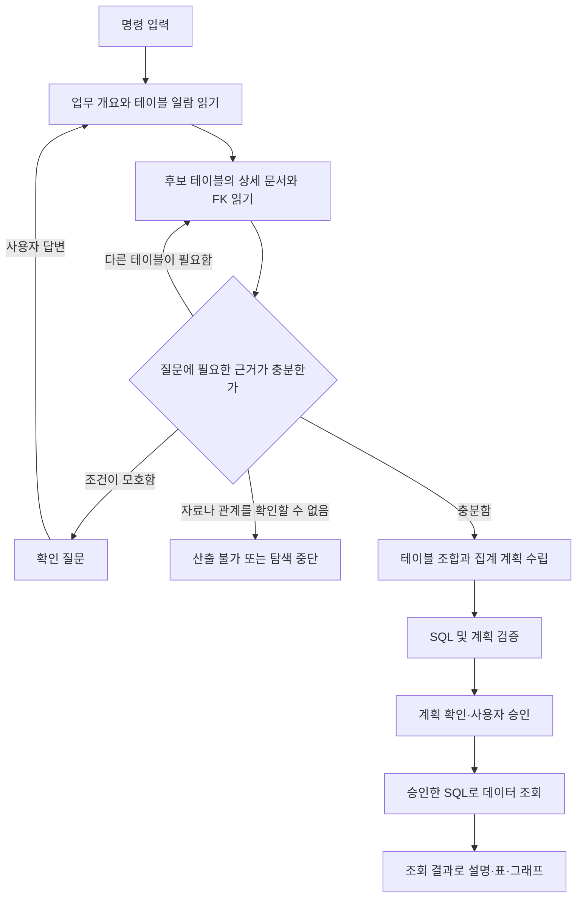
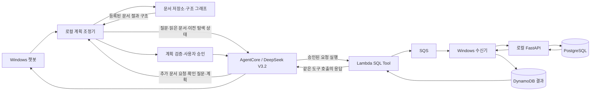

# 테이블 문서와 관계를 먼저 읽는 조회 흐름 설계

작성일: 2026-11-03. 상태: **설계 완료, 기능 구현·AWS 배포·실행 검증 전**.

사용자 요구는 **명령 → 테이블 구성도 읽기 → 관계를 조합해 계획 수립 → 데이터 가져오기**다. 여기서 명령은 자연어 분석 질문이며, 테이블 구성도는 [전체 일람](../database/idempiere/TABLE_INDEX.md), [업무별 개요](../database/idempiere/BUSINESS_GUIDE.md), 테이블별 문서의 열·키·양방향 FK를 뜻한다. 기존의 계획 검토·사용자 승인은 계획과 데이터 조회 사이에 유지한다.

## 1. 사용자가 경험할 순서



핵심 규칙은 **문서 탐색을 통과해야 SQL 계획을 만들 수 있고, 승인한 계획만 조회할 수 있다**는 것이다. AI에게 순서대로 하라고 프롬프트에 적는 것과 별개로, 로컬 상태 전이와 검증기로 이 규칙을 강제한다.

| 단계 | AI가 하는 일 | 시스템이 확인하는 것 | 사용자에게 보이는 것 |
|---|---|---|---|
| 명령 | 원하는 지표·기간·대상·표현 방법을 파악 | 원문·이전 조건·작업 ID 보관 | 원래 질문 |
| 구성도 읽기 | 업무별 개요에서 후보를 찾고 상세 문서·관계 추가 요청 | 실제로 읽어 전달한 문서와 해시, 열·FK 존재 | 참고 중인 테이블과 간단한 용도 |
| 조합·계획 | 필요한 테이블, 조인, 집계 단위와 조건을 구성 | 읽은 근거와 SQL의 일치, 중복 집계·조건 누락 | 조인 경로, 적용 조건, 지표 정의, SQL, 예상 표·그래프 |
| 데이터 가져오기 | 승인된 요청의 SQL 실행 도구를 호출 | 승인·버전·만료·읽기 전용·제한 | 조회 상태와 실제 결과 |

계획 설명은 검토에 필요한 근거·선택 이유·처리 단계를 제공한다. 내부 사고과정의 상세 기록을 생성하거나 사용자에게 표시하지 않는다.

## 2. 현재 구현과 바뀌는 부분

| 부분 | 현재 코드에서 확인한 동작 | 설계에서 추가할 동작 |
|---|---|---|
| 테이블 탐색 | `AgentPlanner.plan()`이 JSON 요약을 보내 최대 12개 선택 | 한국어 일람·업무 개요를 사용하고 상세 Markdown 읽기 단계를 별도로 수행 |
| 관계 확장 | `selected_catalog()`가 선택 테이블의 1단계 FK 부모를 최대 32개까지 추가 | 부모·자식·중간 연결 테이블을 탐색하고 선택 이유와 조인 경로를 보관 |
| SQL 계획 | 선택된 JSON 카탈로그에서 곧바로 계획 생성 | 문서 읽기·근거 충분성 확인 후 계획 생성 |
| 계획 응답 | `/v1/plans`가 계획 하나를 동기 응답하고 저장 | 탐색 진행·추가 질문·산출 불가·승인 가능한 계획을 구분 |
| 버전 확인 | `schema_version`과 계획 digest 확인 | 구조 버전·참고 문서 버전·읽기 증거를 계획 digest에 추가 |
| SQL 검사 | 단일 읽기 전용 문장·함수·테이블·매개변수 검사 | 사용 열, 승인된 조인 조건, 집계 의미와 문서 근거도 검사 |
| 데이터 경로 | AgentCore → Lambda → SQS → Windows → PostgreSQL | 기존 경로 유지 |

현재 `schema_version`은 행 수·설명도 포함한 전체 카탈로그 해시이며, 문서의 `snapshot_sha256`과 같은 값이 아니다. 두 해시를 직접 비교해서 최신 여부를 판정하지 않는다.

## 3. 구성요소와 책임



AWS Agent가 Windows 파일 경로에 직접 접근하는 방식은 사용하지 않는다. **로컬 조정기가 요청받은 Markdown을 읽어 필요한 내용을 AWS Agent에 전달**한다. Agent는 실제로 받은 문서와 구조만 사용한다. 문서 탐색에는 SQL 실행 도구를 제공하지 않으며, Lambda는 승인 후 SQL 실행과 결과 대기만 담당한다. Agent가 DynamoDB를 직접 폴링하지 않는다.

| 구성요소 | 역할 | 저장·전달 범위 |
|---|---|---|
| `SchemaDocumentRepository` 신규 | 문서 ID를 경로로 매핑하고 해시·경로 검사, 절 단위 읽기 | `docs/database/idempiere`에 등록된 문서만 |
| `SchemaGraph` 신규 | 실제 열·PK·UNIQUE·FK 그래프, 양방향 이웃 탐색 | 같은 DB 스냅샷에서 생성한 구조화 데이터 |
| `PlanningCoordinator` 신규 | 단계·질문·탐색 예산·읽기 기록·취소 관리 | 로컬 작업 저장소; 모델 세션 기억에 의존하지 않음 |
| AgentCore의 탐색 단계 확장 | 필요한 테이블과 문서 절을 선택하고 근거 충분성 판단 | 명시적으로 전달한 문서·구조·이전 상태 |
| `QueryPlanValidator` 신규 | 문서 근거·조인·열·집계·조건과 SQL 일치 검사 | 기존 SQL 정책 검사와 함께 사용 |
| 기존 승인·실행 구성 | 승인 digest와 정확히 같은 SQL 실행, 결과 전달 | 기존 요청 ID·TTL·중복 방지·outbox 유지 |

모델은 `aws/config/models.json`의 DeepSeek V3.2, 도쿄 리전을 유지한다. 초기 문서 검색에는 키워드·논리명·물리명·업무 분류와 관계 그래프를 사용한다. Titan 임베딩 설정은 유지하지만 이 설계를 위해 벡터 검색을 필수로 추가하지 않는다.

## 4. 테이블 구성도를 읽는 방법

### 4.1 문서와 구조 데이터 준비

현재 문서는 912개 테이블·28개 폴더다. 매 질문마다 전체 Markdown을 모델에 넣지 않는다.

1. 기존 문서 생성기를 확장해 같은 스냅샷에서 `schema_graph.json`과 `document_index.json`을 추가 생성한다. 이 두 파일은 **구현 예정**이다.
2. `schema_graph.json`에는 물리 테이블·열·타입·NULL·PK·UNIQUE·FK 제약 ID와 열 배열을 넣는다. Mermaid를 파싱해 관계의 기준값으로 사용하지 않는다.
3. `document_index.json`에는 문서 ID, 물리명, 원본·한국어 논리명, 짧은 개요, 업무 분류, 설명 근거, 허용된 경로·절 이름을 넣는다.
4. 문서·그래프·검색 색인은 같은 스냅샷 ID로 묶는다. 새 문서 묶음이 완성·검증된 후 한 번에 활성화해 생성 도중의 신구 파일 혼합을 막는다.
5. 구조 해시는 정렬한 물리명·열·타입·키·FK를 기준으로 계산하고 수집 시각·행 수는 제외한다. 문서 내용 해시는 별도로 관리한다.
6. 기존 JSON 카탈로그와 새 구조의 테이블·열·FK 대응을 검증한다. 불일치하면 `SCHEMA_DOC_MISMATCH`로 탐색을 막는다.

문서의 과거 행 수와 날짜 범위는 탐색 참고 정보다. 현재 결과값이나 정확한 최신 집계로 답하는 근거로 사용하지 않는다. 문서 갱신 시점의 0행 때문에 필수 테이블을 검색에서 제외하지 않는다.

### 4.2 질문마다 필요한 문서만 읽기

1. **업무 탐색:** 업무별 안내와 폴더 요약을 제공해 주문·청구·결제·재고 등 관련 업무를 고른다. 의미가 모호하면 후보를 하나로 단정하지 않는다.
2. **테이블 후보:** 해당 업무의 색인에서 한국어·원본 논리명·물리명을 검색한다. 첫 후보는 최대 12개이며, 검색 결과 밖의 문서도 전체 등록 목록에서 재탐색할 수 있다. 문서가 첫 검색에 없었다는 이유만으로 업무가 없다고 결론내리지 않는다.
3. **상세 읽기:** 후보의 물리명·논리명·개요·근거, 열·키, 관련 FK를 읽는다. 테이블 이름만 전달한 상태는 상세 읽기 완료로 세지 않는다.
4. **관계 확장:** 부모뿐 아니라 자식과 중간 연결 테이블도 찾는다. 전체 3,807개 FK는 로컬 그래프에서 탐색하고, 질문에 필요한 연결만 모델에 전달한다.
5. **경로 검토:** 주문 헤더→상세→제품처럼 필요한 경로를 조합한다. 그래프의 짧은 경로가 업무상 올바른 경로라는 보장은 없으므로 문서의 역할과 질문의 지표를 함께 확인한다. `createdby`·`updatedby` 등 감사 관계를 금액 조인으로 자동 선택하지 않는다.
6. **부족한 부분 읽기:** 모델은 `read_more`, `clarify`, `ready`, `unsupported` 중 하나를 반환한다. 로컬은 허용된 문서만 읽어 다시 전달하고 횟수·크기·시간을 차감한다.

모델의 추가 읽기 응답 예시는 다음과 같다. 파일 경로나 URL을 모델이 직접 지정하게 하지 않는다.

```json
{
  "action": "read_more",
  "documents": [
    {"table": "c_invoice", "sections": ["overview", "columns", "foreign_keys"]},
    {"table": "c_doctype", "sections": ["overview", "columns", "foreign_keys"]}
  ],
  "reason": "청구 금액 기준과 판매 대변전표의 구분을 확인해야 합니다."
}
```

문서 읽기 기록은 모델이 작성한 자기보고를 신뢰하지 않고 로컬이 생성한다. `document_id`, `content_hash`, `sections`, `provided_tables`, `provided_columns`, `provided_fk_ids`, `payload_bytes`를 남긴다. 이것은 **문서를 실제로 제공했다는 증거**이며 모델이 내용을 완전히 이해했다는 증명은 아니다.

**최종 계획 생성과 형식 보정의 각 호출에도 필수 근거를 다시 넣는다.** 탐색 중 한 번 읽었다는 누적 기록이나 AI가 만든 요약만으로 대체하지 않는다. 로컬이 `model_call_id`와 실제 전송한 `fragment_id → content_hash` 집합을 기록하고, 계획에서 쓰는 테이블·열·FK·지표 정의의 근거가 **그 계획을 만든 호출의 payload**에 들어 있었는지 대조한다. 문서의 관련 본문·열 정의·관계와 업무 조건이 크기 한도 때문에 빠졌다면 성공 처리하지 않고 범위를 줄이거나 탐색을 중단한다.

현재 `aws/runtime/main.py`는 모델로 보낼 필드를 명시적으로 선택한다. 구현 시 `schema_documents`, `graph_context`, `context_manifest`를 허용 필드로 추가하고 실제 `converse` 메시지에 포함되는지를 시험한다. 로컬 HTTP payload에만 넣고 모델 메시지에서 누락한 경우는 문서 전달 성공이 아니다.

### 4.3 문서 근거의 권한과 충돌

- 실제 구조는 PostgreSQL 메타데이터가 기준이다. Markdown에만 있는 열·관계는 실행 허용 근거가 될 수 없다.
- 원본 논리명·설명과 한국어 해석을 구분한다. `uncertain` 표시가 있는 의미가 질문의 핵심이면 확인 없이 확정하지 않는다.
- 기존 프롬프트·JSON 업무 규칙과 새 문서 사이의 의미 충돌을 사전에 정리한다. 예를 들어 현재 코드의 `totallines=세전` 단정과 새 문서의 세금 포함 여부 확인 안내는 구현 전에 금액 정의를 통일해야 한다. 서로 모순되는 두 규칙을 동시에 모델에 전달하지 않는다.
- 문서는 데이터다. 문서 본문에 있는 지시가 실행 승인·보안 정책·모델 설정을 바꿀 수 없다.
- 저장소 밖 경로, 경로 순회, 외부 URL, 미등록 문서·절 요청은 거부한다.

## 5. 테이블을 조합해 조회 계획 만들기

상세 읽기가 끝나면 먼저 구조화된 계획을 만들고 그 계획에 맞는 SQL 하나를 생성한다. `ready`는 모델 제안이며 로컬 검증을 통과해야 실제 계획 상태가 된다.

| 계획 필드 | 포함할 내용 |
|---|---|
| 질문 해석 | 지표·대상·기간·결과 형태, 이전 질문에서 계승한 조건 |
| 사용 테이블 | 물리명·역할·읽은 문서 ID |
| 집계 단위 | 주문 헤더/청구 헤더/품목 상세 등 원본 한 행의 의미, 결과 한 행의 의미 |
| 조인 계획 | 좌우 별칭·테이블·열 배열·FK ID·JOIN 종류·선택 이유 |
| 업무 조건 | 테넌트, 판매/구매, 문서 상태, 날짜 기준, 통화, 세금·대변전표 취급 |
| 지표 | 계산식·단위·중복 방지 방법·필요하지만 없는 자료 |
| 결과 계획 | 그룹·정렬·예상 열·차트 축·빈 결과의 설명 |
| 실행 스냅샷 | SQL·매개변수·schema_version·구조 해시·문서 버전·revision |
| 근거 | 사용한 문서 절과 해시, 열·FK 식별자, 로컬 검증 결과 |

검증은 다음 기준으로 수행한다.

1. **참조 가능성:** 모든 실제 테이블·열이 현재 구조에 존재하고, 필요한 테이블 문서를 읽었다. CTE·별칭·계산 열은 원본 열까지 추적한다. 지원하지 못하는 SQL 표현은 검증 성공으로 간주하지 않는다.
2. **조인 근거:** 물리 FK의 자식/부모 방향과 열 배열을 보존한다. 복합 FK는 모든 열을 AND로 연결한다. FK가 없는 업무 관계·동적 `record_id` 관계는 초기 구현에서 자동 추정하지 않고 `RELATION_UNRESOLVED`로 중단한다. 조인이 필요 없는 단일 테이블 조회는 허용한다.
3. **집계 의미:** FK가 존재해도 금액 중복이 생길 수 있다. 헤더 합계를 상세 조인 뒤 재합산하지 않도록 사전 집계·EXISTS·상세 금액 중 질문에 맞는 방법을 계획에 명시한다. 팬아웃 경고를 단순히 DISTINCT 추가로 없애지 않는다.
4. **조건 확정:** 주문일/청구일/회계일, 주문액/청구액/입금액 등 결과가 달라지는 선택은 확인 질문으로 해소한다. 확정된 기본값은 화면에 표시하고 후속 질문에서도 보존한다.
5. **SQL 일치:** 구조화된 계획의 지표·필터·조인·그룹과 SQL AST가 일치해야 한다. 기존 단일 SELECT·허용 함수·바인딩 정책을 함께 적용한다.
6. **한계 표시:** 존재하지 않는 판매자 계정이나 자료가 부족한 순이익을 다른 열로 바꿔 답하지 않는다. 데이터가 없다는 것과 자료를 조회하지 못했다는 것을 구분한다.

기계 검증으로 모든 업무 의미가 증명되지는 않는다. 검증 항목별 통과·경고·미지원 범위를 기록하고 최종 조건은 사용자가 검토한다.

### 계획 승인과 변경

- `plan_ready`일 때만 기존 승인 UI와 `/v1/executions`로 이어진다. 확인 질문·탐색 진행 결과를 `store.save_plan()`에 완성 계획처럼 저장하지 않는다.
- 자연어 계획에는 `planning_contract_version=2`, `planning_id`, `generation_call_id`, `context_manifest_hash`를 추가한다. `/v1/executions`는 클라이언트가 보낸 상태를 믿지 않고 저장된 탐색 작업의 `plan_ready`, 최종 호출의 근거 집합, 전체 검증 통과, 최신 revision과 digest를 서버에서 대조한 뒤에만 승인·dispatch한다.
- 옛 자연어 계획이나 기존 동기 경로에서 만들어진 근거 없는 계획은 새 흐름으로 다시 계획해야 한다. 별도로 표시된 `local_sample`은 고정 샘플 모드의 기존 승인을 유지하며, 문서를 읽은 자연어 계획으로 표시하거나 사용자가 `provenance`를 바꿔 우회할 수 없게 한다.
- 문서 원문은 로컬 탐색 기록에 보관하고, 승인 계획에는 문서 해시·절 ID·테이블·열·FK와 필요한 요약만 넣는다. 실행 계약의 기존 **98,304바이트** 제한 안에 둔다.
- SQL·조건·참고 문서 버전·구조·revision 중 승인 근거가 변경되면 새 계획과 새 승인이 필요하다.
- 계획 시작과 실행 직전에 로컬 DB 구조 메타데이터를 읽어 구조 해시를 확인한다. 승인 전 업무 데이터 미리보기 SQL은 실행하지 않는다. 구조 확인에 실패하면 오래된 파일만 믿고 실행하지 않는다.
- 실행 직전에도 문서 묶음·계획 digest를 확인한다. 구조 재검사 이후의 동시 DDL 등으로 SQL이 실패하면 명시적 실패로 보존하며 자동 SQL 수정·재실행은 하지 않는다.

## 6. 진행 상태·화면·API

읽기 반복이 생기므로 자연어 계획 생성은 **비동기 작업**으로 설계한다. 지금의 긴 `/v1/plans` 요청 한 번 안에 탐색 반복을 계속 추가하지 않는다.

```text
queued → reading_schema → composing_plan → plan_ready
                 ↕               │
        needs_clarification        ├→ blocked / failed

plan_ready → 사용자 승인 → 기존 실행 작업 → 결과
```

| 제안 API | 동작 |
|---|---|
| `POST /v1/planning-runs` | 질문·이전 계획·클라이언트 요청 ID로 시작, 202와 `planning_id` 반환 |
| `GET /v1/planning-runs/{id}` | 단계·읽은 테이블·확인 질문·완성 계획 조회 |
| `POST /v1/planning-runs/{id}/answers` | 질문 ID와 답변을 전달해 탐색 재개; 중복 제출 방지 |
| `POST /v1/planning-runs/{id}/cancel` | 계획 작업 중단; 이미 전송한 모델 호출의 과금 취소를 보장하지 않음 |
| 기존 `POST /v1/executions` | 완성 계획의 사용자 승인 후 기존 실행 흐름 |

새 API 이름은 구현 설계안이다. 기존 고정 샘플 경로는 유지한다. 자연어 UI를 새 API로 옮기며, 기존 동기 자연어 경로가 새 문서 검증을 우회하지 못하도록 함께 전환한다.

화면에는 `테이블 찾는 중 → 구성도 읽는 중 → 조합 계획 작성 중 → 계획 확인 → 조회 중 → 결과`를 표시한다. 계획 화면에는 선택 테이블·조인 경로·조건·지표·한계·참고 문서를 보여주고, 기술적인 해시 전체는 상세 확인에 둔다.

계획 작업은 SQLite에 독립적으로 보관한다. 같은 클라이언트 요청 ID의 재전송은 기존 작업을 반환한다. 현재 `AgentPlanner.invoke()`는 호출마다 새 AgentCore 세션을 만들고 종료하므로, 질문·읽기 기록·남은 쟁점·선택 문맥을 로컬이 관리해 각 호출에 전달한다. 확인 질문을 기다릴 때는 모델 세션과 AWS 작업 슬롯을 점유하지 않는다. 프로세스 재시작 시 중간 모델 호출 결과가 불명인 작업은 중단 상태로 표시하고 자동 유료 재호출하지 않는다.

## 7. 데이터 조회와 응답

조회는 기존 연결 구조를 그대로 사용한다.

```text
사용자 승인
→ AWS Agent의 execute_approved_sql(request_id)
→ Lambda가 승인된 계약을 SQS에 등록
→ Windows 수신기가 로컬 FastAPI 호출
→ PostgreSQL 읽기 전용 조회
→ 결과 로컬 보관 및 DynamoDB 전달
→ Lambda가 같은 도구 호출에서 결과 반환
→ Agent가 결과 설명
→ 챗봇 표·그래프
```

실행 단계의 Agent는 SQL을 새로 만들지 않는다. 승인된 `request_id`에 연결된 계획만 실행한다. 실패·인증 만료·PC 중지·시간 초과는 정상 빈 결과로 바꾸지 않는다. 결과 전송 재시도는 저장된 결과만 재전송한다.

합계·평균·차트 데이터는 조회 결과를 기준으로 코드에서 계산해 설명 단계에 전달한다. 결과가 잘렸으면 반환된 일부 행의 합계를 전체 합계로 설명하지 않는다. Decimal 값·통화·계산 범위·빈 결과를 보존하고, 문서의 행 수를 실제 조회값 대신 쓰지 않는다.

## 8. 탐색 한도와 실패 상태

아래 추가 수치는 **초기 설계값**이며 실측 후 조정한다. 기존 서비스 제한을 이미 통과했다고 뜻하지 않는다.

| 항목 | 초기 기준 |
|---|---|
| 첫 후보 / 상세 테이블 | 최대 12개 / 작업 전체 최대 32개 |
| 관계 확장 | 최대 2홉, 필요성·업무 의미 확인; 전체 범위 초과 시 질문 세분화 |
| 문서 탐색 모델 응답 | 최초 선택 포함 최대 3회 |
| 최종 계획·형식 보정 | 계획 1회, 승인 전 형식 보정 최대 1회; 전체 모델 호출 최대 5회 |
| 계획 작업 실행 시간 | 사용자 답변 대기 제외 누적 180초; 남은 시간에 맞게 개별 호출 timeout 축소 |
| 모델에 보내는 문서·구조 | 호출별 UTF-8 128KiB 이내, 전체 요청은 현재 runtime 상한 1MiB 미만 |
| 모델 출력 | 탐색 4,096 / 계획 8,192토큰을 초기 상한안으로 검증; 현재 코드 2,048에서 조정 필요 |
| SQL 실행 | 기존 최대 20초·500행·256KiB 결과 상한 유지 |
| 실행 계약·만료 | 계약 98,304바이트 이하, 승인 시점부터 기존 요청 TTL 60초 |

바이트 제한과 모델 토큰 제한은 별도다. 구현 시 사용 모델의 지원 한도와 실제 토큰 사용량을 확인하고, 필수 근거를 잘라버린 상태로 계획을 성공 처리하지 않는다. 대형 테이블의 들어오는 FK 전체를 매번 보낼 필요는 없지만, 생략한 범위를 표시하고 해당 조인에 필요한 관계·열은 반드시 추가로 읽는다. 확인 질문 답변을 받았다는 이유로 누적 호출·시간 예산을 초기화하지 않는다.

형식 보정은 동일한 문서 근거·확정 조건 안에서 JSON 형식이나 SQL 표현을 바로잡는 범위다. 수정 후 전체 검증을 다시 수행한다. 새 테이블·열·관계가 필요하면 `reading_schema`로 돌아가 남은 탐색·전체 호출 예산을 적용하고, 지표나 확정 조건 변경은 사용자 확인으로 돌린다. 예산이 부족하면 중단하며 형식 보정을 근거 없는 SQL 재작성 경로로 사용하지 않는다.

| 상태·오류 | 처리 |
|---|---|
| `NEEDS_CLARIFICATION` | SQL 없이 필요한 선택 질문을 표시, 사용자 답변 대기 |
| `DOC_MISSING` / `DOC_HASH_MISMATCH` | 문서 갱신·복구 안내, 임의 문서로 대체하지 않음 |
| `SCHEMA_DOC_MISMATCH` | 구조·문서·색인을 같은 버전으로 재생성 |
| `RELATION_UNRESOLVED` | 물리 FK·업무 관계의 미확인 지점 표시, 자동 조인 중단 |
| `METRIC_UNSUPPORTED` | 필요한 업무 자료와 계산할 수 없는 이유 설명 |
| `DISCOVERY_LIMIT` / `DISCOVERY_TIMEOUT` | 읽은 범위와 남은 쟁점 보존, 범위 축소 안내 |
| `PLAN_TOO_LARGE` / `PLAN_VALIDATION_FAILED` | 불완전한 계획을 승인 화면에 보내지 않음 |
| `PLAN_SUPERSEDED` / `SCHEMA_CHANGED` | 최신 근거로 새 계획·재승인 |
| 기존 AWS·SQL 실패 | 기존 오류 코드와 SQL·전달·Agent 상태를 구분해 표시 |

추가 단계는 모델 호출 수·비용·응답시간을 늘릴 수 있다. `planning_id`, phase, 소요시간, 모델 ID, 입력·출력 토큰, 읽은 문서 수, 검증 결과를 기록한다. 원문 비밀값·DB 접속 문자열은 로그에 남기지 않는다. 기존 월 25 USD 초과 차단과 10 USD 알림을 유지하며 새 설계의 실제 비용은 별도 측정한다.

## 9. 예시: 월별 판매 청구액

명령: “GardenWorld의 USD 확정 판매 청구액을 월별로 보여줘.”

1. 업무 안내에서 주문·입금과 구분되는 청구 업무를 찾는다.
2. `c_invoice`, `c_currency`, `c_doctype` 문서와 실제 FK를 읽는다.
3. `c_invoice.c_currency_id → c_currency.c_currency_id`, `c_invoice.c_doctype_id → c_doctype.c_doctype_id`를 확인한다.
4. 기간과 금액 기준이 확정되지 않았으면 질문한다. 예를 들어 “전체 데모 기간인지”, “문서행 합계인지 세금 포함 총액인지”를 확인한다. 원문에 없는 최근 연도로 바꾸지 않는다.
5. 사용자 답변과 문서 근거로 테넌트·판매·상태·통화·날짜·대변전표 처리를 고정한다.
6. 청구서 헤더 단위 집계로 충분하면 상세 테이블을 불필요하게 조인하지 않는다. 제품별 분석 요청이면 `c_invoiceline`, `m_product`를 추가로 읽고 상세 단위 금액으로 새 계획을 만든다.
7. 선택 테이블·조인·조건·지표·SQL을 보여주고 승인받는다.
8. 기존 AWS→Windows 왕복 경로에서 SQL을 실행하고 결과만으로 설명·표·그래프를 만든다.

이 예시는 처리 설계이며 이번 작업에서 실행한 조회 결과는 아니다.

## 10. 구현할 파일과 순서

| 순서 | 대상 | 해야 할 일 |
|---|---|---|
| 1 | `local/scripts/export_idempiere_docs.py`, `local/scripts/verify_idempiere_docs.py` | 같은 스냅샷의 구조 그래프·검색 색인·버전 묶음 생성과 검증 |
| 2 | 신규 `local/python/poc/schema_docs.py`, `schema_graph.py` | 허용 문서 읽기·해시·절·부모/자식/연결 테이블 탐색 |
| 3 | 신규 `local/python/poc/planning.py`, `plan_validation.py` | 계획 상태 전이·예산·증거 기록·조인/열/집계 검증 |
| 4 | `local/python/poc/agent.py`, `catalog.py`, `aws/runtime/main.py` | 문서 탐색 응답 계약·문서 payload 전달·계획 단계 분리; 상충 업무 규칙 통일 |
| 5 | `local/python/poc/api.py`, `journal.py`, `contracts.py`, `aws/runtime/contract.py` | 비동기 계획 API·독립 상태 저장·승인 digest·실행 크기·버전 검증 |
| 6 | Laravel 중계·대화 저장 및 Vue 화면·타입 | 단계 표시·확인 질문·테이블/관계/근거 확인·계획 승인 |
| 7 | 로컬·모의 AWS·실제 AWS 검증 | 아래 기준을 순서대로 실행하고 결과 구분 |

최초 단계부터 운영 모델을 호출하지 않고 로컬 문서·구조로 검증한다. 실제 AWS 배포·유료 왕복은 후속 구현 범위에서 진행한다. 이 설계 작성 중에는 앱 코드·DB·AWS 설정을 변경하지 않았다.

## 11. 완료 판단

| 검증 사례 | 통과 기준 |
|---|---|
| 문서 없이 계획 요청 | 완성 계획 생성·SQL 실행 모두 거부 |
| 탐색 때만 제공하고 최종 호출에서 누락한 근거 | 계획 검증 실패; 보정 호출에도 같은 기준 적용 |
| 읽지 않은 테이블·없는 열 사용 | 계획 검증 실패; 승인 불가 |
| 부모·자식·중간 연결 테이블 | 필요한 상세 문서까지 읽고 실제 FK 근거를 기록 |
| 복합 FK·자기참조 | 열 순서·별칭·모든 조인 조건 보존 |
| FK 미선언 또는 동적 참조 | 추측 SQL 대신 관계 미확인 응답 |
| 모호한 기간·금액·판매/구매 | 확인 질문 후 답변 조건으로 계획 수립 |
| 헤더+상세 조합 | 독립 정답 SQL과 비교해 금액·건수 중복 없음 |
| 세금·대변전표·복수 통화 | 선택한 정의를 지키고 임의 단위·환율 추가 없음 |
| 문서 변조·구조 변경·옛 revision | 승인 또는 실행 거부, 새 계획 요구 |
| 옛 자연어 계획·완료 상태 위조·샘플 출처 위조 | 서버 측 저장 상태·근거·digest 대조로 승인/dispatch 거부 |
| 탐색 한도·취소·재시작·중복 접수 | 무제한 모델 호출과 업무 SQL 자동 재실행 없음 |
| 승인 전·문서 탐색 중 | Lambda SQL Tool 호출·업무 데이터 조회 0회 |
| 승인 후 실제 왕복 | 같은 Lambda 호출에서 로컬 DB 결과 반환, 표·그래프와 직접 SQL 대조 |
| SQL 성공·결과 전달 또는 설명 실패 | 원본 결과 보존, 실패 단계를 구분 |
| 정확도 평가 | 독립 정답 SQL로 반복 평가, 원본 수치와 설명 점수를 분리; 실패를 재질문으로 숨기지 않음 |

현재 완료된 것은 본 설계와 기존 코드 대조다. 위 기능·시험 결과는 구현 후 별도 기록하며, 문서 생성 검증 성공을 이 조회 흐름의 실행 성공으로 간주하지 않는다.
