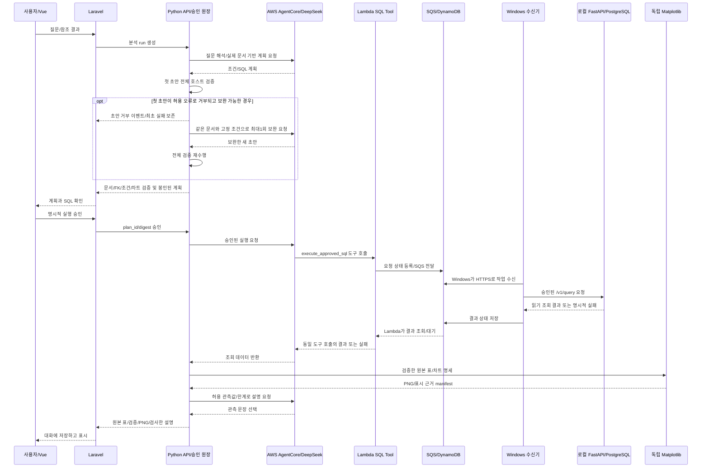

# 질문 한 개가 결과가 되기까지

[교육 안내](README.md) · [공통 구성도](../../doc/architecture.md) · [API 계약](../../analysis-chatbot/docs/API_CONTRACT.md)

사용자는 자연어로 질문하지만 DB에는 SQL이 필요하다. 이 프로젝트는 모델이 제안한 SQL을 바로 실행하지 않고, 실제 문서와 조건을 대조한 계획을 사용자가 승인하도록 만든다. 실행한 뒤에도 표·차트·설명의 정합성을 각각 검사한다.

## 전체 흐름

이 그림은 AI 모드의 정상 경로다. 로컬 고정 샘플은 AWS 부분을 거치지 않는다. 0행은 정상 빈 결과이며 PNG를 만들지 않는다. 실패하면 도달한 단계와 보존된 산출물을 확인한다.

1. **질문과 대화 문맥을 받는다.** 새 질문인지, 이전 결과에서 이어지는 질문인지 구분한다. 다른 대화의 결과를 임의로 참조할 수 없다.
2. **질문을 해석한다.** 테넌트, 기간, 날짜 기준, 지표·필터를 분리한다. 저장된 조건을 바꾸는 근거가 불명확하면 확인 질문으로 멈춘다. 이 단계에도 모델 호출 비용이 발생한다.
3. **실제 테이블 문서를 읽는다.** 후보 테이블과 필요한 FK 이웃만 읽고 원본 해시·실제 전달 문서의 해시를 남긴다. 이름이 비슷한 열이 있다는 이유로 관계를 지어내지 않는다.
4. **계획을 검사하고 봉인한다.** SQL이 실제 열·문서 FK를 사용하는지, 확정 조건이 실제 반환 행을 제한하는지 검사한다. 첫 초안이 허용된 오류로 거부되면 문서·고정 조건을 유지해 최대1회 보완할 수 있으며 모든 검증을 다시 수행한다. 차트 단위·그룹 차원과 시도 요약을 최종 계획 digest에 포함한다. 거부된 초안은 승인할 수 없다.
5. **사용자가 승인한다.** `plan_id`와 `digest`는 승인한 계획을 가리킨다. digest는 내용 변경 탐지값이며 업무적 정답을 증명하는 표시는 아니다. 계획이 바뀌면 같은 승인으로 실행할 수 없다.
6. **Agent가 SQL 도구를 호출한다.** 실행 단계에서 새 SQL을 만드는 대신 승인된 요청 ID에 대응하는 SQL 스냅샷을 사용한다.
7. **Lambda가 요청을 전달하고 기다린다.** SQS는 작업 전달, DynamoDB는 요청·결과 상태 공유를 담당한다. 결과를 기다리고 조회하는 주체는 Lambda다. Agent가 DynamoDB를 직접 폴링하지 않는다.
8. **Windows가 작업을 가져온다.** 수신기는 AWS에 HTTPS 연결을 시작하고 로컬 FastAPI의 `/v1/query`를 호출한다. DB를 인터넷에 공개하거나 AWS에서 PC로 직접 접속하는 구조가 필요하지 않다.
9. **FastAPI가 다시 검사하고 읽는다.** 승인·만료·중복 실행을 검사한 뒤 읽기 전용 PostgreSQL 조회를 수행한다. 실행 시간·행 수·반환 크기를 제한한다.
10. **같은 Lambda 도구 호출로 결과가 돌아온다.** 수신기가 DynamoDB에 결과를 기록하면 Lambda가 결과 또는 명시적 실패를 응답한다. 화면만 정상처럼 보이도록 시간 초과를 빈 표로 바꾸지 않는다.
11. **표·PNG·관측 설명을 각각 검사한다.** 원본 표를 저장하고 독립 가시화 모듈의 PNG·manifest를 원본 값과 대조한다. AI 관측 설명은 호스트가 계산한 허용 문장에 대응해야 한다. 현재 분석 경로의 데이터 반환과 후속 설명은 별도 단계다.
12. **대화에 저장하고 복원한다.** Laravel이 화면용 스냅샷과 이벤트를 저장해 새로고침 뒤에도 표·검증·이미지를 다시 연다.

화면의 `해석 중`, `문서 탐색`, `승인 대기` 등은 이 서버 단계에서 기록된 이벤트다. 서버가 어떤 일을 했는지 알려주는 운영 증거이며, 모델의 비공개 내부 사고를 읽어낸 결과가 아니다.

## 승인 전 보완이 진행되는 경계

보완은 SQL 실행 전 계획 작성 단계에 한정된다. 첫 초안은 `rejected`, 전체 검증을 통과한 초안은 `validated`, 보완 모델 요청을 완료하지 못한 경우는 `model_failed`로 시도 요약에 남는다. 첫 거부 이벤트가 있다고 run 전체가 즉시 종료됐다고 단정하지 말고 보완 시작·결과와 최종 상태를 함께 읽는다. 첫 초안의 원문·해시는 비공개 진단에 보존하고 화면 이벤트에는 시도 번호·오류 코드·해시 등의 요약을 남긴다.

후속 보완의 허용 코드는 `JOIN_NOT_VERIFIED`, `SQL_COLUMN_INVALID`, `CONDITION_BINDINGS_INVALID`, `CONDITION_NOT_APPLIED`, `PARAMS_INVALID`, `UNAPPROVED_SCOPE_FILTER` 여섯 가지다. 마지막 코드는 질문·확정 조건·승인된 이전 계획에 근거 없는 date/timestamp 범위나 `isactive` 필터를 SQL에 추가한 경우를 막는다. SQL에서 조건을 추출해 화면에 표시했다는 사실만으로 사용자가 그 조건을 승인한 것은 아니다. 코드가 같아도 문서·스키마가 바뀌었거나 최초 진단을 저장하지 못했으면 보완하지 않는다. 읽기 전용 SQL 정책의 거부, 문서 무결성 실패, JSON 오류·출력 잘림, AWS 실패·시간 초과는 보완 대상으로 바꾸지 않는다. 보완 중 새 문서를 요청하거나 확정 조건을 변경할 수도 없다.

모델에 전달하는 `catalog.host_validation_feedback`은 스키마 사실과 구분한 호스트 피드백이다. 실패한 SQL·params와 일반 지원 구조만 전달하며 정답 SQL·수치·특정 문항 예제를 주입하지 않는다. 호스트가 SQL을 직접 고쳐 실행하는 방식도 아니다. 보완 초안이 통과하면 그 최종 내용과 시도 이력을 봉인한 digest를 사용자가 승인한다. 승인 뒤 SQL이 실패하거나 후처리가 실패했을 때 이 보완 루프를 사용해 SQL을 자동 변경·재실행하지 않는다.

보완 호출도 기존 계획 최대6회·모델 호출 누적180초 안에서 사용하며 새 예산으로 초기화하지 않는다. 추가 AI 호출 비용과 시간이 생길 수 있다. v13 실제 평가는 보완1회 실패·성공0회였다. 이후 로컬 보완의 실제 모델 성공은 아직 확인되지 않았다. 최신 실증 결과는 [검증 기록](../../analysis-chatbot/docs/VERIFICATION.md)을 따른다.

## 구성요소가 나뉜 이유

| 구성요소 | 현재 역할 | 학습할 점 |
| --- | --- | --- |
| Vue 3/TypeScript | 질문 입력, 상태 조회, 계획·표·PNG·검증 표시 | 화면 상태와 서버 실행 상태를 분리하기 |
| Laravel/PHP | 대화·턴·이벤트 저장, Python 요청 중계, 소유 대화의 이미지 전달 | 브라우저에 내부 API 토큰을 보내지 않고 같은 출처로 서비스하기 |
| Python/FastAPI | 문서/FK·조건 검증, 승인·실행 원장, 후처리 작업 | AI 제안과 실행 권한을 분리하기 |
| AgentCore | Bedrock 모델을 호출하는 Agent 실행환경 | 모델 추론과 도구 실행의 경계, 단계별 실패 구분 |
| Bedrock DeepSeek V3.2 | 질문 해석, SQL 계획 생성, 근거 제한 관측 설명 | 모델 출력은 제안이며 서버 검증을 거쳐야 한다는 점 |
| Lambda SQL Tool | 요청 전달, 로컬 결과 대기와 동일 호출 응답 | 도구 호출을 요청·결과가 연결된 한 계약으로 다루기 |
| SQS | Windows가 가져갈 작업 전달 | 중복 전달·만료를 전제로 원장에서 실행을 통제하기 |
| DynamoDB | 요청 상태·결과 공유 | `QUEUED`, `RUNNING`, 성공·실패·시간 초과를 구분하기 |
| Windows 수신기 | SQS 수신→로컬 API→결과 업로드 | PC가 외부 연결을 시작하기, 같은 큐의 수신기 한 개 유지 |
| PostgreSQL | GardenWorld 업무 데모 데이터 | 읽기 전용 계정·허용 SQL·시간/행/크기 제한을 함께 적용하기 |
| 독립 Matplotlib | 검증된 JSON만 받아 PNG·manifest 생성 | 모델 코드 실행 없이 허용된 표시 계약만 처리하기 |

[공통 모델 설정](../../aws/config/models.json)은 생성 모델 `deepseek.v3.2`, 리전 `ap-northeast-1`을 지정한다. Titan Text Embeddings V2의 1,024차원·정규화 설정도 있지만, 설정 파일이 있다는 사실만으로 벡터 인덱스나 임베딩 검색 기능이 구현·검증됐다고 말하지 않는다. 현재 학습 대상 문서 탐색은 후보·문서·FK 선택 경로다.

v13용 runtime 소스는 `plan`·`document_plan`의 출력 상한을4,096토큰, 다른 모델 단계는2,048토큰으로 설정한다. 문서 입력의128KiB 한도와 출력 토큰 상한은 별개다. `stopReason=max_tokens`면 텍스트가 완전한 JSON처럼 보여도 `MODEL_OUTPUT_TRUNCATED`로 거부하고 잘린 응답을 승인 계획으로 복구하지 않는다. 4,096은 매 호출에서 반드시 생성하거나 과금되는 토큰 수라는 뜻은 아니다.

## SQLite가 두 곳인 이유

| 저장 위치 | 책임과 원본 기준 |
| --- | --- |
| `.local/analysis-chatbot/conversations.sqlite` | Laravel의 대화·턴·이벤트·화면 스냅샷. 사용자가 대화를 다시 열기 위한 저장소 |
| `.local/jobs.sqlite` | Python의 SQL 승인·요청·실행 결과·outbox 및 분석 run/result/artifact 메타데이터. SQL 중복 실행과 승인 검증의 기준 |
| `.local/analysis-chatbot/artifacts/` | PNG·입력 JSON·manifest 및 웹 이미지 캐시. SQLite에 이미지의 실행 가능한 경로를 사용자가 넣는 방식이 아님 |

PostgreSQL의 업무 표를 SQLite에 그대로 이관한 구조가 아니다. 웹 대화를 지우거나 화면이 끊겼다고 승인 원장도 사라졌다고 추측하지 않는다. 두 SQLite와 이미지 경로를 초기화하면 복원·감사 근거가 달라지므로 실습 중 직접 삭제하지 않는다.

현재 요청·반환 표·PNG 입력의 중간 형식은 `columns`·`rows` 등을 담은 JSON이다. CSV에 관해서는 질문에 대한 형식 설명만 했으며 실제 중간 데이터를 CSV로 바꾸는 기능을 구현한 것은 아니다. SQLite 저장과 JSON 전달, PNG 생성의 역할을 구분한다.

## 소스를 읽는 순서

아래 링크는 현재 파일의 해당 함수 시작 위치다. 소스가 바뀌면 함수 이름도 함께 검색한다.

| 순서 | 실제 파일·함수 | 확인할 질문 |
| --- | --- | --- |
| 1 | [Vue `App.vue`](../../analysis-chatbot/resources/js/App.vue), [`TurnCard.vue`](../../analysis-chatbot/resources/js/components/TurnCard.vue) | 입력·폴링·승인·재사용 버튼은 어떤 서버 상태를 보여주는가? |
| 2 | [Laravel `TurnStore::create/refresh/save`](../../analysis-chatbot/app/Services/TurnStore.php#L23), [`PythonApi::request`](../../analysis-chatbot/app/Services/PythonApi.php#L18) | 대화 소유권·요청 ID·연결 끊김과 스냅샷 보존을 어떻게 처리하는가? |
| 3 | [Python `Analysis.plan`](../../local/python/poc/analysis_api.py#L244), [`Analysis.validate_draft`](../../local/python/poc/analysis_api.py#L375), [`Documents.read`](../../local/python/poc/analysis_documents.py#L124) | 실제 읽은 문서와 계획은 어떻게 결합되고 두 초안에 같은 검증을 적용하는가? |
| 4 | [`Documents.verify_plan/verify_conditions`](../../local/python/poc/analysis_documents.py#L216), [`seal_plan`](../../local/python/poc/contracts.py#L9) | 문서·SQL·조건·승인 digest를 어떻게 다시 확인하는가? |
| 5 | [`Analysis.approve/execute`](../../local/python/poc/analysis_api.py#L405), [`Journal.claim`](../../local/python/poc/journal.py#L106) | 중복 전달돼도 왜 SQL이 새로 실행되지 않아야 하는가? |
| 6 | [AWS `Agent.invoke`](../../aws/runtime/main.py#L110), [`sql_tool.run`](../../aws/runtime/sql_tool.py#L22) | 도구 인수·Lambda 결과 대기·명시적 실패는 어디에 있는가? |
| 7 | [`Receiver.process_message`](../../local/python/poc/receiver.py#L25), [`execute_query`](../../local/python/poc/db.py#L23), [`validate_sql`](../../local/python/poc/sql_policy.py#L14) | 승인·만료·중복·읽기 전용 제한을 어느 경계에서 재검사하는가? |
| 8 | [`Analysis.postprocess`](../../local/python/poc/analysis_api.py#L470), [`facts_for/checked_insights`](../../local/python/poc/analysis_postprocess.py#L35), [`renderer.render`](../../analysis-chatbot/visualization/src/analysis_visualization/renderer.py#L156) | 표→관측값→PNG·설명의 근거가 어떻게 이어지는가? |
| 9 | [`Analysis.reuse`](../../local/python/poc/analysis_api.py#L449), [`AnalysisStore.save_result`](../../local/python/poc/analysis_store.py#L125) | 새 파생 결과와 원본 데이터·승인 계획을 어떻게 구분하는가? |
| 10 | [`Agent.converse`](../../aws/runtime/main.py#L48), [`Agent.json_object`](../../aws/runtime/main.py#L63), [`AnalysisStore.save_rejected_plan_diagnostic`](../../local/python/poc/analysis_store.py#L74) | 출력 상한·잘림 거부와 첫 초안 실패 보존은 어떻게 연결되는가? |

## 복습

1. Lambda 대신 Agent가 DynamoDB를 계속 확인하도록 바꾸면 현재 프로젝트의 어떤 계약이 달라지는가?
2. SQL 승인 digest가 맞으면 판매액·청구액·현금 수입의 의미도 자동으로 맞는가?
3. 화면용 SQLite가 잠깐 응답하지 않으면 PostgreSQL 조회를 무조건 다시 실행해도 되는가?
4. 계획 보완 횟수 한 번이 남아 있으면 기존6회·180초를 초과해 호출할 수 있는가?

답 확인

1. Lambda가 대기하고 동일 도구 호출에서 로컬 결과를 반환한다는 처리 흐름이 달라진다. 현재 구조를 유지해야 한다.
2. 아니다. digest는 승인 내용의 변경 탐지다. 업무 지표·문서 단위·통화·대변전표 의미는 별도 검토가 필요하다.
3. 아니다. 실행 원장과 저장 결과부터 확인한다. 이미 처리된 요청을 화면 장애만으로 새 SQL로 재실행하면 중복 실행이 될 수 있다.
4. 아니다. 보완도 같은 누적 한도를 사용한다. 한도가 부족하면 최초 거부 근거를 보존하고 중단한다.

