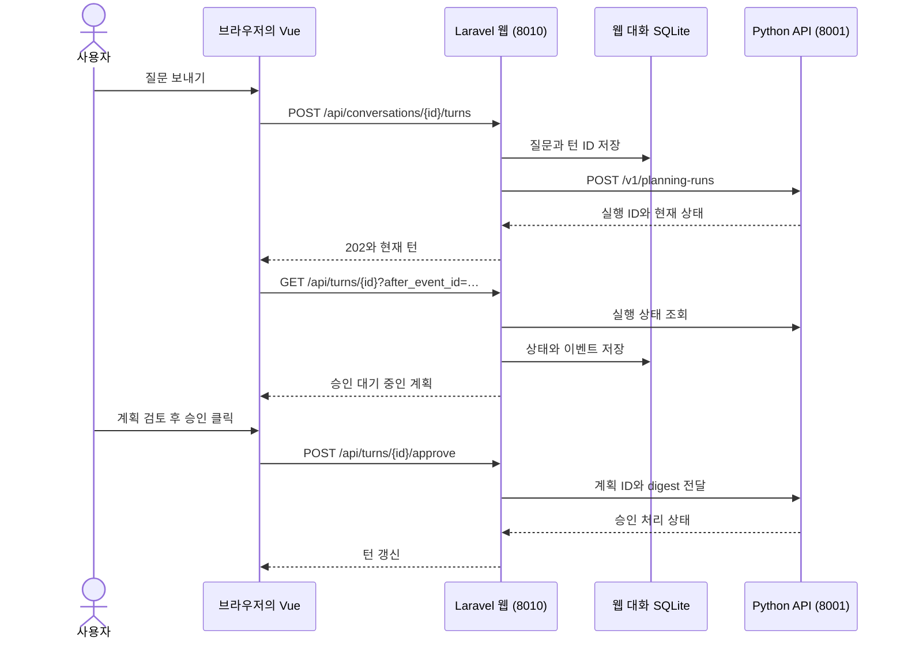

# Laravel과 Vue.js로 만든 분석 챗봇의 구조

챗봇에서 **확인 · 조회 실행** 버튼은 어디에 있고, 그 버튼을 누르면 어떤 코드가 SQL 실행을 승인할까? 버튼을 그리는 코드는 브라우저의 **Vue**, 요청을 받아 대화와 연결하는 코드는 로컬 웹 서버의 **Laravel**, 승인한 계획을 확인하고 실행을 시작하는 코드는 **Python API**에 있다.

아래에서는 대화형 분석 웹인 `analysis-chatbot/`(8010)을 따라간다. 여기서 **대화**는 왼쪽 목록의 채팅방 하나이고, **턴(turn)**은 그 안에서 질문 하나와 그 질문의 계획·진행 기록·결과를 묶은 단위다. 마지막 절에서 기존 웹인 `local/web/`(8000)과 비교한다.

## 1. 첫 화면은 어떻게 만들어지나

브라우저에서 `http://127.0.0.1:8010/`를 열면 두 단계로 화면이 만들어진다. 먼저 Laravel이 HTML을 응답한다. 이어서 브라우저가 JavaScript를 실행하면 Vue가 대화 목록을 가져와 화면에 그린다.

| 순서 | 실행 위치 | 실제 코드에서 볼 것 |
| --- | --- | --- |
| 1 | 서버 · Laravel | PHP 요청의 입구인 `public/index.php`가 앱을 시작한다. `bootstrap/app.php`가 웹 라우트 파일을 등록하고, `Route::view('/', 'app')`가 첫 화면에 사용할 뷰를 고른다. [PHP 진입점](../../analysis-chatbot/public/index.php) · [부트스트랩](../../analysis-chatbot/bootstrap/app.php) · [라우트](../../analysis-chatbot/routes/web.php) |
| 2 | 서버 · Blade | Blade는 Laravel의 HTML 템플릿이다. 이 앱의 템플릿에는 Vue가 들어갈 `<div id="app">`, 요청에 사용할 CSRF 토큰, CSS와 TypeScript를 불러오는 `@vite`가 있다. [화면 템플릿](../../analysis-chatbot/resources/views/app.blade.php) |
| 3 | 브라우저 · Vue | `app.ts`의 `createApp(App).mount('#app')`가 위 요소 안에 최상위 컴포넌트 `App.vue`를 표시한다. 개발자가 작성한 Vue·TypeScript·CSS를 브라우저용 파일로 묶는 도구가 Vite다. [Vue 진입점](../../analysis-chatbot/resources/js/app.ts) · [Vite 설정](../../analysis-chatbot/vite.config.ts) |
| 4 | 브라우저 → Laravel | `App.vue`의 `onMounted`가 대화 목록을 요청한다. 저장된 대화 ID가 목록에 있으면 그 대화를, 없으면 목록의 첫 대화를 불러온다. 대화가 없으면 질문 입력 화면이 보인다. [최상위 컴포넌트](../../analysis-chatbot/resources/js/App.vue) |

같은 Laravel 서버가 **화면 뼈대**와 **화면에 채울 데이터**를 모두 제공한다. `GET /`의 응답은 HTML이고, `GET /api/conversations`의 응답은 JSON이다. 브라우저의 개발자 도구를 열어 *Network*에서 두 응답을 비교하면 이 경계를 볼 수 있다. [웹 라우트](../../analysis-chatbot/routes/web.php)

## 2. 어느 파일에서 무엇을 찾나

| 궁금한 점 | 먼저 열 파일 | 이 프로젝트에서 맡은 일 |
| --- | --- | --- |
| 질문 입력과 대화 선택은 어디에 있나? | [App.vue](../../analysis-chatbot/resources/js/App.vue) | 입력 초안, 선택한 대화, 진행 중인 턴을 관리한다. 질문을 보내고 상태를 다시 조회해 턴 목록을 갱신한다. |
| 질문 한 건의 카드와 승인 버튼은? | [TurnCard.vue](../../analysis-chatbot/resources/js/components/TurnCard.vue) · [PlanSummary.vue](../../analysis-chatbot/resources/js/components/PlanSummary.vue) | 카드가 한 턴의 상태에 맞춰 추가 질문·승인 버튼·표·이미지를 표시한다. 계획 요약은 조회 대상, 조인, 조건, 지표 등을 보여준다. |
| 브라우저 요청은 어떻게 만들어지나? | [api.ts](../../analysis-chatbot/resources/js/api.ts) · [types.ts](../../analysis-chatbot/resources/js/types.ts) | `api()`가 주소 앞에 `/api`를 붙이고 본문 유무에 따라 GET 또는 POST를 보낸다. `Turn`, `Plan`, `Result`는 화면이 읽는 데이터의 TypeScript 타입이다. |
| URL을 어느 PHP 메서드가 받나? | [routes/web.php](../../analysis-chatbot/routes/web.php) · [ConversationController.php](../../analysis-chatbot/app/Http/Controllers/ConversationController.php) | 라우트는 HTTP 메서드와 URL을 컨트롤러에 연결한다. 컨트롤러는 입력 형식을 검사하고 처리 결과를 브라우저에 응답한다. |
| 대화가 어디에 저장되고 Python은 누가 부르나? | [TurnStore.php](../../analysis-chatbot/app/Services/TurnStore.php) · [PythonApi.php](../../analysis-chatbot/app/Services/PythonApi.php) | `TurnStore`가 턴을 저장하고 분석 상태를 동기화한다. `PythonApi`가 서버 측 인증 토큰을 붙여 로컬 FastAPI를 호출한다. |
| 저장 테이블의 구조는 어디에 있나? | [Laravel 마이그레이션](../../analysis-chatbot/database/migrations/2026_11_03_000001_create_conversations.php) | `conversations`, `turns`, `artifacts`의 열과 관계를 정의한다. PHP에서 이 데이터를 읽고 쓰는 곳은 컨트롤러와 서비스의 `DB::table(...)` 호출이다. |

Laravel의 역할을 MVC(Model·View·Controller)라는 말에 대입해 볼 수도 있다. 이 앱의 **View**는 첫 HTML을 만드는 Blade이고, **Controller**는 URL별 요청을 처리하는 `ConversationController`다. **Model**에 해당하는 대화 데이터는 Laravel의 쿼리 빌더로 접근한다. 예를 들어 대화 목록이 어떤 순서로 나오는지 알고 싶으면 `ConversationController::index()`의 `orderByDesc('updated_at')`를 보면 된다. [대화 컨트롤러](../../analysis-chatbot/app/Http/Controllers/ConversationController.php)

Vue의 `.vue` 파일은 화면 조각 하나를 정의한다. `<script setup lang="ts">`에는 상태와 동작을, `<template>`에는 그 상태를 어떻게 그릴지 적는다. 이 앱에서 `draft`는 `ref`로 만든 반응형 값이다. 입력창의 `v-model="draft"`가 타이핑한 글과 값을 연결한다. `active`는 턴 목록에서 진행 중인 턴을 찾는 `computed` 값이다. 목록이 갱신되면 새 질문을 보낼 수 있는지도 함께 바뀐다. [App.vue](../../analysis-chatbot/resources/js/App.vue)

부모와 자식 컴포넌트의 관계는 승인 버튼에서 잘 드러난다. 부모 `App.vue`가 `:turn="turn"`으로 카드에 데이터를 내려준다. 이런 입력을 **prop**이라고 한다. 사용자가 카드를 클릭하면 자식 `TurnCard.vue`가 `action` **이벤트**를 올린다. HTTP 요청을 보내는 함수는 부모의 `@action="action"`에 연결돼 있다. [부모의 이벤트 처리](../../analysis-chatbot/resources/js/App.vue) · [카드의 입력과 이벤트](../../analysis-chatbot/resources/js/components/TurnCard.vue)

## 3. 질문 한 건과 승인 한 번 따라가기



1. **질문 제출.** 예를 들어 사용자가 “월별 매출 흐름을 보여줘”라고 입력하면 `App.vue`의 `send()`가 질문과 `client_request_id`를 보낸다. 첫 질문이고 열린 대화가 없으면 먼저 `POST /api/conversations`로 대화를 만든다. Laravel은 턴을 저장한 뒤 Python에 계획 생성을 요청한다. HTTP `202`는 요청을 접수했다는 뜻이다. 이 시점에 SQL 결과가 없어도 질문은 화면에 표시된다. [질문 제출](../../analysis-chatbot/resources/js/App.vue) · [컨트롤러의 submit](../../analysis-chatbot/app/Http/Controllers/ConversationController.php)
2. **계획 표시.** 진행 중인 턴이 있으면 Vue는 상태 조회가 끝난 뒤 약 1초 후 다시 조회한다. 브라우저는 마지막으로 본 이벤트 ID를 `after_event_id`로 보내고, Laravel은 그 이후의 이벤트를 응답에 담는다. Vue는 이벤트 ID로 합치고 정렬한다. `awaiting_answer`이면 추가 조건 입력란이, `awaiting_approval`이고 계획이 있으면 승인 버튼이 보인다. [poll 함수](../../analysis-chatbot/resources/js/App.vue) · [mergeTurn 함수](../../analysis-chatbot/resources/js/types.ts) · [카드 템플릿](../../analysis-chatbot/resources/js/components/TurnCard.vue)
3. **승인.** 카드가 보내는 본문은 `{ plan_id, digest }`다. `digest`는 화면에 표시된 계획 내용을 식별하는 해시다. Laravel은 URL의 **턴 ID**로 저장된 **실행 ID**를 찾고, Python의 `POST /v1/planning-runs/{run_id}/approve`로 전달한다. Python은 승인 대기 상태와 저장된 계획 ID·해시가 일치하는지 확인하고 실행을 진행한다. [Laravel의 전달](../../analysis-chatbot/app/Services/TurnStore.php) · [Python의 승인 검사](../../local/python/poc/analysis_api.py)
4. **결과 표시.** 이후 상태 조회에서 `result.columns`와 `result.rows`가 도착하면 Vue가 HTML 표를 그린다. 그래프가 있으면 카드의 이미지 주소 `/api/artifacts/{id}`로 별도 GET 요청이 나간다. Laravel은 해당 이미지와 턴의 연결을 확인한 뒤 캐시 또는 Python에서 받은 PNG를 제공한다. 그래서 표의 셀 표시를 바꿀 때는 Vue 카드를, PNG 자체의 모양을 바꿀 때는 Python 시각화 모듈을 본다. [결과 카드](../../analysis-chatbot/resources/js/components/TurnCard.vue) · [이미지 응답](../../analysis-chatbot/app/Http/Controllers/ConversationController.php) · [PNG 생성 모듈](../../analysis-chatbot/visualization/README.md)

## 4. 새로고침하면 무엇이 복원되나

| 위치 | 담는 값 | 다시 열었을 때의 역할 |
| --- | --- | --- |
| 브라우저의 `localStorage` | 마지막으로 선택한 대화 ID, 대화별 미전송 초안 | Vue가 열 대화를 선택하고 입력창을 복원한다. [App.vue](../../analysis-chatbot/resources/js/App.vue) |
| Laravel의 `.local/analysis-chatbot/conversations.sqlite` | 대화 목록, 질문 순서, 턴별 마지막 분석 상태와 누적 이벤트, 이미지 ID·해시 | 대화를 선택하면 Laravel이 저장된 턴을 순서대로 읽어 응답한다. [조회 코드](../../analysis-chatbot/app/Http/Controllers/ConversationController.php) · [저장 코드](../../analysis-chatbot/app/Services/TurnStore.php) |
| Python의 `.local/jobs.sqlite` | 승인 계획, 실행 작업, 분석 결과와 산출물 기록 | 진행 중인 턴은 Laravel에 저장된 `run_id`를 이용해 Python의 최신 상태를 다시 조회한다. [분석 저장소](../../local/python/poc/analysis_store.py) · [승인 원장](../../local/python/poc/journal.py) |

예를 들어 완료한 대화의 표를 다시 열면 Laravel이 저장된 턴을 읽고 Vue가 그 값을 표시한다. 브라우저 개발자 도구에서 새로고침 후 `GET /api/conversations/{id}`의 응답을 열어 `turns`의 `question`, `status`, `result`를 화면과 대조해 볼 수 있다. [저장 결과를 여는 실습](LOCAL_LAB.md)

## 5. 기존 웹(8000)에서 같은 기능 찾기

| 기능 | 대화형 분석 웹 · `analysis-chatbot/` · 8010 | 기존 웹 · `local/web/` · 8000 |
| --- | --- | --- |
| 첫 화면 | `app.blade.php` → `app.ts` → `App.vue` | `analysis.blade.php` → `app.ts` → `App.vue` |
| 질문과 승인 | 대화에 턴을 추가하고 `/api/turns/{id}/approve`로 승인 | `POST /api/plans`로 계획을 만들고 `POST /api/plans/{id}/approve`로 승인 |
| 진행 상태 | `GET /api/turns/{id}`로 턴과 이벤트를 갱신 | `GET /api/jobs/{id}`로 승인 후 작업의 상태를 조회 |
| 그래프 | Python이 만든 PNG를 Vue 카드의 ``로 표시 | `PlotChart.vue`가 응답의 차트 데이터를 받아 브라우저에서 `Plotly.react()`로 그림 |

8000번 화면을 수정할 때는 기존 웹의 라우트에서 `AnalysisController`를 찾으면 된다. 같은 이름의 `App.vue`가 두 개이므로, 브라우저에서 보고 있는 포트를 먼저 확인하면 파일을 잘못 고르는 일을 피할 수 있다. [기존 웹 라우트](../../local/web/routes/web.php) · [기존 화면](../../local/web/resources/js/App.vue) · [차트 컴포넌트](../../local/web/resources/js/PlotChart.vue) · [분석 웹 라우트](../../analysis-chatbot/routes/web.php)

### 직접 확인하기

설치를 마친 Windows 환경에서 프로젝트 루트의 PowerShell로 실행한다. 두 명령은 Laravel이 등록한 API 주소와 담당 컨트롤러를 출력한다.

```powershell
& .\.local\runtime\php-8.5.12\php.exe analysis-chatbot/artisan route:list --path=api --except-vendor
& .\.local\runtime\php\php.exe local/web/artisan route:list --path=api --except-vendor
```

첫 목록에서 `turns/{id}/{action}`, 둘째 목록에서 `plans/{id}/approve`를 찾아보자. 버튼 클릭까지 코드로 확인하려면 Vue 테스트의 `approval emits the displayed digest and never runs automatically`와 Laravel 테스트의 `test_approval_forwards_exact_plan_and_digest_and_filters_incremental_events`를 순서대로 읽는다. 앞 테스트는 **버튼이 보낸 값**, 뒤 테스트는 **서버가 Python에 전달한 값**을 검사한다. [Vue 테스트](../../analysis-chatbot/resources/js/components/TurnCard.test.ts) · [Laravel 테스트](../../analysis-chatbot/tests/ConversationTest.php)
