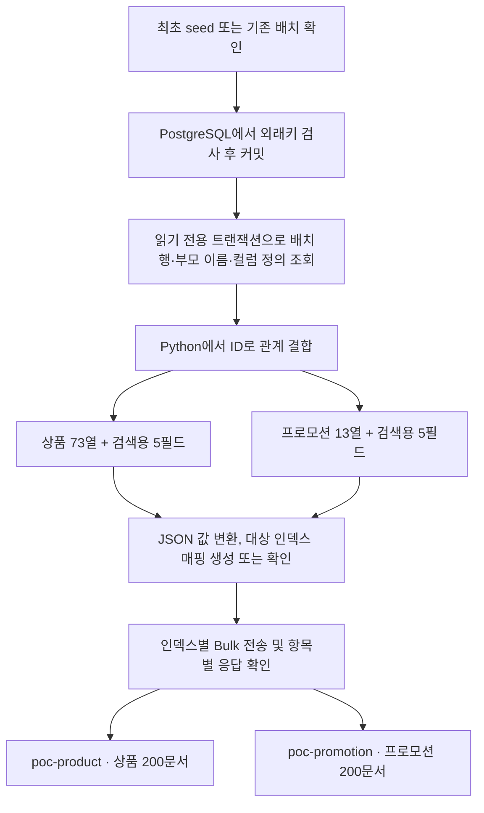
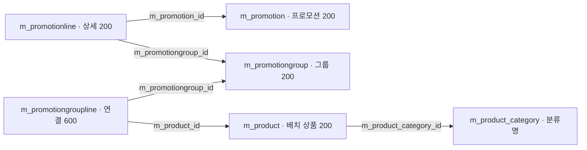
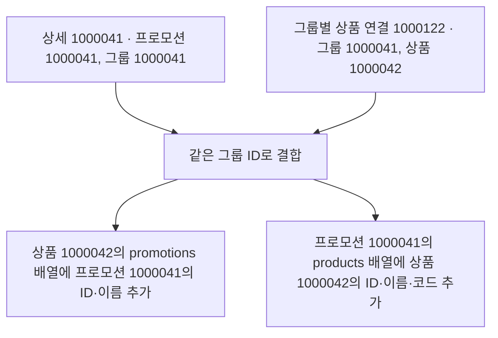
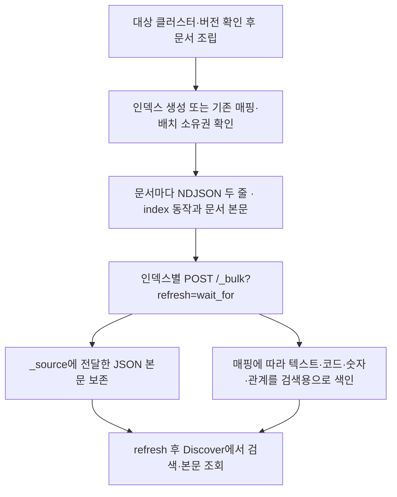
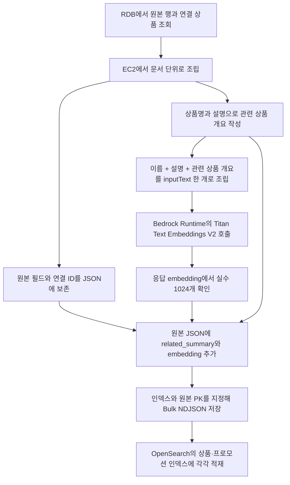
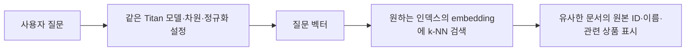

# PostgreSQL 관계를 OpenSearch 일본어 검색으로 옮겨 보기

이 실습은 원본 DB의 상품·프로모션 관계를 읽어 검색 문서로 만드는 과정을 학습합니다. [설치·시작·중지 안내](../../local/opensearch/README.md)를 PowerShell 7에서 먼저 실행한 뒤 같은 PC의 [Dashboards](http://127.0.0.1:5601)를 엽니다. 설치와 적재가 완료되지 않았다면 아래 조회가 실패하거나 인덱스가 없을 수 있습니다.

[문서 안내](../README.md) · [전체 구조](../architecture.md) · [DB 전체 목록](../database/index.md)

Discover의 `?`, `t`, `#` 아이콘과 원본 73개 컬럼·검색용 추가 5개 필드의 실제 저장 값은 [Discover 필드별 해설](opensearch-discover-fields.md)을 참고하세요.

## 1. 원본 DB와 검색 사본은 각각 무엇을 하나요?

PostgreSQL은 상품 한 행, 프로모션 한 행, 두 대상을 연결하는 행을 별도 테이블에 저장합니다. 기본키(PK)는 각 행을 구별하고 외래키(FK)는 다른 테이블의 행을 참조합니다. 예를 들어 그룹 상품 연결의 `m_product_id`는 실제 상품을 가리킵니다. DB는 선언된 FK에 맞지 않는 참조를 거부합니다.

OpenSearch는 JSON 문서를 인덱스에 저장합니다. 이 실습에서는 상품 한 행을 상품 문서 하나로 만들고, 검색에 필요한 부모 이름과 프로모션 목록도 문서 안에 담습니다. 인덱스는 같은 유형의 문서를 모아 검색하는 공간이며, 매핑은 각 필드를 텍스트·정수·날짜 등으로 해석하는 규칙입니다.

| PostgreSQL에서 배울 것 | OpenSearch에서 대응하는 것 | 이번 구현 |
| --- | --- | --- |
| 테이블·행 | 인덱스·문서 | `m_product` → `poc-product`, 상품 한 행 → 문서 하나 |
| PK | 문서 `_id` | `m_product_id` 또는 `m_promotion_id`를 문자열 ID로 사용 |
| 컬럼과 SQL 타입 | 필드와 매핑 | 이름은 `text`, ID는 `long`, 날짜는 `date` 등 |
| 물리 FK·검증한 논리관계와 JOIN | 문서 안에 복사한 관계 배열 | `parent_refs`, `promotions`, `products` |
| 원본 정합성 검사 | 검색 사본의 적재·검증 | DB FK 검사 후 내보내고 문서 수·필드·관계를 검사 |

OpenSearch의 관계 필드는 FK 제약이 아닙니다. 원본 부모 이름을 바꿔도 이미 만든 검색 문서는 자동으로 바뀌지 않으므로 필요한 경우 다시 내보내고 색인해야 합니다. 원본의 정확한 수치·상태·권한 판단은 PostgreSQL을 기준으로 합니다.

## 2. PostgreSQL에서 OpenSearch까지 데이터가 흐르는 과정

실습에서 관계형 정규화는 기존 DB 설계에 반영되어 있습니다. 상품·프로모션·분류를 각 테이블에서 관리하고 서로의 ID를 참조합니다. 적재 프로그램은 조회 방향에 맞춰 필요한 이름과 연결 정보를 문서 안에 복사합니다. 이 과정을 **역정규화**라고 합니다. 코드의 `normalize()`는 이와 별도로 Python 값을 JSON으로 표현할 수 있게 변환합니다.



### 2.1 정규화된 원본을 배치 단위로 읽기

아래 화살표는 **외래키 컬럼이 가리키는 부모** 방향입니다. 프로모션 상세와 그룹별 상품 연결에 같은 그룹 ID가 있으면 해당 프로모션의 대상 상품을 찾을 수 있습니다.



최초 생성 시 한 트랜잭션에서 `AD_Sequence` 행을 잠가 ID를 할당하고, 지정한 부모의 존재·테넌트·활성 상태와 기존 행의 보존 여부를 확인합니다. 외래키 검사까지 통과하면 커밋합니다. 이후 `export_rows()`는 별도의 `REPEATABLE READ, READ ONLY` 트랜잭션에서 다섯 테이블을 같은 시점으로 읽습니다. 배치명·테이블명·순번으로 재현한 UUID 목록이 추출 조건입니다. 기존 상품 55개와 신규 200개 중 이 UUID에 해당하는 200개가 색인 대상입니다. 부모 7개 테이블에서는 필요한 행의 ID와 이름을, DB 메타데이터에서는 두 마스터 테이블의 열 이름·타입·소수 자릿수를 읽습니다. [원본 추출 코드](../../local/opensearch/seed_data.py)

### 2.2 하나의 연결을 두 방향의 검색 문서로 만들기

저장된 예시에서 상품 `1000042`는 `アジサイ コンパクト`, 상품 코드는 `POCJA-0043`입니다. 이 상품의 연결 3개 중 프로모션 `1000041`과 이어지는 한 건을 따라가면 다음과 같습니다.



결합은 `documents()`가 Python 메모리에서 수행합니다. 양쪽 배열에 상세·그룹·그룹별 상품 연결 ID와 그룹 이름도 남기고, 그룹별 상품 연결 ID 순서로 정렬합니다. 별도로 원본의 지정된 참조 컬럼 값이 있으면 `parent_refs`에 부모 정보를 넣습니다. 예를 들어 테넌트 ID 11은 `{"field":"ad_client_id","table":"ad_client","id":11,"name":"GardenWorld"}`가 됩니다. [문서 조립 코드](../../local/opensearch/search_lab.py)

상품 `1000042`의 `promotions` 배열에는 프로모션 `1000041`, `1000042`, `1000079`가 들어가므로 `related_count`는 3입니다. 프로모션 문서에서는 같은 필드가 그 프로모션의 `products` 배열 길이를 뜻합니다. 배열의 각 객체를 `nested`로 색인해 ID와 이름을 같은 연결 항목 안에서 검색할 수 있습니다. [OpenSearch nested 설명](https://docs.opensearch.org/latest/mappings/supported-field-types/nested/)

### 2.3 JSON으로 보낼 값과 검색에 쓸 타입 결정하기

`normalize()`는 사전과 목록의 안쪽까지 값을 변환합니다. 반면 인덱스 타입은 DB 컬럼 정의와 명시한 필드 규칙으로 결정합니다. 예를 들어 소수 컬럼의 특정 행 값이 정수 1로 전송되어도 그 컬럼에 선언한 매핑은 `double`일 수 있습니다.

| DB에서 읽은 값 | JSON에 담는 값 | 현재 색인 처리 |
|---|---|---|
| 상품 ID인 정수값 Decimal | 숫자 `1000042` | 본문 ID는 `long`, Bulk 문서 주소의 `_id`는 문자열 `"1000042"` |
| 무게 Decimal | 소수 부분이 있으면 Python float를 거쳐 숫자 `0.3` | `weight`는 `double`. 원본 decimal과 부동소수점의 정밀도는 다를 수 있음 |
| datetime, UUID | ISO 날짜 문자열, UUID 문자열 | 날짜는 `date`, 상품 UUID는 `keyword`. 시간대 없는 일시는 그대로 직렬화 |
| 일본어 이름·설명 | 원문 문자열 | `text`에 kuromoji 적용, `.keyword`는 전체 문자열 일치·정렬용 |
| 상품 코드, Y/N 값, DB NULL | `"POCJA-0043"`, `"Y"`, `null` | 코드·플래그는 `keyword`, 값이 없는 필드는 본문에 `null` 보존 |

### 2.4 쓰기 요청에서 검색 가능한 상태까지



각 인덱스는 기본 샤드 1개, 복제본 0개이며 `dynamic: strict`로 정의합니다. 상품 배치는 200문서 × 2줄, 프로모션 배치도 200문서 × 2줄입니다. 예를 들어 상품의 첫 줄 형식은 `{"index":{"_index":"poc-product","_id":"1000042"}}`이고 다음 줄에는 해당 상품의 78개 필드 전체가 옵니다. 메모리에서 만든 UTF-8 데이터를 HTTP로 보냅니다. `.local/opensearch/export/`의 NDJSON은 성공한 요청 본문을 이후에 저장한 파일입니다.

검색할 때 일본어 단어로 문서를 찾는 데는 분석된 검색 색인을 쓰고, 이름 원문을 표시할 때는 문서 본문을 읽을 수 있습니다. `refresh=wait_for`는 이번 쓰기가 검색에 보일 때까지 기다립니다. 로더는 응답 항목 수와 개별 상태를 확인합니다. 일부 항목만 실패하면 성공한 항목은 남고, 동일한 원본 ID로 배치를 다시 색인할 수 있습니다. [Bulk API](https://docs.opensearch.org/latest/api-reference/document-apis/bulk/) · [문서 본문과 _source](https://docs.opensearch.org/latest/mappings/metadata-fields/source/)

기본 `Load.ps1` 실행 순서는 DB 배치 생성·확인 → 색인 → Discover 저장 조회입니다. 기존 배치를 다시 색인하는 명령은 `.\local\opensearch\Load.ps1 -Action index`입니다. DB 변경 사항이 검색 사본에 반영되는 시점은 수동 색인 시점이며, 재실행 때도 원본·부모 보존 검사와 소유권 검사를 거칩니다. 2026-11-03의 실제 DB·서버 검증에서 양쪽 200문서와 원본 컬럼, 독립 SQL로 구한 연결 600건이 일치했습니다. [검증 기록](../../local/opensearch/VERIFICATION.md)

## 3. 문서 안의 관계를 읽어 보기

[상품 목록](http://127.0.0.1:5601/app/discover#/view/poc-product-view)에서 한 행을 펼칩니다. `m_product_id`, `name`, `description` 같은 원본 컬럼과 아래 추가 필드를 찾습니다.

| 필드 | 읽는 방법 |
| --- | --- |
| `seed_batch` | 이 문서를 만든 실습 배치, `poc-search-ja-v1` |
| `entity_type` | `product` 또는 `promotion` |
| `parent_refs` | 원본의 물리 FK 및 검증한 논리참조의 필드명·부모 테이블·ID·이름 목록 |
| 상품의 `promotions` | 이 상품에 연결된 프로모션과 연결 테이블 ID 목록 |
| 프로모션의 `products` | 이 프로모션에 연결된 상품 이름·코드·관계 ID 목록 |
| `related_count` | 해당 문서의 관계 배열 항목 수 |

상품은 원본 73컬럼, 프로모션은 원본 13컬럼을 모두 복사합니다. `null` 필드도 원본 문서에 남을 수 있습니다. 아래 Dev Tools 예제에서는 읽기 쉽게 일부 필드만 응답에 표시합니다. `_source`에서 숨기는 것과 원본 문서에 없는 것은 다릅니다.

예를 들어 `createdby`·`updatedby`와 프로모션의 `ad_client_id`·`ad_org_id`는 물리 FK가 선언되지 않은 논리참조이며, 이 실습은 부모 행 존재를 확인해 이름을 복사합니다. `parent_refs`는 지정한 비NULL 참조의 목록이므로 원본의 물리 FK 전체 목록과 같지 않습니다. DB에 선언한 FK 검사와 애플리케이션이 확인한 논리관계를 구분해 읽습니다.

## 4. Dev Tools에서 문서 수와 매핑 확인

Dashboards 메뉴의 **Dev Tools**를 열고 Console에 요청 하나씩 붙여 넣어 실행합니다. 이 절의 요청은 조회용입니다.

```http
GET poc-product/_count

GET poc-promotion/_count
```

적재 성공 후 각 응답의 `count`가 `200`인지 확인합니다. 인덱스 내부의 nested 항목은 여기서 별도 상품·프로모션 문서로 세지 않습니다. `related_count`가 5인 프로모션도 루트 문서는 하나입니다.

```http
GET poc-product/_mapping
```

응답에서 `m_product_id.type`이 `long`, `name.type`이 `text`, `name.analyzer`가 `kuromoji`, `parent_refs.type`과 `promotions.type`이 `nested`인지 찾습니다. 프로모션은 `GET poc-promotion/_mapping`으로 보고 관계 필드가 `products`인지 확인합니다.

## 5. 일본어 이름으로 검색

```http
GET poc-product/_search
{
  "size": 5,
  "_source": ["m_product_id", "value", "name", "description", "related_count"],
  "query": {
    "match": {
      "name": "ラベンダー"
    }
  }
}
```

`hits.total.value`는 일치 문서 수, `hits.hits`는 이번에 받은 문서들입니다. `size: 5`는 최대 5개만 보여 달라는 뜻입니다. `_score`는 이 검색어와 문서의 텍스트가 얼마나 잘 맞는지를 계산한 검색 점수이며 상품 품질이나 판매 순위가 아닙니다.

kuromoji는 띄어쓰기가 적은 일본어를 검색 단위로 분석하는 데 사용합니다. 다음 요청으로 실제 분석 결과를 직접 확인합니다.

```http
GET poc-product/_analyze
{
  "analyzer": "kuromoji",
  "text": "家庭菜園で使えるラベンダー"
}
```

응답의 `tokens`를 읽어 봅니다. 모든 부분 문자열·동의어·오타가 자동으로 검색된다는 뜻은 아닙니다. 사전과 분석 규칙에 따라 단어가 나뉘므로 검색 결과를 보고 확인해야 합니다. `name.keyword`는 분석한 단어 대신 이름 전체를 정확한 값으로 다룰 때 사용합니다.

## 6. nested로 같은 부모 관계에 조건 적용

`parent_refs`는 여러 항목을 가진 배열입니다. 각 항목에 필드명·부모 테이블·부모 ID·부모 이름이 함께 들어 있습니다. `nested` 쿼리는 조건을 **배열의 같은 항목**에 적용하도록 합니다.

아래 요청은 부모 관계 중 `m_product_category` 테이블의 ID `106`을 가리키는 상품을 찾습니다. `106`은 이번 배치가 재사용한 상품 분류 ID입니다.

```http
GET poc-product/_search
{
  "size": 5,
  "_source": ["value", "name", "parent_refs"],
  "query": {
    "nested": {
      "path": "parent_refs",
      "query": {
        "bool": {
          "filter": [
            {"term": {"parent_refs.table": "m_product_category"}},
            {"term": {"parent_refs.id": 106}}
          ]
        }
      },
      "inner_hits": {}
    }
  }
}
```

`term`은 정확한 값 조건이고 `match`는 텍스트 분석을 사용하는 조건입니다. `inner_hits`에서는 어떤 관계 항목이 일치했는지 볼 수 있습니다. 부모 테이블 조건은 한 항목에서, ID 조건은 다른 항목에서 맞는 결과를 의도치 않게 섞지 않도록 배열의 한 묶음으로 조회하는 것입니다.

## 7. 프로모션에 연결된 상품명으로 검색

```http
GET poc-promotion/_search
{
  "size": 5,
  "_source": ["m_promotion_id", "name", "related_count", "products"],
  "query": {
    "nested": {
      "path": "products",
      "query": {
        "match": {
          "products.name": "ラベンダー"
        }
      },
      "inner_hits": {}
    }
  }
}
```

이 요청은 프로모션 이름 대신 그 안의 연결 상품 이름으로 프로모션을 찾습니다. 응답의 루트 `name`은 프로모션 이름이며 `products`의 `name`은 상품 이름입니다. 관계에 저장한 `m_promotionline_id`, `m_promotiongroup_id`, `m_promotiongroupline_id`로 원본 연결 행을 추적할 수 있습니다. 원본 테이블의 정확한 FK는 [전체 사전](../database/idempiere/TABLE_INDEX.md)에서 확인합니다.

상품 문서에서 반대로 프로모션을 검색하려면 `poc-product`의 `promotions` 경로를 사용합니다. `products`는 프로모션 인덱스, `promotions`는 상품 인덱스에 있으므로 인덱스와 경로를 함께 확인합니다.

## 8. 실습을 마친 뒤 확인할 것

| 확인 항목 | 관찰할 결과 |
| --- | --- |
| 원본과 사본 | DB 상품 총 255행, `poc-product` 실습 배치 200문서의 차이를 설명할 수 있음 |
| 일본어 분석 | `match` 결과와 `_analyze` 토큰을 직접 확인함 |
| 관계 검색 | `parent_refs`와 `products`의 nested 조회에서 일치 항목을 찾음 |
| 재실행 | 운영 가이드의 같은 배치를 다시 실행해도 중복 생성하지 않도록 설계됨. 실제 성공은 검증 기록으로 확인 |
| 중지와 재시작 | 운영 스크립트로 종료·시작하고 저장 문서를 확인. 데이터 삭제 명령은 사용하지 않음 |

검증 파일 `.local/opensearch/verification.json`이 있다면 실제 실행 시점·통과/실패 항목을 함께 읽습니다. 코드·문서의 존재만으로 브라우저 표시나 재시작 검증 성공을 추정하지 않습니다.

이번 실습은 Windows 로컬 검색입니다. AWS OpenSearch Service, 기존 챗봇의 검색 연동, 임베딩 생성, 벡터·하이브리드 검색, 검색 품질 점수·부하 성능 평가를 포함하지 않습니다. 기존 앱의 DeepSeek·Titan 설정과 AWS SQL 왕복 흐름은 별도의 구성입니다.

## 9. EC2에서 관련 상품 개요와 Titan 벡터를 붙이는 설계

현재 구현한 키워드 검색에서 의미 검색으로 확장하는 제안입니다. 짧은 상품 한 건 또는 프로모션 한 건을 검색 결과 하나로 반환하려는 경우, 문서당 검색용 텍스트 한 개와 벡터 한 개를 만듭니다. EC2에서 RDB를 읽을 수 있는 연결과 읽기 권한이 전제입니다. 현재 Windows PostgreSQL의 루프백 접속 범위를 유지하려면 Windows에서 읽어 낸 배치 파일을 EC2에 전달하는 방식도 가능합니다.



예를 들어 프로모션 `1000042`의 개요는 DB에서 확인한 세 상품명을 일정한 순서로 나열해 만들 수 있습니다. 다음은 기존 더미 값으로 조립한 Titan 요청 본문 예시입니다.

```json
{
  "inputText": "企画名：草花 庭応援フェア 043\n説明：草花の対象商品をまとめて探せるデモ企画。庭の準備におすすめ。\n対象商品：アジサイ コンパクト、ツツジ コンパクト、ミント コンパクト。",
  "dimensions": 1024,
  "normalize": true,
  "embeddingTypes": ["float"]
}
```

EC2 적재기는 인스턴스 역할로 Bedrock Runtime의 `InvokeModel`을 호출합니다. 리전·모델·차원·정규화는 [공통 설정](../../aws/config/models.json)의 도쿄, `amazon.titan-embed-text-v2:0`, 1024, true를 읽습니다. 응답의 `embedding`이 길이 1024인 실수 배열이면 JSON 배열 그대로 문서에 넣습니다. 호출 실패나 차원 불일치 항목은 재시도 대상으로 기록합니다. [AWS 요청·응답 규격](https://docs.aws.amazon.com/bedrock/latest/userguide/model-parameters-titan-embed-text.html)

대상 인덱스는 벡터 검색을 위해 `index.knn: true`로 준비하고 기존 매핑에 `related_summary`(일본어 검색용 text), `embedding`(knn_vector, dimension 1024)을 명시합니다. 벡터 인덱스 방법의 거리 척도는 코사인 유사도에 대응하는 `cosinesimil`을 선택할 수 있습니다. 현재 매핑은 `dynamic: strict`이므로 추가할 필드까지 선언한 뒤 적재해야 합니다. [벡터 필드](https://docs.opensearch.org/latest/mappings/supported-field-types/knn-vector/)



초기 배치에는 상품 200개와 프로모션 200개에 대응하는 문서 벡터 400개가 생깁니다. 이후에는 완성된 입력 텍스트와 임베딩 설정이 같은 문서의 벡터를 재사용할 수 있습니다. 연결 상품 이름이 바뀌면 그 이름을 입력 텍스트에 담았던 프로모션도 재생성 대상입니다. 이 설계의 실제 Titan 호출과 AWS 벡터 검색은 추후 검증 항목입니다.

### 일본어 원문과 의미 검색의 품질

OpenSearch 문서 본문에 일본어 원문과 개요를 저장하면 그대로 표시할 수 있습니다. Titan V2는 입력 문장의 의미적 유사성을 검색용 숫자 배열로 근사합니다. 표현이 비슷한 후보를 찾는 데 쓸 수 있고, 원문에 있는 정확한 상품 코드·관계·조건은 별도 필드에서 확인합니다. AWS는 영어에 최적화된 모델로 설명하며 일본어를 다국어 지원 목록에 포함합니다. 다국어 지원은 문서상 프리뷰이며, 질의와 문서 언어가 다르면 검색 성능이 떨어질 수 있습니다. [AWS 언어 지원과 제한](https://docs.aws.amazon.com/bedrock/latest/userguide/titan-embedding-models.html)

일본 아마가사키시 FAQ 문서 1,785건·검색 질의 748건의 공개 벤치마크에서 Titan V2는 Recall@10 0.660을 기록했습니다. 이 값은 상위 10건이 관련 문서를 얼마나 회수했는지 나타냅니다. 원예 상품이나 한국어 질의의 정확도는 별도로 측정해야 합니다. [평가 데이터·방법·결과](https://github.com/mahiya/amagasaki-qna-text-embed-benchmark)

이 실습에서는 상품명 표기 변형(예: ハサミ·はさみ·ばさみ), 용도 표현(예: 枝を切る道具), 한국어·일본어로 짝지은 질문을 준비할 수 있습니다. DOC ID 정답 집합을 직접 정한 뒤 상위 5건의 회수율과 실제 반환 ID를 언어·질문 유형별로 비교합니다. 프로모션 대상 상품의 정확한 포함 여부는 RDB의 연결 행을 정답으로 사용합니다.
