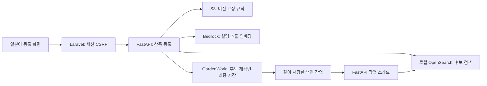

# GardenWorld 일본어 상품 등록 안내

분석 웹에서 **商品登録**을 열면 설명 → 유사 상품 선택 → 상품·마스터 입력 → 검사·등록 순서로 진행한다. 도움말은 입력을 대신 수정하지 않는다. 원본 DB에는 마지막 화면에서 담당자가 등록을 확정한 뒤에만 새 상품과 마스터가 저장된다.

| 읽는 목적 | 문서 |
|---|---|
| 한 건을 처음부터 등록하거나 검사까지만 연습하기 | [라벤더 한국어 실습서](lab.md) |
| 항목 복사 순서, 도움말, 오류·응답 유실 처리 이해하기 | [화면과 API 계약](web.md) |
| 실제 등록·재검색 결과 확인하기 | [검증 기록](verification.md) · [실제 등록 완료 화면](verification.md#실제-등록-완료-화면) |
| 소스 변경 위치 찾기 | [기능 코드 안내](../../product-registration/README.md) · [프로젝트 전체 구조](../architecture.md) |
| DB 테이블·권한 확인하기 | [상품 등록·검색 반영 업무영역](../database/domains/operations-registration.md) · [전체 DB 목록](../database/index.md) |

## 실행 흐름



도움말과 최종 검사는 S3 규칙의 같은 버전을 사용한다. 검색은 전용 인덱스 `poc-registration-product-v1`에서 최대 10건을 보여준다. 저장 시 전용 DB 역할이 상품·초안 마스터와 [등록 요청](../database/registration/registration_request.md)·[감사 이력](../database/registration/registration_audit.md)·[색인 작업](../database/registration/indexing_job.md)을 한 트랜잭션으로 기록한다. 분석 챗봇의 SQL 실행은 기존 읽기 전용 경로를 사용한다.

## 설치와 시작 (Windows PowerShell)

명령은 프로젝트 루트에서 실행한다. 새 PC에서는 [로컬 환경](../../local/README.md), [분석 웹 설치](../../analysis-chatbot/README.md), [OpenSearch 설치](../../local/opensearch/README.md)를 먼저 준비한다. 이미 상품을 등록했던 PC에서 **폴더 이동만 반영할 때는** 기존 프로젝트 가상환경에 새 백엔드를 설치하고 웹을 다시 빌드하면 된다. 기존 상품·규칙·색인을 다시 만들 필요가 없다.

```powershell
.\.venv\Scripts\python.exe -m pip install --no-deps -e .\product-registration\backend
.\analysis-chatbot\scripts\Setup.ps1 -SkipInstall
```

기존 API가 실행 중이면 소유한 실행 스크립트로 API만 재시작해 새 모듈을 읽힌다. 분석 웹 스크립트가 시작한 API라면 `.\analysis-chatbot\scripts\Stop.ps1 -Role api`를 사용한다. 설치가 끝난 환경의 시작·상태 확인은 다음과 같다.

```powershell
.\local\opensearch\Start.ps1
.\analysis-chatbot\scripts\Start.ps1
.\analysis-chatbot\scripts\Status.ps1
.\local\opensearch\Status.ps1
```

[등록 화면](http://127.0.0.1:8010/products/new)과 [공유 API 상태](http://127.0.0.1:8001/health)를 확인한다. 정상 API는 `product_registration_contract_version: 1`을 반환한다. 중지는 각 폴더의 `Stop.ps1`을 사용한다. 분석 웹과 API는 다른 기능도 공유하므로 기존 프로세스의 소유자와 사용 여부를 확인한다.

**최초 환경에서만** [DB 설치](../../product-registration/database/Setup.ps1)로 등록 전용 계정·함수를 준비하고 [AWS 운영 안내](../../aws/registration/README.md)에 따라 일반 앱 역할과 버전 관리된 규칙을 설정한다. 비밀 값은 Git 밖의 `.local/registration.env`에 두며 [예시](../../product-registration/database/registration.env.example)에는 실제 값이 없다. 웹/API를 시작하기 전에 OpenSearch를 실행하고 `.\.venv\Scripts\python.exe -m product_registration.ops sync`로 초기 색인을 준비한다. 전체 동기화는 Bedrock을 호출하므로 단순 폴더 이동 점검용으로 실행하지 않는다.

## 복구와 확인

| 증상 | 확인·조치 |
|---|---|
| 검색 실패 | OpenSearch 상태와 초기 동기화를 확인한다. 장애와 정상 0건은 화면에서 구분되며 직접 입력할 수 있다. |
| 규칙을 확인할 수 없음 / 검사 후 규칙 변경 | 일반 앱 역할의 로그인과 버전 관리된 S3 객체를 확인한 뒤 기존 초안에서 재검사한다. |
| 등록 응답 유실 | 같은 탭에서 상태 확인 또는 같은 요청 번호로 재전송한다. 새 요청으로 상품을 만들지 않는다. |
| `登録済み・検索反映待ち` | 상품은 이미 저장됐다. API의 재시도를 기다리거나 `.\.venv\Scripts\python.exe -m product_registration.ops retry`로 대기 중인 색인 작업만 처리한다. |

DB 사전만 점검할 때는 `.\.venv\Scripts\python.exe docs/database/audit_database_docs.py --offline`을 사용한다. 현재 등록 테이블과 외래키를 실제로 대조하려면 같은 명령의 옵션을 `--registration-only`로 바꾼다(읽기 전용). 원본 데이터 변경 없이 동시 등록·롤백을 시험하는 범위는 [검증 기록](verification.md)에 따로 표시했다.

기존 실습 자동화의 `local/registration/Setup.ps1`과 `python -m poc.registration_ops`는 새 DB 설치 스크립트와 새 색인 CLI를 호출하는 호환 진입점이다.
