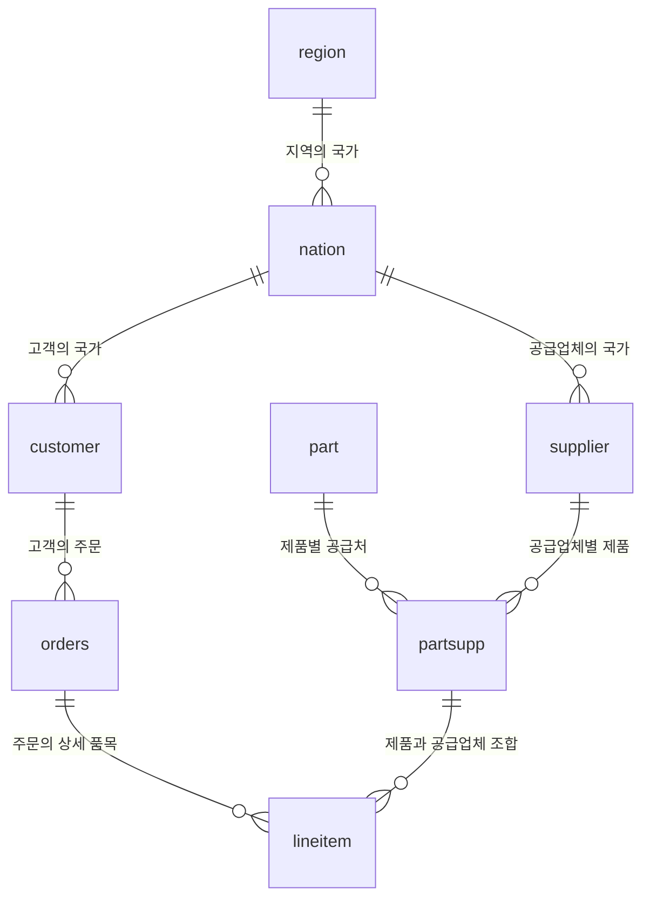

# 연습용 데이터베이스 테이블 설명서

이 문서는 `poc_tpch` 데이터베이스에 어떤 데이터가 있고, 각 테이블을 언제 사용하며, 서로 어떻게 연결하는지 설명합니다. SQL이나 데이터 분석을 처음 연습할 때는 먼저 전체 목록을 보고, `customer → orders → lineitem` 순서로 읽으면 됩니다.

확인 기준일: **2026-10-12**. 현재 PostgreSQL에서 테이블, 컬럼, 자료형, 기본 키·외래 키와 분류값을 읽기 전용으로 확인했습니다. 분석용 테이블의 행 수와 주문일 범위도 같은 날 직접 조회한 값입니다.

## 1. 어떤 데이터인가요?

현재 데이터는 **TPC-H SF1**입니다. 고객이 제품을 주문하고 공급업체가 제품을 공급하는 상황을 표현한 합성 데이터입니다. 프로젝트에서는 DuckDB의 TPC-H 생성기로 데이터를 만들고 PostgreSQL에 적재했습니다. 실제 회사의 고객이나 거래 내역은 아닙니다. 생성·적재 과정은 [데이터 적재 코드](python/poc/dataset.py)에 있습니다.

| 항목 | 현재 구성 |
| --- | --- |
| 데이터베이스 | `poc_tpch` |
| 서버 | `127.0.0.1:5432` |
| 분석용 스키마 | `tpch` |
| 읽기 전용 계정 | `poc_reader` |
| 분석용 테이블 | 8개 |
| 별도 관리용 테이블 | `public.poc_dataset` 1개 |
| 주문일 범위 | 1992-01-01 ~ 1998-08-02 |

`tpch.orders`에서 `tpch`는 테이블을 묶는 스키마 이름이고, `orders`는 테이블 이름입니다. 이 문서의 SQL은 스키마 이름을 함께 적습니다. 웹 대화·승인 이력을 보관하는 Laravel/Python SQLite는 별도 저장소이며 이 설명서의 대상에 포함하지 않습니다.

## 2. 테이블 전체 목록

**한 행이 무엇을 뜻하는지**를 먼저 이해하면 집계할 때 중복을 피할 수 있습니다.

| 테이블 | 한 행의 의미 | 주로 답할 수 있는 질문 | 실제 행 수 |
| --- | --- | --- | ---: |
| `tpch.region` | 지역 하나 | 어떤 지역 구분이 있나요? | 5 |
| `tpch.nation` | 국가 하나 | 국가별·지역별로 나누면 어떤가요? | 25 |
| `tpch.customer` | 고객 하나 | 어떤 고객·고객군이 주문했나요? | 150,000 |
| `tpch.supplier` | 공급업체 하나 | 어느 나라의 업체가 공급하나요? | 10,000 |
| `tpch.part` | 제품·부품 하나 | 어떤 브랜드·유형의 제품인가요? | 200,000 |
| `tpch.partsupp` | 제품과 공급업체의 조합 하나 | 이 제품을 누가 얼마에 공급하나요? | 800,000 |
| `tpch.orders` | 주문 하나 | 언제, 누가, 어떤 상태로 주문했나요? | 1,500,000 |
| `tpch.lineitem` | 주문 안의 상세 품목 한 줄 | 무엇을 몇 개, 얼마에 주문하고 언제 배송했나요? | 6,001,215 |
| `public.poc_dataset` | 프로젝트 데이터 적재 정보 | 어떤 스케일·생성기의 데이터를 적재했나요? | 행 수 미조회 |

분석용 데이터에는 `tpch`의 8개 테이블을 사용합니다. `public.poc_dataset`은 설치·재적재 점검용이며 현재 `poc_reader`에 SELECT 권한이 없습니다.

## 3. 테이블 연결 관계

예를 들어 한 고객이 여러 번 주문할 수 있고, 한 주문에 여러 제품이 들어갈 수 있습니다. 같은 제품도 여러 공급업체가 공급할 수 있으므로 제품과 공급업체 사이에 `partsupp` 테이블이 있습니다.



도표의 각 연결은 왼쪽 한 행을 오른쪽 여러 행이 참조할 수 있다는 뜻입니다. 그림이 표시되지 않는 환경에서는 아래 연결 조건을 참고하세요.

| 연결할 테이블 | SQL의 연결 조건 |
| --- | --- |
| 국가 → 지역 | `nation.n_regionkey = region.r_regionkey` |
| 고객 → 국가 | `customer.c_nationkey = nation.n_nationkey` |
| 공급업체 → 국가 | `supplier.s_nationkey = nation.n_nationkey` |
| 주문 → 고객 | `orders.o_custkey = customer.c_custkey` |
| 주문 상세 → 주문 | `lineitem.l_orderkey = orders.o_orderkey` |
| 제품·공급처 → 제품 | `partsupp.ps_partkey = part.p_partkey` |
| 제품·공급처 → 공급업체 | `partsupp.ps_suppkey = supplier.s_suppkey` |
| 주문 상세 → 제품·공급처 | `lineitem.l_partkey = partsupp.ps_partkey` **그리고** `lineitem.l_suppkey = partsupp.ps_suppkey` |

위 표는 현재 DB에 실제로 설정된 외래 키 관계입니다. 제품명만 필요하면 `lineitem.l_partkey = part.p_partkey`로 직접 연결할 수도 있습니다. 공급원가가 필요할 때는 반드시 제품과 공급업체 두 조건으로 `partsupp`을 연결합니다.

## 4. 컬럼 설명을 읽는 방법

- **기본 키(PK)**: 한 행을 고유하게 식별하는 값입니다.
- **외래 키(FK)**: 다른 테이블의 행을 가리키는 값입니다.
- **복합 키**: 두 개 이상의 컬럼을 함께 사용해야 한 행을 구분할 수 있는 키입니다.
- `integer`, `bigint`는 정수, `numeric(15,2)`는 전체 15자리 중 소수점 이하 2자리까지 저장하는 수, `date`는 날짜입니다.
- 아래 표의 `varchar`는 현재 PostgreSQL의 `character varying`을 줄여 쓴 것입니다. 현재 모든 대상 컬럼에는 `NOT NULL`이 설정되어 있습니다.

컬럼 앞의 `c_`, `o_`, `l_` 같은 접두사는 소속 테이블을 나타냅니다. 각각 `customer`, `orders`, `lineitem`의 컬럼이라는 뜻입니다.

## 5. 테이블별 상세 설명

### 5.1 `region` — 지역

국가를 큰 지역으로 묶는 기준 테이블입니다. 지역별 고객 수, 공급업체 수, 매출 등을 분석할 때 사용합니다.

기본 키는 `r_regionkey`입니다. 현재 지역명은 `AFRICA`, `AMERICA`, `ASIA`, `EUROPE`, `MIDDLE EAST`입니다.

| 컬럼 | 자료형 | 의미 |
| --- | --- | --- |
| `r_regionkey` | integer | 지역 식별자, PK |
| `r_name` | varchar | 지역명 |
| `r_comment` | varchar | 생성된 설명 문자열 |

### 5.2 `nation` — 국가

고객과 공급업체의 소속 국가를 나타냅니다. `n_regionkey`를 통해 국가가 어느 지역에 속하는지 알 수 있습니다. 데이터에 들어 있는 25개 국가는 연습 데이터의 범위이며 세계 모든 국가를 포함하지 않습니다.

기본 키는 `n_nationkey`입니다.

| 컬럼 | 자료형 | 의미 |
| --- | --- | --- |
| `n_nationkey` | integer | 국가 식별자, PK |
| `n_name` | varchar | 국가명 |
| `n_regionkey` | integer | 소속 지역, `region.r_regionkey` 참조 |
| `n_comment` | varchar | 생성된 설명 문자열 |

고객 국가별 매출을 구할 때는 `customer.c_nationkey`를, 공급업체 국가별 매출을 구할 때는 `supplier.s_nationkey`를 사용합니다. 두 국가의 의미가 다릅니다.

### 5.3 `customer` — 고객

제품을 주문하는 고객의 기본 정보입니다. 고객명, 국가, 고객군별로 주문과 매출을 분석할 때 사용합니다. 실제 주문 내역은 `orders`에 있습니다.

기본 키는 `c_custkey`입니다.

| 컬럼 | 자료형 | 의미 |
| --- | --- | --- |
| `c_custkey` | bigint | 고객 식별자, PK |
| `c_name` | varchar | 고객명 |
| `c_address` | varchar | 주소 |
| `c_nationkey` | integer | 고객의 국가, `nation.n_nationkey` 참조 |
| `c_phone` | varchar | 전화번호 문자열 |
| `c_acctbal` | numeric(15,2) | 고객 계정 잔액. 누적 매출과는 다른 값 |
| `c_mktsegment` | varchar | 고객의 시장 세그먼트·분류 |
| `c_comment` | varchar | 생성된 설명 문자열 |

현재 고객 분류는 `AUTOMOBILE`, `BUILDING`, `FURNITURE`, `HOUSEHOLD`, `MACHINERY`입니다. 고객군별 주문 수나 매출을 비교할 수 있습니다.

### 5.4 `supplier` — 공급업체

제품을 공급하는 업체의 기본 정보입니다. 공급업체명·국가별 분석과 제품의 공급처 확인에 사용합니다.

기본 키는 `s_suppkey`입니다.

| 컬럼 | 자료형 | 의미 |
| --- | --- | --- |
| `s_suppkey` | bigint | 공급업체 식별자, PK |
| `s_name` | varchar | 공급업체명 |
| `s_address` | varchar | 주소 |
| `s_nationkey` | integer | 공급업체의 국가, `nation.n_nationkey` 참조 |
| `s_phone` | varchar | 전화번호 문자열 |
| `s_acctbal` | numeric(15,2) | 공급업체 계정 잔액. 매출이나 공급원가 합계가 아님 |
| `s_comment` | varchar | 생성된 설명 문자열 |

공급업체는 이 데이터의 공급 주체입니다. 쇼핑몰의 실제 판매자 계정이나 입점 계정과 동일한 것으로 해석하지 않습니다.

### 5.5 `part` — 제품·부품

판매·공급되는 제품의 기본 정보입니다. 브랜드, 제조사, 제품 유형, 크기별 분석에 사용합니다.

기본 키는 `p_partkey`입니다.

| 컬럼 | 자료형 | 의미 |
| --- | --- | --- |
| `p_partkey` | bigint | 제품 식별자, PK |
| `p_name` | varchar | 제품명 |
| `p_mfgr` | varchar | 제조사 구분 |
| `p_brand` | varchar | 브랜드 구분 |
| `p_type` | varchar | 제품 유형 문자열. 예: `ECONOMY ANODIZED BRASS` |
| `p_size` | integer | 제품 크기 구분 값 |
| `p_container` | varchar | 포장·용기 구분 |
| `p_retailprice` | numeric(15,2) | 제품의 기준 소매가격. 개별 거래의 실제 매출액과 다름 |
| `p_comment` | varchar | 생성된 설명 문자열 |

현재 앱은 `p_type`의 첫 단어를 **제품군**으로 사용합니다. 값은 `ECONOMY`, `LARGE`, `MEDIUM`, `PROMO`, `SMALL`, `STANDARD`입니다. 별도의 `product_group` 컬럼은 없으며 `split_part(p_type, ' ', 1)`로 구합니다. `p_size`와 이 제품군은 서로 다른 분류입니다.

### 5.6 `partsupp` — 제품별 공급처와 공급원가

어떤 공급업체가 어떤 제품을 공급하는지 나타냅니다. 같은 제품이라도 공급업체에 따라 공급원가와 가용 수량이 다를 수 있습니다.

기본 키는 **`(ps_partkey, ps_suppkey)` 두 컬럼의 조합**입니다.

| 컬럼 | 자료형 | 의미 |
| --- | --- | --- |
| `ps_partkey` | bigint | 제품 식별자, 복합 PK의 일부. `part.p_partkey` 참조 |
| `ps_suppkey` | bigint | 공급업체 식별자, 복합 PK의 일부. `supplier.s_suppkey` 참조 |
| `ps_availqty` | bigint | 해당 공급업체가 해당 제품에 대해 보유한 가용 수량 |
| `ps_supplycost` | numeric(15,2) | 해당 제품·공급업체 조합의 단위당 공급원가 |
| `ps_comment` | varchar | 생성된 설명 문자열 |

`ps_availqty`는 주문 판매량이 아닙니다. 이 테이블에는 원가 적용일이나 재고 기준일 컬럼이 없으므로 과거 날짜별 원가·재고 변화를 복원할 수 없습니다.

주문 상세와 연결할 때 제품 ID만 조건으로 사용하면 다른 공급업체의 행까지 붙어 금액이 중복됩니다. 반드시 공급업체 ID도 함께 비교합니다.

### 5.7 `orders` — 주문

주문 전체에 공통인 정보를 저장합니다. 한 고객이 여러 번 주문하면 고객 ID는 같지만 주문 ID가 다른 여러 행이 생깁니다.

기본 키는 `o_orderkey`입니다. 한 주문에 포함된 상세 품목은 `lineitem`에 있습니다.

| 컬럼 | 자료형 | 의미 |
| --- | --- | --- |
| `o_orderkey` | bigint | 주문 식별자, PK |
| `o_custkey` | bigint | 주문한 고객, `customer.c_custkey` 참조 |
| `o_orderstatus` | varchar | 주문 상태 코드. 현재 값은 `F`, `O`, `P` |
| `o_totalprice` | numeric(15,2) | 주문 단위의 총액 |
| `o_orderdate` | date | 주문일 |
| `o_orderpriority` | varchar | 주문 우선순위 |
| `o_clerk` | varchar | 주문 담당자 구분 문자열 |
| `o_shippriority` | integer | 배송 우선순위 값 |
| `o_comment` | varchar | 생성된 설명 문자열 |

월별 주문 수는 `o_orderdate`로 집계합니다. 상세 테이블과 연결한 뒤에는 주문 한 건이 여러 행으로 늘어날 수 있으므로 주문 수에 `COUNT(DISTINCT o.o_orderkey)`를 사용합니다. 같은 이유로 연결 결과에서 `SUM(o.o_totalprice)`를 계산하면 주문 총액이 반복 합산될 수 있습니다.

### 5.8 `lineitem` — 주문 상세 품목

실제 분석에서 가장 자주 사용하는 테이블입니다. 주문 하나에 제품 세 개를 각각 한 줄씩 담았다면 주문 행은 하나, 상세 행은 세 개가 됩니다. 한 줄의 수량인 `l_quantity`는 그와 별도로 저장됩니다.

기본 키는 **`(l_orderkey, l_linenumber)` 두 컬럼의 조합**입니다. 같은 제품이 여러 주문이나 상세 줄에 나타날 수 있으므로 제품 ID로 상세 행을 구분하면 안 됩니다.

| 컬럼 | 자료형 | 의미 |
| --- | --- | --- |
| `l_orderkey` | bigint | 주문 ID, 복합 PK의 일부. `orders.o_orderkey` 참조 |
| `l_partkey` | bigint | 해당 상세 줄의 제품 ID |
| `l_suppkey` | bigint | 해당 상세 줄의 공급업체 ID |
| `l_linenumber` | bigint | 주문 안에서 상세 줄을 구분하는 번호, 복합 PK의 일부 |
| `l_quantity` | numeric(15,2) | 상세 줄의 주문 수량 |
| `l_extendedprice` | numeric(15,2) | 수량이 반영된 할인 전 상세 금액. 단가가 아님 |
| `l_discount` | numeric(15,2) | 할인율. 예: `0.05`는 5% |
| `l_tax` | numeric(15,2) | 상세 금액에 적용하는 세율. 예: `0.02`는 2% |
| `l_returnflag` | varchar | 반품 관련 구분 코드. 현재 값은 `A`, `N`, `R` |
| `l_linestatus` | varchar | 상세 품목 상태 코드. 현재 값은 `F`, `O` |
| `l_shipdate` | date | 출하일 |
| `l_commitdate` | date | 약속된 이행 날짜. 수령일과 비교하는 기준 |
| `l_receiptdate` | date | 수령일 |
| `l_shipinstruct` | varchar | 배송 지시 문자열 |
| `l_shipmode` | varchar | 운송 방식 코드 |
| `l_comment` | varchar | 생성된 설명 문자열 |

`(l_partkey, l_suppkey)`는 `partsupp`의 복합 키를 참조합니다. 현재 운송 방식 코드는 `AIR`, `FOB`, `MAIL`, `RAIL`, `REG AIR`, `SHIP`, `TRUCK`입니다.

주문일·출하일·수령일은 서로 다릅니다. “월별 매출”을 구할 때 어떤 날짜를 기준으로 묶는지 먼저 정해야 합니다. 이 문서의 월별 매출 예제는 **주문일 기준**입니다.

### 5.9 `public.poc_dataset` — 프로젝트 적재 정보

TPC-H의 기본 분석 테이블이 아니라 프로젝트에서 추가한 관리용 테이블입니다. 설치 과정에서 적재한 데이터와 생성 기록을 비교하고, 다른 스케일의 데이터로 기존 DB를 덮어쓰지 않도록 확인하는 데 사용합니다.

| 컬럼 | 자료형 | 의미 |
| --- | --- | --- |
| `id` | integer | PK. `id = 1` 제약이 있어 최대 한 행만 저장 가능 |
| `manifest` | jsonb | 스케일, 생성기 버전, 테이블별 컬럼·생성 행 수 등의 JSON 정보 |

테이블 구조와 제약은 DB 메타데이터에서 확인했습니다. 현재 읽기 전용 계정에 이 테이블의 SELECT 권한이 없어 저장된 행 수와 JSON 내용은 조회하지 않았습니다. 위 용도 설명은 [적재 코드](python/poc/dataset.py)의 생성·조회 로직을 근거로 합니다.

## 6. 어떤 질문에 어떤 테이블을 쓰나요?

| 질문 | 필요한 테이블 | 기준 |
| --- | --- | --- |
| 월별 주문 건수는? | `orders` | 주문일별 주문 행 수 |
| 월별 할인 후 매출은? | `orders`, `lineitem` | 주문일과 상세 금액 |
| 고객군별 매출은? | `customer`, `orders`, `lineitem` | `c_mktsegment` |
| 브랜드별 판매량은? | `part`, `lineitem` | `p_brand`, `SUM(l_quantity)`; 주문일 조건이 있으면 `orders` 추가 |
| 고객 국가별 매출은? | `nation`, `customer`, `orders`, `lineitem` | 고객의 `c_nationkey` |
| 공급업체 국가별 매출은? | `nation`, `supplier`, `lineitem` | 공급업체의 `s_nationkey`; 주문일 조건이 있으면 `orders` 추가 |
| 제품별 공급원가는? | `part`, `partsupp`, `supplier` | 제품과 공급업체의 조합 |
| 공급원가를 뺀 금액은? | `lineitem`, `partsupp` | 할인 후 매출에서 수량 × 단위 공급원가 차감 |
| 약속 날짜보다 늦게 받은 품목은? | `lineitem` | `l_receiptdate > l_commitdate` |

## 7. 금액과 집계를 해석할 때 주의할 점

아래 식은 **상세 한 줄** 기준입니다. 전체 금액은 각 식을 `SUM(...)`으로 합산합니다.

| 지표 | 계산식 |
| --- | --- |
| 할인 전 금액 | `l_extendedprice` |
| 할인 후 매출, 상세 세금 제외 | `l_extendedprice * (1 - l_discount)` |
| 상세 세금 포함 금액 | `l_extendedprice * (1 - l_discount) * (1 + l_tax)` |
| 공급원가 | `l_quantity * ps_supplycost` |
| 공급원가 차감액 | `l_extendedprice * (1 - l_discount) - l_quantity * ps_supplycost` |

금액식은 TPC-H의 [기본 분석 쿼리와 데이터 정의](https://tpc.org/TPC_Documents_Current_Versions/pdf/tpc-h_v2.18.0.pdf)를 참고합니다. 여기서 공급원가 차감액은 현재 저장된 단위 원가를 사용하는 연습용 계산입니다.

- `l_extendedprice`에는 수량이 반영되어 있으므로 여기에 다시 `l_quantity`를 곱하지 않습니다.
- `l_tax`는 상세 거래의 세율입니다. 회사 전체의 법인세·판매관리비·금융비용 자료는 없어 실제 순이익을 계산할 수 없습니다.
- 데이터의 금액을 원화로 가정하지 않습니다. 결과에는 통화가 지정되지 않았음을 표시합니다.
- 주문 수, 상세 줄 수, 판매 수량은 각각 다른 값입니다. `COUNT(DISTINCT l_orderkey)`, `COUNT(*)`, `SUM(l_quantity)`를 구분합니다.
- 월별 고유 고객 수나 공급업체 수를 더하면 여러 달에 나타난 대상을 중복 계산합니다. 연간 고유 수는 연간 범위에서 다시 `COUNT(DISTINCT ...)`로 계산합니다.
- 반품·주문 상태를 제외할 필요가 있다면 해당 조건을 별도로 정의합니다. 아래 매출 예제는 반품·상태별 제외 조건을 적용하지 않습니다.
- 분류·상태 코드는 생성 데이터의 값입니다. 현재 날짜를 기준으로 실제 주문의 처리 상황을 나타내는 값으로 해석하지 않습니다.

## 8. 읽기 전용 SQL 예제

다음 예제는 PostgreSQL에서 실행하는 SELECT입니다. 접속·앱 시작 방법은 [로컬 실행 가이드](README.md)를 참고하세요. 챗봇 경유 조회에는 SQL 20초, 최대 500행·256KiB 제한과 계획 승인 절차가 적용됩니다. DB 클라이언트에서 직접 실행할 때는 앱의 행 수·크기 제한이 적용되지 않으므로 조회 범위를 직접 제한해야 합니다.

### 8.1 국가와 지역을 연결해 보기

```sql
SELECT n.n_name AS nation, r.r_name AS region
FROM tpch.nation AS n
JOIN tpch.region AS r ON r.r_regionkey = n.n_regionkey
ORDER BY r.r_name, n.n_name;
```

국가마다 소속 지역이 한 개 연결되어 25행이 나옵니다.

### 8.2 주문 상세에 고객명과 제품명 붙이기

```sql
SELECT
    o.o_orderkey,
    o.o_orderdate,
    c.c_name,
    l.l_linenumber,
    p.p_name,
    l.l_quantity,
    l.l_extendedprice,
    l.l_discount
FROM tpch.orders AS o
JOIN tpch.customer AS c ON c.c_custkey = o.o_custkey
JOIN tpch.lineitem AS l ON l.l_orderkey = o.o_orderkey
JOIN tpch.part AS p ON p.p_partkey = l.l_partkey
WHERE o.o_orderkey = (SELECT MIN(o_orderkey) FROM tpch.orders)
ORDER BY l.l_linenumber
LIMIT 10;
```

가장 작은 주문 ID 한 건의 상세 품목을 보여줍니다. 같은 주문 ID·고객명이 여러 행에 나타나는 것은 주문 안에 상세 품목이 여러 개 있기 때문입니다.

### 8.3 1995년 주문일 기준 월별 매출·공급원가 차감액

```sql
SELECT
    date_trunc('month', o.o_orderdate)::date AS month,
    COUNT(DISTINCT o.o_orderkey) AS order_count,
    SUM(l.l_extendedprice * (1 - l.l_discount)) AS revenue,
    SUM(l.l_quantity * ps.ps_supplycost) AS supply_cost,
    SUM(
        l.l_extendedprice * (1 - l.l_discount)
        - l.l_quantity * ps.ps_supplycost
    ) AS revenue_less_supply_cost
FROM tpch.orders AS o
JOIN tpch.lineitem AS l ON l.l_orderkey = o.o_orderkey
JOIN tpch.partsupp AS ps
    ON ps.ps_partkey = l.l_partkey
   AND ps.ps_suppkey = l.l_suppkey
WHERE o.o_orderdate >= DATE '1995-01-01'
  AND o.o_orderdate < DATE '1996-01-01'
GROUP BY 1
ORDER BY 1;
```

`partsupp`을 제품 ID와 공급업체 ID 두 조건으로 연결한 예입니다. `revenue_less_supply_cost`는 공급원가 차감액이며 실제 순이익이 아닙니다. 날짜 조건은 시작일을 포함하고 다음 해 시작일을 제외합니다.

## 9. 확인 근거와 참고 문서

| 항목 | 근거·확인 범위 |
| --- | --- |
| 테이블 9개 존재, 컬럼·자료형·키 관계 | 2026-10-12 PostgreSQL 카탈로그 읽기 전용 조회 |
| 컬럼 설명의 누락 여부 | 9개 테이블의 전체 63개 컬럼을 해당 설명 절과 대조, 누락 없음 |
| 분석용 8개 테이블 행 수·주문일 범위 | 같은 날 `poc_reader`로 직접 조회 |
| 지역·고객군·제품 유형 예·상태·운송 코드 | 같은 날 실제 데이터의 분류값 조회 |
| 생성·적재 방식, 관리 테이블 용도 | [프로젝트 적재 코드](python/poc/dataset.py)와 로컬 생성 manifest |
| 앱의 제품군 정의·지표 한계 | [적재·카탈로그 코드](python/poc/dataset.py), [로컬 가이드](README.md) |
| 문서의 SQL 예제 3개 | 같은 날 읽기 전용 실행 성공. 8.1은 25행, 8.2는 6행, 8.3은 12행 반환 |

이 설명서의 구조 확인과 SQL 실행은 로컬 PostgreSQL 기준입니다. 이 문서 작성 과정에서 AWS Agent·Lambda·챗봇을 통한 왕복 호출을 다시 검증한 것은 아닙니다.

- [TPC-H 공식 소개](https://www.tpc.org/tpch/): 벤치마크의 목적과 개요.
- [TPC 공식 명세 다운로드](https://www.tpc.org/tpc_documents_current_versions/current_specifications5.asp): TPC-H 항목에서 최신 명세 확인.
- [DuckDB TPC-H 확장 사용법](https://duckdb.org/docs/current/core_extensions/tpch): 데이터 생성과 22개 분석 쿼리 제공. DuckDB 전용 명령은 PostgreSQL에서 그대로 실행할 수 없습니다.
- [로컬 설치·실행 가이드](README.md): 서비스 시작·중지, 설정, 조회 제한과 오류 대응.
