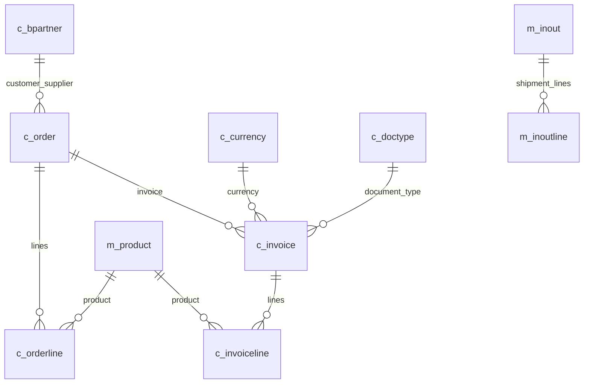

# iDempiere 13 / GardenWorld 분석용 DB

새 Mac에서 처음 설치하려면 [Mac 설치 지침서](../docs/MACOS_SETUP.md)를 따른다. Windows용 PowerShell 설치·운영 명령을 Mac에서 그대로 실행하지 않는다.

현재 챗봇의 조회 데이터는 iDempiere 13의 공식 GardenWorld 데모다. PostgreSQL 데이터베이스와 분석 연결을 설치했으며, Java 기반 iDempiere ERP 웹 서버는 설치 범위에 포함하지 않는다.

[설치·로컬 시험·실제 AWS 왕복 검증 결과](../docs/verification/2026-10-12-idempiere.md)를 함께 확인할 수 있다.

## 설치 내용

| 항목 | 값 |
|---|---|
| PostgreSQL | 기존 18.6, `127.0.0.1:5432` |
| DB / 스키마 | `poc_idempiere` / `adempiere` |
| 테이블 / 뷰 | **912개 / 161개** |
| 외래키 관계 | **3,807개** |
| 행이 있는 테이블 | **460개** |
| 기본 업무 테넌트 | GardenWorld, `ad_client_id=11` |
| 조회 계정 | `poc_idempiere_reader`, SELECT 전용 |
| 소유자 | `poc_idempiere_owner`, 로그인 불가 |
| 이전 DB | `poc_tpch` 보존 |

[전체 912개 테이블 목록](IDEMPIERE_TABLES.md)은 실제 적재 DB에서 생성했다. 표에는 물리 테이블명, 원본 업무 명칭·설명, 실제 행 수가 있다. 열 전체와 외래키 관계는 `.local/datasets/idempiere/catalog.json`에 저장된다. 카탈로그에 기록한 행 수는 설치·재검증 시점의 값이다.

원본 출처는 [iDempiere 공식 binary.file 저장소](https://github.com/idempiere/binary.file/tree/30af25e9db302a6cdefd9e6c3846f7cedc5ce4d0/database/13)다. 설치 스크립트가 커밋과 SHA-256을 고정해 확인한다. upstream 소프트웨어의 라이선스는 해당 저장소와 iDempiere 프로젝트를 따른다.

앞서 비교표에 적었던 879개는 **v9의 공개 스키마** 기준이다. 이번 설치는 v13 시드이므로 912개다. [v9 SchemaSpy 설명·관계도](https://www.globalqss.com/idempiere/9_20211224/schemaspy/complete/)는 개념 참고용이며, 현재 설치의 정확한 구조는 로컬 카탈로그를 기준으로 한다.

## 데이터 규모와 해석

스키마는 복잡하지만 기본 시드의 거래 데이터는 적다. 대규모 성능 시험용 거래량을 생성하지 않았다.

| 테이블 | 역할 | 전체 행 수 |
|---|---|---:|
| `c_order` / `c_orderline` | 판매·구매 주문 / 상세 | 8 / 27 |
| `c_invoice` / `c_invoiceline` | 판매·구매 청구서 / 상세 | 8 / 24 |
| `c_payment` | 수금·지급 | 2 |
| `c_bpartner` | 고객·공급업체 등 거래처 | 18 |
| `m_product` | 제품·서비스 | 55 |
| `m_inout` / `m_inoutline` | 출하·입고 / 상세 | 9 / 27 |
| `fact_acct` | 회계 분개 원장 | **0** |

GardenWorld 청구일 범위는 **2002-02-22 ~ 2003-11-01**이다. 현재 연도의 질문에 거래가 없으면 정상적인 빈 결과다. 최근 거래처럼 날짜를 변경하지 않았다. 테이블이 존재한다고 그 업무의 데모 행이 존재하는 것은 아니다.

- 판매와 구매는 `issotrx='Y'/'N'`로 구분한다.
- 확정 거래 분석은 `docstatus IN ('CO','CL')`를 사용하고, 초안 등을 제외했다는 점을 설명한다.
- 주문액(`c_order`), 청구액(`c_invoice`), 입금액(`c_payment`)을 구분한다.
- 청구서 `totallines`는 세전, `grandtotal`은 세금 포함 금액이다. 판매 대변전표는 `c_doctype.docbasetype='ARC'`이며 차감해 집계한다.
- USD·EUR 등 서로 다른 통화는 나누어 집계한다. 환율을 임의로 가정하지 않는다.
- 헤더와 상세를 조인한 후 헤더 총액을 SUM하면 중복된다. 상세 분석에는 `c_invoiceline.linenetamt`를 사용한다.
- 원장이 비어 있으므로 완전한 회계 손익 분석이 가능하다고 설명하지 않는다.

핵심 관계의 일부는 아래와 같다. 전체 관계는 카탈로그의 `relationships`에 있다.



## 챗봇 사용

```powershell
cd D:\Projects\PoC-Practice
.\local\scripts\Start.ps1 -Receiver
.\local\scripts\Check.ps1
```

기존 로컬 앱 주소에서 연결 표시가 `iDempiere 13 · GardenWorld 데모 · 912개 테이블`인지 확인한다. `고정 샘플 계획 열기`는 AI 없이 월별·통화별 확정 판매 청구액을 조회한다. 서로 다른 통화를 하나의 금액 그래프로 혼합하지 않도록 이 샘플은 표로 표시한다.

자연어 질문 예:

- `GardenWorld의 확정 판매 청구액을 통화별로 보여줘.`
- `GardenWorld의 USD 확정 판매 청구액을 월별로 집계하고 막대그래프로 보여줘.`
- `GardenWorld의 판매 주문을 거래처별로 집계하고 초안과 완료 상태를 구분해줘.`
- `청구서 상세에 등장하는 제품별 판매 수량을 통화별로 나누어 보여줘.`

Agent는 먼저 전체 테이블 명칭·설명·행 수에서 최대 12개를 선택한다. 로컬에서 선택한 테이블과 1단계 외래키 부모를 최대 32개로 확장하고, 해당 열과 관계만 SQL 계획 단계에 보낸다. 이 방식은 DeepSeek의 테이블 선택이며 임베딩·벡터 검색 구현이 아니다. 테이블 선택은 모든 질문에 대한 정확성을 보장하지 않는다. 계획의 SQL·통화·문서 상태를 검토한 뒤 승인한다.

SQL API는 전체 912개 물리 테이블을 허용 목록으로 사용한다. 임의 시스템 스키마·사용자 함수·쓰기 SQL은 계속 차단하며 20초·500행·256KiB 제한을 유지한다. 뷰 161개는 복원했으나 챗봇의 조회 허용 목록에는 포함하지 않았다. 기존 TPC-H 계획은 스키마 버전이 달라 재실행·후속 수정이 차단된다. 새 분석을 시작하면 된다.

## 재설치·운영·복구

```powershell
# 기존 데이터가 있으면 덮어쓰지 않고 카탈로그·권한·행 수를 재확인
.\local\scripts\Install-Idempiere.ps1

# 설치와 기본 연결 설정을 함께 수행
.\local\scripts\Install-Idempiere.ps1 -Activate

# 설정을 바꾼 후 SQL API 재시작
.\local\scripts\Stop.ps1 -Role api
.\local\scripts\Start.ps1 -Components api
```

실제 연결값은 `.local/app.env`의 `POC_DB_DSN`, `POC_CATALOG_PATH`에 있다. 비밀번호는 `.local/secrets/idempiere.json`과 로컬 연결 설정에 저장하며 문서·소스에 복사하지 않는다. `.local/`은 소스 관리 제외 대상이다. 기존 `Setup.ps1` 재실행도 활성 iDempiere 데이터를 유지한다.

| 경로 | 내용 |
|---|---|
| `.local/downloads/idempiere/Adempiere_pg-13.jar` | 체크섬 검증한 공식 시드 |
| `.local/downloads/idempiere/restore-project.sql` | 전용 소유자·PG18 호환 처리를 적용한 복원 SQL |
| `.local/datasets/idempiere/restore.log` | 복원 로그 |
| `.local/datasets/idempiere/manifest.json` | 출처·체크섬·테이블 행 수 |
| `.local/datasets/idempiere/catalog.json` | 전체 열·관계·업무 규칙 |
| `.local/datasets/idempiere/app-before-idempiere.env` | 최초 전환 전 환경설정 백업. 비밀값 포함, 공유 금지 |
| `.local/logs/` | SQL API·웹·수신기 로그 |

PostgreSQL 서비스 `poc-postgresql-18`과 기존 로컬 수신 범위를 사용한다. DB를 별도로 중지했으면 관리자 PowerShell의 `Start-Service poc-postgresql-18`로 복구하고 Check를 실행한다. 앱 중지는 DB를 중지하지 않는다.

복원은 새 DB에서 단일 트랜잭션으로 수행한다. 실패하면 시드 변경분은 롤백되며 로그에서 원인을 확인한 뒤 다시 설치한다. 같은 이름의 비프로젝트 DB·역할은 덮어쓰지 않는다.

PG18 호환 처리: 시드의 날짜 덧셈·뺄셈 연산자 4개에 있던 상충하는 `COMMUTATOR` 최적화 힌트를 제거했다. 함수 구현·연산자 인자·테이블·거래 행은 유지했다. 소유자는 프로젝트 전용 NOLOGIN 역할로 매핑했다. 이 DB는 **읽기 분석용**이며 ERP 웹 서버의 업무 처리 호환성을 검증한 배포가 아니다.

TPC-H로 되돌릴 때는 실행 중 작업이 없는 것을 확인한 뒤 API를 중지하고, 최초 백업에서 **`POC_DB_DSN`만** 복원하고 `POC_CATALOG_PATH`를 `.local/catalog.json`으로 지정한다. 다른 AWS 설정을 오래된 백업으로 덮어쓰지 않는다. TPC-H DB와 카탈로그는 보존되어 있다.
